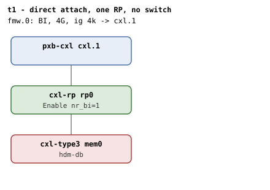

# t1 — the minimal BI topology: one root port, one cxl-type3 directly under it, no switch

| | |
|---|---|
| Topology script | `topos/t1-direct.sh` |
| Checks | `guest/run-tests.sh` (`t1)` case) |
| Mode | guest-driven |
| Outputs | `t1.tap`, `t1.dmesg` (plus `t1.kmemleak` only when the host-side kmemleak scan reports unreferenced objects) |

## What it tests

The happy path with the RP as the sole upstream hop between the endpoint
and the cxl_root. Every BI wire prerequisite (256B Flit on the RP, 256B
Flit + hdm-db on the endpoint, back-invalidate on the CFMWS) is
satisfied. The script's own list: `cxl_bi_setup` walks the topology
(single dport, the RP), the endpoint's BI Decoder is mapped and
`cxlds->bi` ends up 1; the root decoder advertises
`cap_back_invalidate=1`; a ram region created via the BI-restricted root
decoder is a DEVMEM region and the endpoint decoder's `bi=1` after
commit; the RP's `nr_bi` bumps to 1 across the enable path (verifiable
indirectly by re-binding the same device in t2 phase 2).

## Topology

One `pxb-cxl` (`cxl.1`) with one `cxl-rp` (`rp0`, `x-256b-flit=on`) and
one `cxl-type3` (`mem0`, 1G volatile memdev, `x-256b-flit=on,hdm-db=on`)
directly under it. One CFMWS: 4G, `interleave-granularity=4k`,
`back-invalidate=on`. Per [topologies.md](../topologies.md#t1--direct-attach)
the RP takes Enable itself (`nr_bi=1`); no switch, and no commit anywhere
(Table 8-156 reserves the commit at RPs and devices).

## Semantics

Single phase. The suite first verifies the sysfs ABI shape: every root
decoder exposes `cap_back_invalidate` with a 0/1 value, every endpoint
decoder exposes `back_invalidate` with a 0/1 value, and no switch decoder
exposes either file. It then locates the BI root decoder (first
`decoder0.*` with `cap_back_invalidate=1`) and the first memdev's
endpoint decoder, and pins the endpoint at `bi=0` before any region
exists. Both attributes must be read-only.

A 1-way, 256M ram region is created under the BI root (`create_region`:
`interleave_granularity=256`, `interleave_ways=1`, endpoint `mode=ram`,
`dpa_size`, `target0`), committed, and the endpoint decoder must then
read `target_type=accelerator` (DEVMEM: a committed HDM-DB region
propagates its type into every attached endpoint decoder's
`target_type`) and `back_invalidate=1`. dmesg must carry no
`BI setup failed`. Destroying the region (commit=0, `delete_region`)
must return the endpoint to `bi=0`.

## Checks

| # | Check (TAP text) | Expected | Why |
|---|---|---|---|
| 1 | cap_back_invalidate present on all root decoders (N found) | ok; `not ok` as `DECODER/cap_back_invalidate missing` or `... has bogus value 'V'` | Every root decoder must expose cap_back_invalidate whether it is set or not |
| 2 | back_invalidate present on all endpoint decoders (N found) | ok; `not ok` as `DECODER/back_invalidate missing`, `... has bogus value 'V'`, or `no endpoint decoders enumerated` | No decoders at all means enumeration failed, not a pass |
| 3 | no cap_back_invalidate/back_invalidate on switch decoders | 0 | Those files live only on root and endpoint decoders |
| 4 | found BI root decoder RD | ok; `not ok - no BI root decoder` then exit | - |
| 5 | endpoint bi=0 pre-region | 0 (preceded by `not ok - no endpoint decoder for MEM` + exit if none) | - |
| 6 | cap_back_invalidate read-only | ok; `not ok - cap_back_invalidate writable (should be RO)` | Writes to the attribute must be rejected |
| 7 | endpoint back_invalidate read-only | ok; `not ok - endpoint back_invalidate writable (should be RO)` | Read-only ABI |
| 8 | create HDM-DB region | ok; `not ok` then exit | create + attach + commit HDM-DB region |
| 9 | commit HDM-DB region | ok | - |
| 10 | endpoint decoder target_type=accelerator (DEVMEM) | accelerator | A committed HDM-DB region propagates its type into every attached endpoint decoder's target_type |
| 11 | endpoint bi=1 post-commit | 1 | - |
| 12 | no 'BI setup failed' in dmesg | ok | - |
| 13 | endpoint bi=0 post-destroy | 0 | - |

Host-side (run-all.sh), folded into `t1.tap` only on failure:
`not ok - qemu BI oracle silent` if the qemu BI oracle (`-d guest_errors`,
"CXL BI oracle" messages) flagged any RP/DSP BI Decoder programming that
contradicts the topology.

## Skips and limitations

No SKIP lines in this suite. Needs QEMU with `hdm-db`, `x-256b-flit` and
`cxl-fmw.N.back-invalidate` (README). README diagnostics: `BI setup
failed` in dmesg on t1 means the topology walk failed where it should
have succeeded. The RP's `nr_bi` bump is not read back here; the script
says it is verifiable indirectly via t2 phase 2.

## Related

- [t2](t2.md) — same path with a switch in it; its phase 2 is where the
  script says the RP `nr_bi` bump becomes observable.
- [t15](t15.md), [t22](t22.md), [t34](t34.md) — reuse t1's direct-attach
  shape (topologies.md, README).
