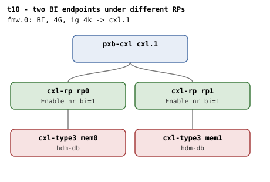

# t10 — two BI-capable endpoints under different root ports

| | |
|---|---|
| Topology script | `topos/t10-cross-rp.sh` |
| Checks | `guest/run-tests.sh` (`t10)` case) |
| Mode | guest-driven |
| Outputs | `t10.tap`, `t10.dmesg` |

## What it tests

Cross-RP interleave is a distinct code path: the region attaches targets that
live below different Root Ports, so `cxl_bi_setup` runs once per endpoint,
each bumping its RP's `nr_bi` independently. Two direct-attach BI walks run in
parallel through separate RPs and each RP ends up with `dport->nr_bi = 1`
after both endpoints bind. A 2-way HDM-DB region across `mem0+mem1` commits
because both endpoints are BI-capable and both RPs enabled BI, and both
endpoints read `bi=1`.

## Topology

One `pxb-cxl` (`cxl.1`) with two root ports, `rp0` (port 0, slot 2) and
`rp1` (port 1, slot 3), each with a direct-attached `cxl-type3` (`mem0`,
`mem1`; 1G volatile memdevs, `hdm-db=on`), every hop `x-256b-flit=on`. One
BI window (`fmw.0`, 4G, ig 4k, `back-invalidate=on`). Per
[topologies.md, t10](../topologies.md#t10--two-rps-on-one-host-bridge):
independent per-RP BI setups under a single (non-passthrough) HB; each RP
Enable, nr_bi=1.

## Semantics

Both memdevs must enumerate and neither may have logged "BI setup failed"
(independent RP walks). Cross-RP interleave may or may not succeed depending
on the root decoder's target set: if the BI root decoder's `interleave_ways`
is >= 2 the suite builds a 2-way HDM-DB region across both RPs; a successful
commit must leave both endpoint decoders at `back_invalidate=1`, while a
rejected commit is recorded as ok ("expected on some hosts"). If the root
only offers 1 way the 2-way attempt is skipped (recorded as ok). The suite
then falls back to a 1-way HDM-DB region on `mems[0]` to verify that RP is
BI-enabled, expecting `back_invalidate=1`.

## Checks

| # | Check (TAP text) | Expected | Why |
|---|---|---|---|
| 1 | `cap_back_invalidate present on all root decoders (N found)` | ok (fail variants: `.../cap_back_invalidate missing`, `... has bogus value 'V'`) | - |
| 2 | `back_invalidate present on all endpoint decoders (N found)` | ok (fail variants: `.../back_invalidate missing`, `... has bogus value 'V'`, `no endpoint decoders enumerated`) | - |
| - | `no BI root decoder` | not ok + exit, only if no root decoder has `cap_back_invalidate=1` | prerequisite |
| 3 | `two memdevs enumerated` | 2 | - |
| 4 | `no 'BI setup failed' in dmesg` | ok | independent RP walks: neither endpoint failed BI setup |
| 5 | `commit 2-way cross-RP HDM-DB region` | ok, when root `interleave_ways` >= 2 and the 2-way region creates and commits | both endpoints BI-capable, both RPs enabled BI |
| 6 | `both endpoints bi=1 (cross-RP)` | `back_invalidate` of both = "11" (only after #5 ok) | - |
| 5' | `cross-RP 2-way commit rejected by root (expected on some hosts)` | ok, instead of #5-6 when root `interleave_ways` >= 2 but the 2-way create or commit fails | cross-RP interleave may or may not succeed depending on the root decoder's target set |
| 5'' | `root interleave_ways=IW (2-way cross-RP skipped)` | ok, instead of #5-6 when root `interleave_ways` < 2 | - |
| 7 | `commit 1-way HDM-DB region on RP0` | ok | fall back to per-endpoint 1-way to verify each RP is BI-enabled |
| 8 | `mem0 endpoint bi=1` | `back_invalidate` = 1 | - |

## Skips and limitations

- No `# SKIP` lines; the 2-way cross-RP branch degrades to an `ok` line
  (`... rejected by root (expected on some hosts)` or
  `root interleave_ways=IW (2-way cross-RP skipped)`) rather than a SKIP.
- `run-all.sh` folds a host-side `not ok - qemu BI oracle silent` into
  `t10.tap` if the QEMU BI oracle flags BI Decoder programming that
  contradicts the topology.

## Related

[t5](t5.md) (two endpoints sharing one RP through a switch),
[t1](t1.md) (single direct-attach endpoint).
