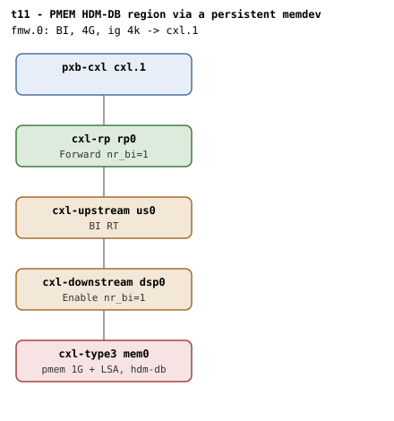

# t11 — PMEM HDM-DB region via a persistent memdev

| | |
|---|---|
| Topology script | `topos/t11-pmem.sh` |
| Checks | `guest/run-tests.sh` (`t11)` case) |
| Mode | guest-driven |
| Outputs | `t11.tap`, `t11.dmesg` |

## What it tests

Same shape as t2 (endpoint under a switch, BI CFMWS) but the backing memory is
`persistent-memdev`, so the tests exercise `can_create_pmem` visibility on
the BI root decoder (must be 1 for an HDM-DB PMEM CFMWS: F_DEVMEM | F_BI |
F_PMEM), `create_pmem_region` on the BI root, and endpoint `mode=pmem` with
endpoint decoder `bi=1` after commit.

## Topology

t2's shape (`rp0 - us0 - dsp0 - mem0`, every hop `x-256b-flit=on`) with a
`persistent-memdev` + LSA endpoint (`sn=0xbeef`, `hdm-db=on`): QEMU needs a
file-backed memdev + LSA for `persistent-memdev`, so the topology script
creates ephemeral backing files under `RUNDIR` (`t11-pmem.raw`, 1G, and
`t11-lsa.raw`, 256M; overridable via `PMEM_FILE`/`LSA_FILE`). One BI window
(`fmw.0`, 4G, ig 4k, `back-invalidate=on`). Per
[topologies.md, t11](../topologies.md#t11--persistent-memdev): t2's counts
(`dsp0` Enable / `rp0` Forward, nr_bi=1).

## Semantics

The BI root decoder must read `cap_pmem=1` and expose the create files its
`cap_ram`/`cap_pmem` flags call for (`check_create_visibility`: the kernel's
`can_create_ram`/`can_create_pmem` accept either HDM-H or HDM-DB flag sets,
and the suite verifies the visibility algebra matches the flags). Because
the shared `create_region` helper hard-codes `create_ram_region`, the suite
rolls a pmem variant inline: `create_pmem_region` on the BI root, `uuid`
granted before size and before any target attach (pmem regions require it),
ig 256, 1 way, 256M, the endpoint switched to `mode=pmem` before the
`dpa_size` allocation so DPA is carved from the pmem partition, then the
endpoint decoder attached as `target0`. After commit the endpoint decoder
must read `back_invalidate=1` and `target_type=accelerator` (a committed
HDM-DB region propagates DEVMEM into the attached endpoint decoder's
`target_type` via `cxl_rr_assign_decoder()`). dmesg must have neither
"BI setup failed" nor the `cxl_rr_free_decoder` "region mismatch" WARN.
Teardown: pmem regions also honor `commit=0` + `delete_region`.

## Checks

| # | Check (TAP text) | Expected | Why |
|---|---|---|---|
| 1 | `cap_back_invalidate present on all root decoders (N found)` | ok (fail variants: `.../cap_back_invalidate missing`, `... has bogus value 'V'`) | - |
| 2 | `back_invalidate present on all endpoint decoders (N found)` | ok (fail variants: `.../back_invalidate missing`, `... has bogus value 'V'`, `no endpoint decoders enumerated`) | - |
| - | `no BI root decoder` | not ok + exit, only if no root decoder has `cap_back_invalidate=1` | prerequisite |
| 3 | `BI root cap_pmem=1` | 1 | `can_create_pmem` must be 1 for an HDM-DB PMEM CFMWS |
| 4 | `RD: create_ram_region present (cap_ram=1, cap_back_invalidate=X)` | ok, emitted only if the root reads `cap_ram=1` (fail text: `RD: create_ram_region missing despite cap_ram=1`) | visibility algebra must match the flags |
| 5 | `RD: create_pmem_region present (cap_pmem=1, cap_back_invalidate=X)` | ok, emitted only if the root reads `cap_pmem=1` (fail text: `RD: create_pmem_region missing despite cap_pmem=1`) | - |
| - | `create_pmem_region write` | not ok + exit, only if the write fails | - |
| 6 | `create HDM-DB pmem region (REGION)` | ok | `create_pmem_region` on the BI root |
| - | `endpoint mode=pmem` | not ok, only if the `mode` write fails | - |
| - | `dpa_size (pmem)` | not ok, only if the `dpa_size` write fails | - |
| - | `attach mem0 to pmem region` | not ok, only if the `target0` write fails | - |
| 7 | `commit HDM-DB pmem region` | ok | - |
| 8 | `endpoint bi=1 (pmem)` | `back_invalidate` = 1 | - |
| 9 | `endpoint decoder target_type=accelerator (pmem)` | `accelerator` | a committed HDM-DB region propagates its type into the endpoint decoder's `target_type` |
| 10 | `no 'BI setup failed' in dmesg` | ok | - |
| 11 | `no 'region mismatch' WARN across BI attach` | ok | the decoder-to-region association must unwind symmetrically |

## Skips and limitations

- No `# SKIP` lines. Lines marked "-" above are failure-only (`not ok`)
  emissions; on the happy path the suite emits 11 `ok` lines.
- Needs a host that can create the 1G/256M backing files under `RUNDIR`.
- `run-all.sh` folds a host-side `not ok - qemu BI oracle silent` into
  `t11.tap` if the QEMU BI oracle flags BI Decoder programming that
  contradicts the topology.

## Related

[t2](t2.md) (same shape with a volatile memdev).
