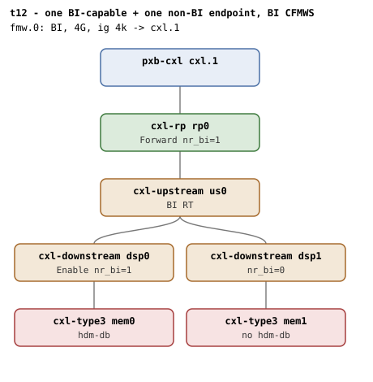

# t12 — one BI-capable + one non-BI endpoint, BI CFMWS

| | |
|---|---|
| Topology script | `topos/t12-mixed-iw.sh` |
| Checks | `guest/run-tests.sh` (`t12)` case) |
| Mode | guest-driven |
| Outputs | `t12.tap`, `t12.dmesg` |

## What it tests

Two independent `cxl_bi_setup` invocations under one switch: `mem0` succeeds
(`cxlds->bi=1`), `mem1` sees "BI not supported by topology" at the endpoint
check (its bi_decoder cap is missing) and stays `bi=0`. A 1-way HDM-DB region
on `mem0` commits with `mem0` `bi=1`; a 1-way HDM-DB region on `mem1` is
rejected at attach with "BI not enabled on device" (`cxlds->bi=0`), so commit
never fires; and an attempted 2-way HDM-DB region across `mem0+mem1` cannot
reach the committed state because the attach for `mem1` rejects.

## Topology

t5's shape: `rp0 - us0` with two DSPs, `dsp0` (port 0, slot 4) above
`mem0` (`hdm-db=on`) and `dsp1` (port 1, slot 5) above `mem1` with no
`hdm-db` (plain HDM-H device); every hop `x-256b-flit=on`, 1G volatile
memdevs. One BI window (`fmw.0`, 4G, ig 4k, `back-invalidate=on`). Per
[topologies.md, t12](../topologies.md#t12--bi--non-bi-siblings-under-one-switch):
only the BI device enables (`dsp0` nr_bi=1, `dsp1` 0, `rp0` 1).

## Semantics

Both memdevs must enumerate. The suite identifies the BI vs non-BI endpoint
by whether `cxl_bi_setup` succeeded, using a visible proxy: it attempts a
1-way HDM-DB region on each memdev in `all_mems` (BDF) order. The one whose
region creates, commits and reads `back_invalidate=1` is `m_bi`; the one
whose create or commit fails is `m_nobi` (the `create_region` helper keeps
the expected -ENXIO attach reject off stderr because the reject is the
behavior under test). Both must be found. Then a 2-way HDM-DB region across
`m_bi + m_nobi` is attempted: the non-BI endpoint's attach must fail, and
reaching commit means the attach reject was missed; dmesg must carry
"BI not enabled on device". Finally the `cxl_rr_free_decoder` "region
mismatch" WARN must not have fired across the attach/detach cycling.

## Checks

| # | Check (TAP text) | Expected | Why |
|---|---|---|---|
| 1 | `cap_back_invalidate present on all root decoders (N found)` | ok (fail variants: `.../cap_back_invalidate missing`, `... has bogus value 'V'`) | - |
| 2 | `back_invalidate present on all endpoint decoders (N found)` | ok (fail variants: `.../back_invalidate missing`, `... has bogus value 'V'`, `no endpoint decoders enumerated`) | - |
| - | `no BI root decoder` | not ok + exit, only if no root decoder has `cap_back_invalidate=1` | prerequisite |
| 3 | `two memdevs enumerated` | 2 | - |
| 4 | `BI-capable endpoint identified (MEM)` | ok (fail text: `no BI-capable endpoint (both attaches failed)`) | 1-way HDM-DB region on `mem0` commits, `mem0` bi=1 |
| 5 | `non-BI endpoint identified (MEM)` | ok (fail text: `no non-BI endpoint (both attaches succeeded)`) | 1-way HDM-DB region on `mem1` rejects at attach |
| 6 | `2-way commit rejects non-BI target` | ok, emitted only when both #4 and #5 found an endpoint (fail text: `2-way commit unexpectedly permitted with non-BI target`) | reaching commit means the attach reject was missed |
| 7 | `dmesg: 'BI not enabled on device'` | ok if dmesg has the string (same condition as #6) | the attach for `mem1` rejects with "BI not enabled on device" |
| 8 | `no 'region mismatch' WARN across BI attach` | ok | the decoder-to-region association must unwind symmetrically |

## Skips and limitations

- No `# SKIP` lines.
- README, Known limitations: t12 classifies the BI endpoint by attempting the
  HDM-DB commit; if a future QEMU emulates BI on the non-`hdm-db` device too,
  switch to a positive `cap_back_invalidate` probe.
- `run-all.sh` folds a host-side `not ok - qemu BI oracle silent` into
  `t12.tap` if the QEMU BI oracle flags BI Decoder programming that
  contradicts the topology.

## Related

[t5](t5.md) (same shape with both endpoints BI-capable), [t4](t4.md)
(a lone non-BI device under the BI window), [t14](t14.md) (the other
negative-attach suite the `create_region` helper names).
