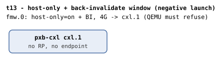

# t13 — negative launch test: host-only + back-invalidate

| | |
|---|---|
| Topology script | `topos/t13-hostonly-bi.sh` |
| Checks | the topology script itself (host-driven, 1 launch attempt, no guest) |
| Mode | host-driven |
| Outputs | `t13.tap` (run-all.sh tees the script's stdout); QEMU stderr in `$RUNDIR/t13-qemu-stderr.log`. No `t13.dmesg`: no guest boots. |

## What it tests

Per the CXL 4.0 CFMWS Window Restrictions (§9.18.1.3), a BI decoder
mapped to a host-only window "will result in undefined behavior", so a
window advertising both host-only coherency and back-invalidate is
rejected. Upstream QEMU enforces this in the machine-init code
(`hw/cxl/cxl-host.c`), so the launch itself must fail before the guest
ever comes up. The suite exits 0 iff QEMU refused the machine with the
expected error.

## Topology

Barely a topology: one `pxb-cxl` (`cxl.1`, no RP, no endpoint) and a 4G
CFMWS with no granularity set, declaring both `host-only=on` and
`back-invalidate=on`. QEMU is launched raw in the foreground with
`-display none -no-user-config -nodefaults` and `-smp 1 -m 512M`, not
through `launch_qemu`, so there is no BI oracle either (see
[topologies.md](../topologies.md#t13--host-only--back-invalidate-window-negative-launch)).
Stderr is captured to `$RUNDIR/t13-qemu-stderr.log`.

## Semantics

No kernel runs. The script waits for the QEMU process and branches on
its exit status and stderr:

- rc == 0: QEMU accepted the invalid CFMWS; the check fails and a
  diagnostic `# QEMU accepted the invalid CFMWS (rc=0)` is printed.
- rc != 0 and stderr matches
  `host-only.*(back-invalidate|BI)|CFMW.*host-only.*(BI|back-invalidate)`
  (case-insensitive): the expected refusal; pass.
- rc != 0 on a different message: "still likely a launch failure" but
  marked failed so the tester can investigate; the last 5 stderr lines
  are printed as `# ` diagnostics.

run-all.sh lists t13 in `HOST_ONLY_SUITES` and runs it last in the
default order ("the guest-less checks").

## Checks

Exactly one TAP line is emitted (plan `1..1`), one of the three below.

| # | Check (TAP text) | Expected | Why |
|---|---|---|---|
| 1 | `QEMU refused host-only + back-invalidate CFMWS` | ok (rc != 0 and stderr matches the host-only + BI regex) | §9.18.1.3: host-only + BI window is undefined behavior; QEMU rejects at machine init |
| 1 | `QEMU refused host-only + back-invalidate CFMWS` | not ok when rc == 0 | QEMU accepted the invalid CFMWS |
| 1 | `QEMU error but not the expected host-only + BI message` | not ok when rc != 0 but the regex does not match | "Still likely a launch failure" - printed for the tester to investigate |

Trailer: `1..1` and `# passed: P  failed: F`; exit status is 1 iff the
check failed.

## Skips and limitations

- Never SKIPs. Needs a QEMU with `cxl-fmw.N.host-only` and
  `cxl-fmw.N.back-invalidate` CFMWS flags (README: QEMU section).
- README Known limitations: "t13 greps QEMU's stderr for the launch
  refusal; adjust the regex if QEMU's wording changes."
- No guest, no dmesg, no BI oracle, no kmemleak scan.

## Related

- [t16](t16.md) - the in-kernel side of §9.18.1.3 (BI-decoder-in-a-non-BI-window reject), per the README table.
