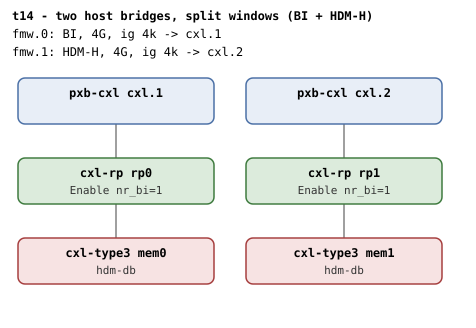

# t14 — two CFMWS windows, one BI and one HDM-H

| | |
|---|---|
| Topology script | `topos/t14-mixed-cfmws.sh` |
| Checks | `guest/run-tests.sh` (`t14)` case) |
| Mode | guest-driven |
| Outputs | `t14.tap`, `t14.dmesg` |

## What it tests

Multiple root decoders are present with distinct `cap_back_invalidate`
values (one 1, one 0): the endpoint under RP0 is BI-eligible, the one
under RP1 is HDM-H eligible, and both are `hdm-db` capable (device-side
BI is up for both). BI and HDM-H root decoders must coexist, each
endpoint must bind to the root decoder whose window covers its host
bridge, and cross-assignment must be rejected: mem1 lives outside the BI
window's HPA range so its host bridge is not a valid target for that
root decoder.

## Topology

Two host bridges (`cxl.1` at `bus_nr=12`, `cxl.2` at `bus_nr=222`), each
with one `cxl-rp` and one `cxl-type3` (`hdm-db=on`, 1G volatile memdev,
`x-256b-flit=on` everywhere). Two 4G windows at 4k granularity:
`cxl-fmw.0` (`targets=cxl.1`, `back-invalidate=on`) is the BI window,
`cxl-fmw.1` (`targets=cxl.2`) the HDM-H window.

Per [topologies.md](../topologies.md#t14--two-host-bridges-split-windows),
both devices are BI-capable so both RPs enable (nr_bi=1 each - BI setup
does not consult windows); the window split is what the region paths
must respect.

## Semantics

The case locates the first root decoder with `cap_back_invalidate=1`
(`rd_bi`) and the first with `cap_back_invalidate=0` (`rd_h`), bailing
out if either is missing, and verifies each exposes the `create_*_region`
attribute matching its `cap_ram`/`cap_pmem` flags.

Pairing is discovered rather than hard-coded ("this avoids hard-coding
which memdev corresponds to which pxb"): every memdev is tried in a
1-way 256M region under `rd_bi`, and the one that commits is the BI
endpoint; the remaining memdev is tried under `rd_h` the same way. Each
probe region is destroyed after the attempt. Then the HDM-H endpoint is
attached to the BI root: the create or commit must fail ("an endpoint
whose HB is not in the BI CFMWS window can't attach to that root
decoder"). The expected `-ENXIO` on the target write is kept off stderr
by `create_region`. The case ends with the dmesg checks for
`BI setup failed` and the `region mismatch` WARN.

## Checks

| # | Check (TAP text) | Expected | Why |
|---|---|---|---|
| 1 | `cap_back_invalidate present on all root decoders (N found)` (or `DECODER/cap_back_invalidate missing` / `... has bogus value 'V'`) | ok | every root decoder exposes `cap_back_invalidate` with a 0/1 value |
| 2 | `back_invalidate present on all endpoint decoders (N found)` (or `DECODER/back_invalidate missing` / `... has bogus value 'V'` / `no endpoint decoders enumerated`) | ok | present and 0/1 on every endpoint decoder; zero decoders means enumeration failed |
| - | `no BI root decoder` / `no HDM-H root decoder` | not ok, then exit 1 (bail-out only) | - |
| 3 | `both BI and HDM-H root decoders present` | ok | - |
| 4 | `RD_BI: create_ram_region present (cap_ram=1, cap_back_invalidate=1)` (or `RD_BI: create_ram_region missing despite cap_ram=1`) | ok | create visibility matches the root's cap flags (HDM-DB root) |
| 4' | `RD_BI: create_pmem_region present (cap_pmem=1, cap_back_invalidate=1)` (or `... missing despite cap_pmem=1`) | emitted only if `cap_pmem=1` | - |
| 5 | `RD_H: create_ram_region present (cap_ram=1, cap_back_invalidate=0)` (or `... missing despite cap_ram=1`) | ok | same rule on the HDM-H root |
| 5' | `RD_H: create_pmem_region present (cap_pmem=1, cap_back_invalidate=0)` (or `... missing despite cap_pmem=1`) | emitted only if `cap_pmem=1` | - |
| 6 | `two memdevs enumerated` | ok (count = 2) | - |
| 7 | `BI endpoint bound to BI root (MEM)` (fail text: `no endpoint could bind to BI root`) | ok | one endpoint commits a 1-way region under the BI root |
| 8 | `HDM-H endpoint bound to HDM-H root (MEM)` (fail text: `no endpoint could bind to HDM-H root`) | ok | the other endpoint commits under the HDM-H root |
| 9 | `cross-assignment (HDM-H endpoint into BI root) rejected` | ok (create or commit fails); emitted only when both pairings in 7 and 8 were found | its HB is not in the BI CFMWS window |
| 10 | `no 'BI setup failed' in dmesg` | ok | - |
| 11 | `no 'region mismatch' WARN across BI attach` | ok | `cxl_rr_free_decoder`'s WARN_ONCE must not fire across attach/detach cycling |

`expect_eq` failures append ` (got 'X' want 'Y')` to the description.
run-all.sh may fold in `not ok N - qemu BI oracle silent` if the QEMU BI
oracle flagged mis-programming, and prints a `# kmemleak: ...`
diagnostic.

## Skips and limitations

- No SKIP lines. Needs `hdm-db`, `x-256b-flit` and
  `cxl-fmw.N.back-invalidate` (README baseline).
- Check 9 is conditional: if either pairing was not found, it is not
  emitted at all (checks 7/8 already failed).

## Related

- [t15](t15.md) - the same two-window split on a single pxb/endpoint ("unlike t14 (two windows, two pxbs, two endpoints)").
- [t12](t12.md) - the other negative-attach suite that keeps the expected `-ENXIO` off stderr.
