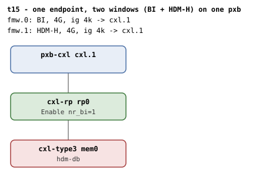

# t15 — one endpoint, two CFMWS windows on one pxb

| | |
|---|---|
| Topology script | `topos/t15-decoder-reuse.sh` |
| Checks | `guest/run-tests.sh` (`t15)` case) |
| Mode | guest-driven |
| Outputs | `t15.tap`, `t15.dmesg` |

## What it tests

Unlike t14 (two windows, two pxbs, two endpoints), both windows here
decode through the same root port, so the single endpoint decoder can be
cycled through both region flavors: commit an HDM-DB region (decoder
inherits DEVMEM, bi=1), delete it (the decoder must return to its default
`target_type`), then commit an HDM-H region on the same decoder, which
must succeed with bi=0 and without tripping the "mismatch decoder type"
WARN in `cxl_rr_assign_decoder()`.

## Topology

t1's direct-attach shape: `cxl.1` - `rp0` - `mem0` (`hdm-db=on`, 1G
volatile memdev, flit on). Two 4G windows at 4k granularity, both
targeting `cxl.1`: `cxl-fmw.0` with `back-invalidate=on` (BI window) and
`cxl-fmw.1` without (HDM-H window). Per
[topologies.md](../topologies.md#t15--one-endpoint-two-windows), `rp0`
nr_bi=1.

## Semantics

The endpoint decoder's `target_type` is the observable: "expander" for
HOSTONLYMEM, "accelerator" for DEVMEM (a committed HDM-DB region
propagates its type into every attached endpoint decoder via
`cxl_rr_assign_decoder()`; the region itself has no `target_type` file).

Sequence on the one decoder: read the default (`expander`); create and
commit a 1-way 256M region under the BI root (`bi=1`, `accelerator`);
destroy it under the BI root (`destroy_region` names the root because
`delete_region` only acts on children of the given root decoder); the
type must be back to `expander`; create and commit a 1-way region under
the HDM-H root on the same decoder (`bi=0`); destroy it. `create_region`
releases any leftover DPA on the decoder before re-reserving, since the
kernel rejects `dpa_size` writes with `-EBUSY` on a stale allocation.

## Checks

| # | Check (TAP text) | Expected | Why |
|---|---|---|---|
| 1 | `cap_back_invalidate present on all root decoders (N found)` (or `DECODER/cap_back_invalidate missing` / `... has bogus value 'V'`) | ok | - |
| - | `no BI root decoder` / `no HDM-H root decoder` | not ok, exit 1 (bail-out only) | - |
| 2 | `both BI and HDM-H root decoders present` | ok | - |
| 3 | `one memdev enumerated` | ok (count = 1) | - |
| - | `no endpoint decoder for MEM` | not ok, exit 1 (bail-out only) | - |
| 4 | `decoder starts at default type` | ok (`expander`) | pre-region default |
| - | `HDM-DB region create` | not ok, exit 1 (bail-out only) | - |
| 5 | `HDM-DB region commit` | ok | - |
| 6 | `endpoint bi=1 in HDM-DB region` | ok (1) | - |
| 7 | `decoder type follows HDM-DB region` | ok (`accelerator`) | attach to an HDM-DB region inherits DEVMEM |
| 8 | `decoder type restored to default after delete` | ok (`expander`) | deleting the region must restore the decoder's default target_type |
| - | `HDM-H region create on recycled decoder` | not ok, exit 1 (bail-out only) | - |
| 9 | `HDM-H region commit on recycled decoder` | ok | a subsequent HDM-H region commits on the same decoder |
| 10 | `endpoint bi=0 in HDM-H region` | ok (0) | - |
| 11 | `no 'BI setup failed' in dmesg` | ok | - |
| 12 | `no 'region mismatch' WARN across BI attach` | ok | decoder-to-region association must unwind symmetrically |

`expect_eq` failures append ` (got 'X' want 'Y')`. run-all.sh may fold in
`not ok N - qemu BI oracle silent` and prints a `# kmemleak: ...`
diagnostic.

## Skips and limitations

- No SKIP lines; baseline QEMU knobs only.
- README Diagnostics: a `mismatch decoder type` WARN in dmesg on t15
  means "region detach did not restore the endpoint decoder's default
  `target_type`". Note the case greps for `region mismatch` (the
  `cxl_rr_free_decoder` WARN_ONCE) rather than for `mismatch decoder
  type`; the latter string is swept by t18's hygiene loop.

## Related

- [t14](t14.md) - two windows across two pxbs/endpoints.
- [t21](t21.md) - the same window pair behind a switch (README: "Same window pair as t15").
- [t1](t1.md) - the direct-attach shape.
