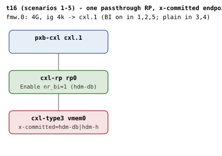
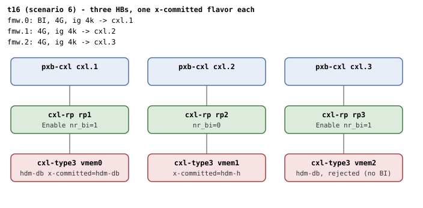
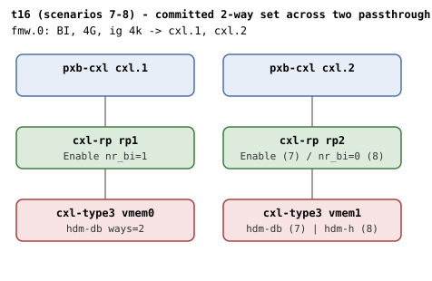
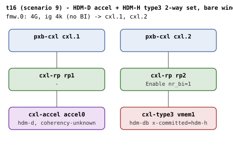

# t16 — firmware-committed (auto-discovered) BI decoders

| | |
|---|---|
| Topology script | `topos/t16-autodiscover.sh` |
| Checks | the topology script itself (host-driven, up to 8 QEMU launches + 1 guest reboot, 9 scenarios) |
| Mode | host-driven |
| Outputs | `t16.tap`, `t16.dmesg` (scenario 1 guest log), `t16-mixed-trt.dmesg` (scenario 9 guest log) |

## What it tests

QEMU's `x-committed=hdm-h|hdm-db` (cxl-type3) emulates firmware having
programmed and committed HDM decoder 0 against a fixed memory window
before OS handoff, with the device's BI Enable set for `hdm-db`. The
kernel is expected to adopt the inherited configuration: accept the
committed decoder at enumeration, adopt the enabled BI state, and refuse
a BI decoder under a window without the BI restriction (CXL 4.0 9.18.1.3
Window Restrictions). Each scenario needs its own QEMU command line, so
the script launches the guests itself and emits TAP directly. A combined
three-host-bridge boot asserts per-device independence (window
auto-selection with several windows present, adoption on one device
coexisting with the window reject on another), and the later scenarios
stage committed 2-way interleave sets (`x-committed-ways=2`) that must
assemble when coherent and must never reach a committed region when
mixed.

## Topology

All shapes are passthrough single-RP host bridges (the only staging
`x-committed` supports). Deviations from the shared conventions in
[topologies.md](../topologies.md#t16--firmware-committed-decoders-multi-boot-host-driven):
memdevs are 256M `share=on`, the RPs never carry an explicit
`x-256b-flit=on` (only the `hdm-db` endpoints do), and shape (d)'s first
endpoint is a `cxl-accel`.

### Scenarios 1-5: single device (shape a)

`cxl.1 - rp0 - vmem0` with one 4G `cxl-fmw.0` (ig 4k) targeting
`cxl.1`. The device props and the window's `back-invalidate` flag vary
per scenario:

| Scenario | tag | endpoint props | window |
|---|---|---|---|
| 1 | `bi` | `x-256b-flit=on,hdm-db=on,x-committed=hdm-db` | `back-invalidate=on` |
| 2 | `reboot` | (scenario 1's guest, `reboot` from inside) | (same) |
| 3 | `hdm-h` | `x-committed=hdm-h` | plain |
| 4 | `neg` | `x-256b-flit=on,hdm-db=on,x-committed=hdm-db` | plain |
| 5 | `hostonly-bi` | `x-committed=hdm-h` | `back-invalidate=on` |

### Scenario 6: combined 3-HB machine (shape b)

Three single-RP host bridges (`cxl.1` bus_nr 12, `cxl.2` bus_nr 64,
`cxl.3` bus_nr 128), one window each (`cxl-fmw.0/1/2`, 4G, ig 4k):
`vmem0` (sn 0x1) is `hdm-db` committed in a BI window (adopts +
assembles), `vmem1` (sn 0x2) is `hdm-h` committed in a plain window
(control), `vmem2` (sn 0x3) is `hdm-db` committed in a plain window
(rejected).

### Scenarios 7-8: committed 2-way set (shape c)

One BI window (`cxl-fmw.0`, 4G, ig 4k, `back-invalidate=on`) targeting
two passthrough HBs (`targets.0=cxl.1`, `targets.1=cxl.2`). `vmem0`
(sn 0x1) always commits `hdm-db` with `x-committed-ways=2`; the second
member is `x-256b-flit=on,hdm-db=on,x-committed=hdm-db,x-committed-ways=2`
in scenario 7 (`2way`) and `x-committed=hdm-h,x-committed-ways=2` in
scenario 8 (`mixed`).

### Scenario 9: mixed-TRT 2-way set (shape d)

Same two-HB window as (c) but without `back-invalidate` (a bare window
permitting both models). `accel0` is a `cxl-accel` with
`x-coherency-unknown=on,x-committed=hdm-d,x-committed-ways=2`; `vmem1`
(sn 0x2) is a `cxl-type3` with
`x-256b-flit=on,hdm-db=on,x-committed=hdm-h,x-committed-ways=2`.

## Semantics

`x-committed` stages the endpoint HDM decoder committed (BI bit per
mode) and, for `hdm-db`, the endpoint BI Enable — the firmware adoption
entry state. nr_bi=1 at each RP above an `hdm-db` device (adoption takes
the refcount exactly like a fresh enable), 0 above the `hdm-h` ones that
lack `hdm-db` (topologies.md).

- **Scenario 1 (bi)**: with a committed HDM-DB decoder in a BI window
  the kernel must log "adopting firmware-enabled BI", enumerate decoder
  `decoder2.0` as `mode=ram`, and the qemu RP BI oracle must stay silent
  (direct attach: the RP must terminate BI (BI Enable), not forward,
  Table 8-157). If the kernel can assemble committed regions through the
  passthrough decoder, `region0` must be committed and the endpoint
  decoder must read `back_invalidate=1`. An oracle self-test then
  mis-programs the RP BI decoder from the guest via `/dev/mem` (BI FW +
  BI Enable together, illegal per Table 8-157; ctrl at component block
  BAR0 + 0x1000 + 0xab8) and expects the oracle to flag "both set",
  restoring the good value (0x2) after.
- **Scenario 2 (reboot)**: the same guest reboots; BI must be re-adopted
  after the reset re-commit, with the same assembly checks.
- **Scenario 3 (hdm-h)**: a committed HDM-H decoder under a plain window
  enumerates `mode=ram`, `back_invalidate=0`, and (assembly permitting)
  `region0` commits.
- **Scenario 4 (neg)**: a committed BI decoder under a non-BI window is
  rejected ("coherency model not permitted by the window", 9.18.1.3), no
  `region0` is assembled, and the endpoint survives (adopt-then-gate
  layering, `mode=ram`).
- **Scenario 5 (hostonly-bi)**: the inverse — a committed HDM-H decoder
  whose HPA lands in a BI window. `cxl_acpi_cfmws_verify()` refuses a
  CFMWS that declares both Host-only Coherent and BI, so a BI window is
  never also a host-only one; the decoder is rejected with the same
  diagnostic, no region, endpoint survives. Deliberately a lone device:
  with a BI peer present the peer constructs the region first and the
  reject arrives from the attach path instead of `construct_region()`.
- **Scenario 6 (combined)**: one boot, three HBs; endpoint decoders are
  resolved by memdev serial. Exactly two "adopting firmware-enabled BI"
  lines, exactly one window reject, two regions (BI + HDM-H) when
  assembly is available, `bi=1` on the adopted `hdm-db` device, `bi=0`
  on the `hdm-h` one, and the rejected endpoint survives with `bi=0`.
- **Scenario 7 (2way)**: both members of the committed 2-way HDM-DB set
  adopt and (assembly permitting) auto-assemble into a single committed
  HDM-DB region ("created HDM-DB region", `region0/commit=1`), both
  endpoints `bi=1`.
- **Scenario 8 (mixed)**: a committed-BI decoder and a committed HDM-H
  decoder describing one interleave set must never reach a committed
  region whatever the construct order; the committed-BI decoder's
  coherency model is hardware fact and must not be coerced to the peer's
  model (`target_type` stays `accelerator`, Table 8-157). Assembly
  permitting, a mismatch diagnostic must be logged (one of "coherency
  model mismatch", "mismatch decoder type", "BI not enabled on device",
  "coherency model not permitted by the window").
- **Scenario 9 (mixed-trt)**: class-honest members (accel commits HDM-D,
  type3 commits HDM-H) under a bare window: every member passes the BI
  parity and window checks and only the committed range type
  contradicts across the set. The accel declines to report a coherency
  model (`x-coherency-unknown`, Table 8-116) so only the committed-flavor
  range-type comparison stands between this set and a committed region.
  No committed region, both memdevs present, "coherency model mismatch"
  logged (assembly permitting).

The assembly checks are documented SKIPs when dmesg contains "region
sort failed" (kernel lacks the out-of-series passthrough-decoder
assembly patch); adoption itself is still asserted.

## Checks

### Preamble

| # | Check (TAP text) | Expected | Why |
|---|---|---|---|
| 1 | `# SKIP qemu cxl-type3 lacks x-committed` | SKIP, then exit 0 (plan 1..1) | QEMU lacks the staging knob; skips wholesale |

### Scenario 1 — `bi`: hdm-db adoption

| # | Check (TAP text) | Expected | Why |
|---|---|---|---|
| 1 | `bi: qemu launch` | only emitted as `not ok` when launch fails (exit 1) | - |
| 2 | `bi: guest booted with a committed HDM-DB decoder` | ok (fail exits) | - |
| 3 | `bi: firmware-enabled BI adopted` | dmesg "adopting firmware-enabled BI" | adopt the enabled BI state |
| 4 | `bi: committed decoder enumerated (mode=ram)` | `decoder2.0/mode` = ram | accept the committed decoder at enumeration |
| 5 | `bi: qemu RP BI oracle silent` | 0 "CXL BI oracle" lines in qemu.log | direct attach: RP must Enable, not forward (Table 8-157) |
| 6 | `# SKIP bi: region commit (kernel lacks passthrough assembly)` | SKIP when dmesg has "region sort failed" | out-of-series passthrough assembly patch |
| 7 | `# SKIP bi: endpoint bi (kernel lacks passthrough assembly)` | SKIP, paired with #6 | - |
| 6' | `bi: auto-assembled region committed` | `region0/commit` = 1 (instead of #6) | - |
| 7' | `bi: endpoint bi=1` | `decoder2.0/back_invalidate` = 1 (instead of #7) | - |
| 8 | `# SKIP bi: oracle fires on illegal RP program (qemu lacks BI oracle)` | SKIP when cxl-downstream lacks `x-bi-commit-fault` | a qemu without it predates the BI oracle |
| 8' | `# SKIP bi: oracle fires on illegal RP program (ctrl readback RPCTL)` | SKIP when the RP ctrl readback is not 0x2 (or empty: needs /dev/mem, !CONFIG_IO_STRICT_DEVMEM) | skipped unless the readback shows BI Enable-only |
| 8'' | `bi: oracle fires on illegal RP program` | "both set" appears in qemu.log after the poke | oracle self-test |

### Scenario 2 — `reboot`: re-adoption across guest reboot

| # | Check (TAP text) | Expected | Why |
|---|---|---|---|
| 1 | `reboot: guest returned` | ok (fail exits) | - |
| 2 | `reboot: BI re-adopted after reset re-commit` | dmesg "adopting firmware-enabled BI" | - |
| 3 | `# SKIP reboot: region commit (kernel lacks passthrough assembly)` / `reboot: auto-assembled region committed` | SKIP on assembly gap, else `region0/commit` = 1 | - |
| 4 | `# SKIP reboot: endpoint bi (kernel lacks passthrough assembly)` / `reboot: endpoint bi=1` | SKIP on assembly gap, else `back_invalidate` = 1 | - |

### Scenario 3 — `hdm-h`: control

| # | Check (TAP text) | Expected | Why |
|---|---|---|---|
| 1 | `hdm-h: qemu launch` | `not ok` only on launch failure (exit 1) | - |
| 2 | `hdm-h: guest booted with a committed HDM-H decoder` | ok (fail exits) | - |
| 3 | `hdm-h: committed decoder enumerated (mode=ram)` | `decoder2.0/mode` = ram | - |
| 4 | `hdm-h: endpoint bi=0` | `decoder2.0/back_invalidate` = 0 | - |
| 5 | `# SKIP hdm-h: region commit (kernel lacks passthrough assembly)` / `hdm-h: auto-assembled region committed` | SKIP on assembly gap, else `region0/commit` = 1 | - |

### Scenario 4 — `neg`: BI decoder under a non-BI window

| # | Check (TAP text) | Expected | Why |
|---|---|---|---|
| 1 | `neg: qemu launch` | `not ok` only on launch failure (exit 1) | - |
| 2 | `neg: guest booted (BI decoder, non-BI window)` | ok (fail exits) | - |
| 3 | `neg: rejected per 9.18.1.3 Window Restrictions` | dmesg "coherency model not permitted by the window" | Window Restrictions |
| 4 | `neg: no region assembled` | no `region0` in /sys/bus/cxl/devices | - |
| 5 | `neg: endpoint survives (adopt-then-gate layering)` | `decoder2.0/mode` = ram | - |

### Scenario 5 — `hostonly-bi`: host-only decoder under a BI window

| # | Check (TAP text) | Expected | Why |
|---|---|---|---|
| 1 | `hostonly-bi: qemu launch` | `not ok` only on launch failure (exit 1) | - |
| 2 | `hostonly-bi: guest booted (HDM-H decoder, BI window)` | ok (fail exits) | - |
| 3 | `hostonly-bi: rejected per 9.18.1.3 Window Restrictions` | dmesg "coherency model not permitted by the window" | a BI window is never also a host-only one |
| 4 | `hostonly-bi: no region assembled` | no `region0` | - |
| 5 | `hostonly-bi: endpoint survives` | `decoder2.0/mode` = ram | - |

### Scenario 6 — `combined`: 3-HB machine (per-device independence)

| # | Check (TAP text) | Expected | Why |
|---|---|---|---|
| 1 | `combined: qemu launch` | `not ok` only on launch failure (exit 1) | - |
| 2 | `combined: guest booted (3 HBs, one x-committed flavor each)` | ok (fail exits) | - |
| 3 | `combined: all three endpoints enumerated (DA DB DC)` | an endpoint decoder resolved for sn 0x1, 0x2, 0x3 (fail exits) | - |
| 4 | `combined: both hdm-db devices adopted (2)` | exactly 2 "adopting firmware-enabled BI" | per-device independence |
| 5 | `combined: exactly one non-BI-window reject` | exactly 1 "coherency model not permitted by the window" | - |
| 6 | `# SKIP combined: two regions assembled (kernel lacks passthrough assembly)` / `combined: two regions assembled (BI + HDM-H)` | SKIP on assembly gap, else exactly 2 `region*` | - |
| 7 | `# SKIP combined: hdm-db endpoint bi=1 (kernel lacks passthrough assembly)` / `combined: hdm-db endpoint bi=1` | SKIP on assembly gap, else sn 0x1 decoder `back_invalidate` = 1 | - |
| 8 | `combined: hdm-h endpoint bi=0` | sn 0x2 decoder `back_invalidate` = 0 | - |
| 9 | `combined: rejected endpoint survives, bi=0` | sn 0x3 decoder `mode` = ram and `back_invalidate` = 0 | - |

### Gate before scenarios 7-9

| # | Check (TAP text) | Expected | Why |
|---|---|---|---|
| 1 | `# SKIP qemu cxl-type3 lacks x-committed-ways (2-way + mixed scenarios)` | SKIP, then exit (status = any earlier failure) | - |

### Scenario 7 — `2way`: committed 2-way HDM-DB interleave (control)

| # | Check (TAP text) | Expected | Why |
|---|---|---|---|
| 1 | `2way: qemu launch` | `not ok` only on launch failure (exit 1) | - |
| 2 | `2way: guest booted (committed 2-way HDM-DB set)` | ok (fail exits) | - |
| 3 | `2way: both set members adopted` | exactly 2 "adopting firmware-enabled BI" | - |
| 4 | `# SKIP 2way: region commit (kernel lacks passthrough assembly)` / `2way: single HDM-DB region committed across the set` | SKIP on assembly gap, else dmesg "created HDM-DB region" and `region0/commit` = 1 | the set must auto-assemble into a single committed HDM-DB region |
| 5 | `# SKIP 2way: both endpoints bi=1 (kernel lacks passthrough assembly)` / `2way: both endpoints bi=1` | SKIP on assembly gap, else both endpoint decoders `back_invalidate` = 1 | - |

### Scenario 8 — `mixed`: mixed-coherency 2-way set must not assemble

| # | Check (TAP text) | Expected | Why |
|---|---|---|---|
| 1 | `mixed: qemu launch` | `not ok` only on launch failure (exit 1) | - |
| 2 | `mixed: guest booted (BI + HDM-H committed 2-way set)` | ok (fail exits) | - |
| 3 | `mixed: no committed region across the mixed set` | 0 regions with `commit` = 1 | must never reach a committed region |
| 4 | `mixed: both endpoints survive` | sn 0x1 decoder `mode` = ram and sn 0x2 decoder resolves | - |
| 5 | `mixed: committed-BI decoder type preserved (accelerator)` | sn 0x1 decoder `target_type` = accelerator | coherency model is hardware fact, not coerced to the peer's (Table 8-157) |
| 6 | `# SKIP mixed: mismatch reject diagnostic (kernel lacks passthrough assembly)` / `mixed: mismatch rejected with a diagnostic` | SKIP on assembly gap, else one of the four mismatch diagnostics in dmesg | - |

### Gate before scenario 9

| # | Check (TAP text) | Expected | Why |
|---|---|---|---|
| 1-4 | `# SKIP qemu lacks cxl-accel with x-coherency-unknown` (x4) | four SKIPs, then exit (status = any earlier failure) | needs `cxl-accel` with `x-coherency-unknown` |

### Scenario 9 — `mixed-trt`: mixed-TRT 2-way set (HDM-D accel + HDM-H type3)

| # | Check (TAP text) | Expected | Why |
|---|---|---|---|
| 1 | `mixed-trt: guest booted (HDM-D accel + HDM-H type3 2-way set)` | ok; the failing form is `not ok - mixed-trt: guest booted` (exit 1) | - |
| 2 | `mixed-trt: no committed region across the set` | 0 regions with `commit` = 1 | - |
| 3 | `mixed-trt: both endpoints survive` | exactly 2 `mem*` devices | - |
| 4 | `# SKIP mixed-trt: range-type mismatch refused (kernel lacks passthrough assembly)` / `mixed-trt: range-type mismatch refused` | SKIP on assembly gap, else dmesg "coherency model mismatch" | the committed-flavor range-type comparison is the only refusal standing |

## Skips and limitations

- Skips wholesale (one SKIP, exit 0) when `cxl-type3` lacks
  `x-committed`.
- Scenarios 7-9 are skipped (one SKIP, exit) when `cxl-type3` lacks
  `x-committed-ways`; scenario 9 is skipped (four SKIPs) when QEMU lacks
  `cxl-accel` or `cxl-accel` lacks `x-coherency-unknown`.
- Region-assembly checks (region commit, endpoint bi, region counts,
  mismatch diagnostics) are emitted as SKIPs when the kernel lacks the
  out-of-series passthrough-decoder assembly patch (dmesg "region sort
  failed"); adoption is still asserted.
- The scenario 1 oracle self-test SKIPs when `cxl-downstream` lacks
  `x-bi-commit-fault` (the oracle's generation marker), or when the RP
  BI ctrl readback is not 0x2 — it needs `/dev/mem` MMIO access
  (`!CONFIG_IO_STRICT_DEVMEM`).
- Any launch or boot failure fails the scenario and exits the suite;
  the EXIT trap still emits the plan and summary.

## Related

- [t24](t24.md) — firmware adoption; the RP register readback for the
  direct-attach adopt scenario lives there.
- [t19](t19.md) — manual counterpart of t16's committed 2-way set.
- [t13](t13.md) — the host-driven style t16 follows.
