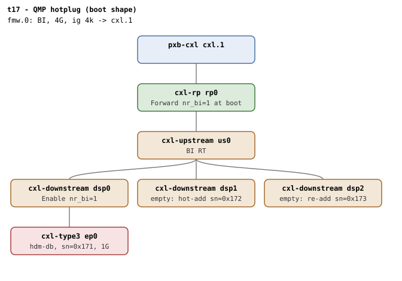

# t17 — QMP runtime hotplug of cxl-type3 endpoints

| | |
|---|---|
| Topology script | `topos/t17-hotplug.sh` |
| Checks | the topology script itself (host-driven, 1 boot) + `guest/hotplug-helpers.sh` sourced over ssh |
| Mode | host-driven |
| Outputs | `t17.tap`, `t17.dmesg` |

## What it tests

The dport/endpoint BI setup driven by real pciehp events rather than a
driver rebind on an already-enumerated device, which the bind/unbind
phases of t2/t5 cannot reach. Hot-add into an empty DSP (pciehp Link Up
-> `cxl_pci` probe -> `devm_cxl_dport_bi_setup` at dport-add time -> BI
requests enabled) must let an HDM-DB region commit on the hot-added
endpoint. Hot-remove (attention button) with a committed HDM-DB region
must run BI disable + decoder reap with no WARN, decommit the region
(its device persists target-less for userspace to delete), and leave
the surviving endpoint's path BI-enabled (`nr_bi` on the shared
USP/RP), proven by a post-removal commit on the survivor. Add-after-
remove into a spare slot completes the lifecycle on a topology that
has already seen a removal.

## Topology



Boot shape: `rp0` - `us0` with three DSPs; `dsp0` carries the
cold-plugged `cxl-type3 ep0` (`sn=0x171`, 1G, `hdm-db=on`), `dsp1` and
`dsp2` are empty. One BI window. Hot-added devices are `cxl-type3`
with a 1G `memory-backend-ram` created over QMP, `sn=0x172` into
`dsp1` and `sn=0x173` into `dsp2`, both `x-256b-flit` and `hdm-db`.
Devices are identified by memdev serial throughout: hotplug recycles
`memN` names (`guest/hotplug-helpers.sh`).

The topology changes across the run; the `nr_bi` transitions are in
[topologies.md, t17](../topologies.md#t17--qmp-hotplug):

```
                    rp0  dsp0  dsp1  dsp2
boot                 1     1     -     -
hot-add 0x172        2     1     1     -
hot-remove 0x171     1     0     1     -     survivor path (dsp1) stays enabled
hot-add 0x173        2     0     1     1
```

## Semantics

The script launches the guest, copies `hotplug-helpers.sh` in, and
interleaves QMP (`object-add` + `device_add`, `device_del`) with guest
checks. `mkreg_sn <sn>` builds a 1-way 256M HDM-DB region on the device
with that serial and prints `regionN bi=<0|1>`; only one region exists
at a time (the switch USP does not have enough decoders for two
disjoint routings). `wait_sn_state <sn> present` waits for the
endpoint decoder, not just the memdev, since the `cxl_mem`/`cxl_port`
probe chain completes after the QMP add returns.

1. **Baseline** on the cold-plugged `0x171`: region commits with
   `bi=1`.
2. **Hot-add** `0x172` into `dsp1`. If QEMU refuses the `device_add`,
   the remaining seven checks are emitted as SKIP and the suite exits
   0. Otherwise: the endpoint enumerates (pciehp), `BI requests
   enabled` appears in dmesg (polled up to 5s, since the decoder wait
   can land between decoder registration and `cxl_bi_setup()`), and a
   region commits on it with `bi=1`.
3. **Hot-remove** `0x171` with a region re-committed on it
   (`device_del ep0`, attention button). The memdev must go away; the
   region must reach `commit=0` (polled up to 10s) while persisting
   for `rmreg_all` to delete; `BI requests disabled` must be logged;
   no splat; then a fresh region on `0x172` commits with `bi=1`.
4. **Add-after-remove** `0x173` into the spare `dsp2`: enumerates,
   region commits with `bi=1`, no `BI setup failed` anywhere, and the
   qemu BI oracle is silent across the whole lifecycle (checked here
   because host-driven suites return before run-all's generic oracle
   fold).

## Checks

Scenario 1, baseline:

| # | Check (TAP text) | Expected | Why |
|---|---|---|---|
| - | qemu launch | not ok, exit (launch failure only) | - |
| 1 | guest booted (1 endpoint, 2 empty DSPs) | ok (exit on fail) | - |
| 2 | baseline: HDM-DB region commits on cold-plugged endpoint | `mkreg_sn 0x171` ends in `bi=1` (fail text: `baseline: HDM-DB region commits (got '...')`) | - |

Scenario 2, hot-add into empty dsp1. If `device_add` is refused the
suite emits, in order, `# SKIP hot-add accepted by QEMU (no cxl-type3
hotplug support)`, `# SKIP hot-added endpoint enumerated`, `# SKIP BI
enabled on hot-added path`, `# SKIP region commits on hot-added
endpoint`, `# SKIP hot-remove with committed region`, `# SKIP survivor
path stays BI-enabled`, `# SKIP add-after-remove into spare slot`, then
exits 0. Otherwise:

| # | Check (TAP text) | Expected | Why |
|---|---|---|---|
| 3 | hot-add accepted by QEMU (dsp1) | ok | - |
| 4 | hot-added endpoint enumerated (pciehp) | ok (exit on fail) | waits for the endpoint decoder |
| 5 | BI enabled through hot-added dport path | dmesg `BI requests enabled` >= 1 | devm_cxl_dport_bi_setup at dport-add time |
| 6 | HDM-DB region commits on hot-added endpoint | `bi=1` | - |

Scenario 3, hot-remove with a committed HDM-DB region:

| # | Check (TAP text) | Expected | Why |
|---|---|---|---|
| 7 | removal setup: region re-committed on sn=0x171 | `bi=1` (fail text: `removal setup: region re-committed (got '...')`) | - |
| 8 | hot-remove completed guest-side (Ns incl. 5s attn-button) | memdev absent within 30s (fail text: `hot-remove completed guest-side (timeout)`) | - |
| 9 | region decommitted by hot-remove (REGION persists, commit=0) | `commit` reads 0 (fail text: `region decommitted by hot-remove (commit='...')`) | the region survives losing its only target; the detach work decommits it |
| 10 | BI disabled during hot-remove teardown | dmesg `BI requests disabled` >= 1 | - |
| 11 | no WARN/BUG/lockdep splat across hot-remove | no `SPLAT_RE` match | teardown runs BI disable + decoder reap with no WARN |
| 12 | survivor path stays BI-enabled (post-removal commit) | `mkreg_sn 0x172` ends in `bi=1` | the USP/RP must still be BI-enabled for sn=0x172 (nr_bi) |

Scenario 4, add-after-remove (spare slot dsp2):

| # | Check (TAP text) | Expected | Why |
|---|---|---|---|
| - | add-after-remove accepted by QEMU (dsp2) | not ok + exit only when `device_add` is refused; no ok line on success | dsp0's slot is not reusable (QEMU gap) |
| 13 | add-after-remove endpoint enumerated (dsp2) | ok (exit on fail) | - |
| 14 | HDM-DB region commits after a prior hot-remove | `bi=1` | - |
| 15 | no 'BI setup failed' across the hotplug lifecycle | ok | - |
| 16 | qemu BI oracle silent across the hotplug lifecycle | no `CXL BI oracle` in `qemu.log` (matches printed as diagnostics) | host-driven suites return before run-all's oracle fold |

## Skips and limitations

- Skips wholesale (seven SKIP lines after the first two checks) when
  QEMU rejects `device_add` of a `cxl-type3`.
- QEMU gap (v11.1.0-rc0): the guest completes the unplug but QEMU never
  finalizes it - the `cxl-type3` stays in the QOM tree and the slot
  reads occupied forever, so re-adding into the same slot fails.
  Scenario 4 therefore uses the spare `dsp2`; if QEMU learns to
  finalize, it can move back to `dsp0` (README Known limitations).
- QMP `device_add` wants integer properties as JSON numbers, so the
  serial is sent in decimal while the hex form stays the guest-side key.
- Listed in `HOST_ONLY_SUITES`; the generic kmemleak scan and oracle
  fold of `run_suite` do not run for it (the oracle check is in the
  script).

## Related

[t2](t2.md) and [t5](t5.md) (bind/unbind phases this complements),
[t16](t16.md) (the other host-driven, QMP-less multi-boot suite the
script names as its model).
