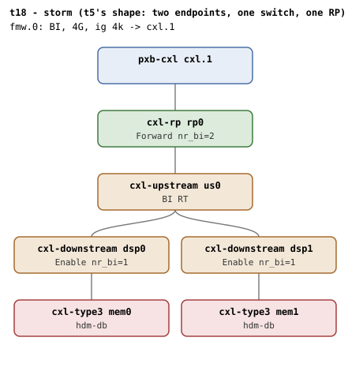

# t18 — concurrency storm topology

| | |
|---|---|
| Topology script | `topos/t18-storm.sh` |
| Checks | `guest/run-tests.sh` (`t18)` case) |
| Mode | guest-driven |
| Outputs | `t18.tap`, `t18.dmesg` |

## What it tests

Identical to t5 (two BI endpoints under one switch/RP) but driven by the
storm case: parallel unbind/bind flips of both endpoints (racing `nr_bi`
on the shared RP, `cxl_bi_setup`/`cxl_bi_dealloc`, and devres teardown)
under a concurrent `back_invalidate`/`cap_back_invalidate` sysfs reader;
region create/commit/destroy churn with per-cycle timing (a rollback
regression that re-polls a failed dport shows up as a 5s+ jump in cycle
time); and dmesg hygiene across the whole storm: no WARN, no lockdep
splat, no refcount underflow, no leaked BI mappings.

## Topology

t5's shape: `cxl.1` - `rp0` - `us0` - {`dsp0` - `mem0`, `dsp1` - `mem1`},
both endpoints `hdm-db=on` with 1G volatile memdevs, flit on everywhere,
one BI window. Steady-state counts as t5 (`rp0` nr_bi=2, `dsp0`/`dsp1`
nr_bi=1); see [topologies.md](../topologies.md#t18--storm-t5s-shape).

## Semantics

Setup: the generic ABI checks, the BI root decoder, two memdevs, and
their BDFs (`bdf0`, `bdf1`). Endpoints are tracked by BDF throughout
because "memN names recycle across a flip, BDFs never do". A pre-storm
2-way HDM-DB commit proves the topology works, then `dmesg -C` opens a
fresh window so everything the storm provokes is swept by the hygiene
checks at the end.

**Phase A (flip storm).** Two background `flip_storm` loops, one per
BDF, each doing `FLIPS=12` iterations of: write the BDF to
`cxl_pci/unbind`, sleep 0-0.3s (random), write it to `cxl_pci/bind`,
then poll up to 50 x 0.2s for the memdev to reappear. Every failed
unbind, bind or reprobe appends a `BDF unbind#i` / `BDF bind#i` /
`BDF reprobe#i` line to a failure file. Concurrently a background reader
loops over `cat` of every root `cap_back_invalidate` and every endpoint
`back_invalidate` until the flips finish. The failure file's line count
must be 0.

**Convergence.** The bind write returns when `cxl_pci` probe is done,
but the memdev -> endpoint port -> decoders chain completes after it, so
the case waits at the decoder level. "The kernel does not promise that a
probe racing a sibling's switch-port reap succeeds: it may fail
terminally, leaving the memdev driverless, recoverable by rebind" (README
Known limitations). `converge` therefore waits up to 20 x 0.5s for the
endpoint decoder; if the memdev exists but has no driver, it rebinds it
once via `cxl_mem/bind`, records the recovery, and waits up to 60 x 0.5s
more. Both endpoints must converge; recoveries are reported as a
diagnostic, and only a memdev that stays endpoint-less fails the suite.

**Phase B (region churn).** `CYCLES=10` cycles of create (1-way, 256M,
`mem0`) / commit / destroy, timing each cycle in ms. Any create or commit
failure increments `churn_fail`; the maximum cycle time is printed and
must be below 15000ms (the script's comment: a commit poll on a failed
dport "shows up as a 5s+ jump in cycle time").

**Post-storm proof.** A 2-way HDM-DB region across `mem0` and `mem1`
commits and both endpoint decoders read `back_invalidate=1`; the region
is destroyed.

**Hygiene sweep.** Nine dmesg patterns over the storm window, each its
own TAP line; on a hit the first two matching lines are printed as
diagnostics.

## Checks

The happy path emits 20 TAP lines. The flip loops, the reader and the
convergence waits emit no TAP lines of their own, only the `# `
diagnostics noted below.

### Setup and pre-storm baseline

| # | Check (TAP text) | Expected | Why |
|---|---|---|---|
| 1 | `cap_back_invalidate present on all root decoders (N found)` (or `DECODER/cap_back_invalidate missing` / `... has bogus value 'V'`) | ok | - |
| 2 | `back_invalidate present on all endpoint decoders (N found)` (or `DECODER/back_invalidate missing` / `... has bogus value 'V'` / `no endpoint decoders enumerated`) | ok | - |
| - | `no BI root decoder` | not ok, exit 1 (bail-out only) | - |
| 3 | `two memdevs enumerated` | ok (count = 2) | - |
| 4 | `pre-storm 2-way HDM-DB commit` | ok (not ok exits 1) | "the topology works" before the storm |

### Phase A: flip storm and convergence

| # | Check (TAP text) | Expected | Why |
|---|---|---|---|
| 5 | `storm A: no unbind/bind/reprobe failures` | ok (failure-file line count = 0); each failure is then echoed as `# BDF unbind#i` / `# BDF bind#i` / `# BDF reprobe#i` | 12 flips per endpoint, in parallel, under the sysfs reader |
| - | `# storm A: recovered N endpoint(s) via rebind (probe lost reap race)` | diagnostic only, printed when N > 0 | README Known limitations: probe racing a sibling's switch-port reap may fail terminally; one recovery rebind allowed per endpoint |
| 6 | `storm A: both endpoints converged (MEM0 MEM1, recovered=N)` (fail text: `storm A: both endpoints converged (dec0='..' dec1='..' recovered=N)`, followed by up to 8 `# ` lines of `dmesg | grep -E "cxl.*probe|endpoint"`, then exit 1) | ok | only a memdev that stays endpoint-less after one rebind is a failure |
| 7 | `back_invalidate present on all endpoint decoders (N found)` (second call of the same helper, same alternates as 2) | ok | decoders re-enumerated after the storm |

### Phase B: region churn

| # | Check (TAP text) | Expected | Why |
|---|---|---|---|
| 8 | `storm B: 10 create/commit/destroy cycles clean` | ok (`churn_fail` = 0) | - |
| - | `# storm B max cycle: Nms` | diagnostic, always printed | per-cycle wall-clock |
| 9 | `storm B: no stalled cycle (max Nms < 15s)` (fail text: `storm B: no stalled cycle (max Nms, 5s-poll leak?)`) | ok (max < 15000ms) | a rollback that drives a commit poll on a failed dport shows up as a 5s+ jump |

### Post-storm proof

| # | Check (TAP text) | Expected | Why |
|---|---|---|---|
| 10 | `post-storm 2-way HDM-DB commit` | ok | full-function proof after both storms |
| 11 | `post-storm both endpoints bi=1` | ok (`11`) | - |

### Hygiene sweep (9 lines, fixed)

One line per pattern, in this order; on a failure the first two matching
dmesg lines are printed as `# ` diagnostics.

| # | Check (TAP text) | Expected | Why |
|---|---|---|---|
| 12 | `dmesg clean of 'WARNING:'` | ok | no WARN |
| 13 | `dmesg clean of 'BUG:'` | ok | - |
| 14 | `dmesg clean of 'UBSAN:'` | ok | - |
| 15 | `dmesg clean of 'kernel BUG at'` | ok | - |
| 16 | `dmesg clean of 'possible circular'` | ok | no lockdep splat |
| 17 | `dmesg clean of 'refcount_t'` | ok | no refcount underflow |
| 18 | `dmesg clean of 'BI setup failed'` | ok | - |
| 19 | `dmesg clean of 'Failed to request region'` | ok | no leaked BI mappings |
| 20 | `dmesg clean of 'mismatch decoder type'` | ok | - |

`expect_eq` failures append ` (got 'X' want 'Y')`. run-all.sh may fold in
`not ok N - qemu BI oracle silent` (the oracle must stay silent across
the whole suite) and prints a `# kmemleak: ...` diagnostic.

## Skips and limitations

- No SKIP lines; baseline QEMU knobs only.
- Timing-dependent: Phase A sleeps are random (0-0.3s) and the 15s
  stall bound is wall-clock.
- README Known limitations: a `cxl_mem` probe racing a sibling's
  switch-port reap can fail terminally (silent -ENXIO; the memdev is
  left driverless and only a rebind recovers it). t18 converges through
  at most one recovery rebind per endpoint and reports it as a TAP
  diagnostic; only an unrecoverable memdev fails the suite.
- run-all.sh runs t18 after the other guest-driven suites in the
  default order.

## Related

- [t5](t5.md) - the same topology, run sequentially (2-way region, `nr_bi` refcount phases).
- [t7](t7.md) / [t8](t8.md) - README Diagnostics: a 5s+ pause on their rollback is the same err_rollback symptom Phase B bounds.
