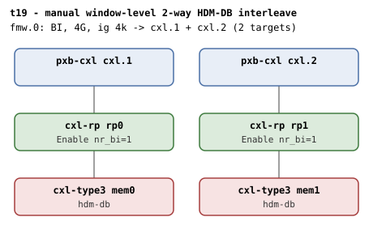

# t19 — manual window-level 2-way HDM-DB interleave

| | |
|---|---|
| Topology script | `topos/t19-manual-2way.sh` |
| Checks | `guest/run-tests.sh` (`t19)` case) |
| Mode | guest-driven |
| Outputs | `t19.tap`, `t19.dmesg` |

## What it tests

The regular (sysfs-driven) counterpart of t16's committed 2-way set: the
window itself interleaves across two passthrough host bridges (root
decoder iw=2), and a manually created HDM-DB region across both
BI-capable endpoints must attach, commit, and reach bi=1 on both. Unlike
t10 (two RPs under one host bridge, 1-target window), the root decoder
here is deterministically 2-way. The region must also survive a full
teardown and re-create cycle.

## Topology

Two host bridges (`cxl.1` at `bus_nr=12`, `cxl.2` at `bus_nr=64`), each
`cxl-rp` - `cxl-type3` (`hdm-db=on`, 1G volatile memdev, flit on). One
4G BI window at 4k granularity with TWO targets
(`cxl-fmw.0.targets.0=cxl.1`, `targets.1=cxl.2`). Per
[topologies.md](../topologies.md#t19--t20--window-level-2-way-interleave),
nr_bi=1 at each RP.

## Semantics

The window has two targets, so the root decoder is iw=2 and region
targets must be wired in window-target (BDF) order; 1-way regions cannot
exist under this window (every stride crosses both HBs). The case sets
`CR_IG=4096` so the region's interleave granularity matches the CFMWS
("window-level interleave suites must match the CFMWS granularity"),
sorts the memdevs by BDF, and creates a 2-way 256M-per-target region
with `mems[0]`, `mems[1]` in that order.

After commit both endpoint decoders must read `back_invalidate=1` and
dmesg must contain the `created HDM-DB` region log. After
`destroy_region` both must read 0. A second create + commit of the same
region then proves the path after full teardown.

## Checks

| # | Check (TAP text) | Expected | Why |
|---|---|---|---|
| 1 | `cap_back_invalidate present on all root decoders (N found)` (or `DECODER/cap_back_invalidate missing` / `... has bogus value 'V'`) | ok | - |
| 2 | `back_invalidate present on all endpoint decoders (N found)` (or `DECODER/back_invalidate missing` / `... has bogus value 'V'` / `no endpoint decoders enumerated`) | ok | - |
| - | `no BI root decoder` | not ok, exit 1 (bail-out only) | - |
| 3 | `root decoder iw=2 (window-level interleave)` | ok (2) | the window has two targets |
| 4 | `two memdevs enumerated` | ok (count = 2) | - |
| 5 | `create 2-way HDM-DB region (cross-HB)` | ok (not ok exits 1) | targets wired in BDF (window-target) order, ig 4096 |
| 6 | `commit 2-way HDM-DB region (cross-HB)` | ok | - |
| 7 | `both endpoints bi=1 post-commit` | ok (`11`) | - |
| 8 | `dmesg: 'created HDM-DB' region log` | ok | - |
| 9 | `no 'BI setup failed' in dmesg` | ok | - |
| 10 | `no 'region mismatch' WARN across BI attach` | ok | - |
| 11 | `both endpoints bi=0 post-destroy` | ok (`00`) | - |
| 12 | `re-create + commit after full teardown` | ok | survives a full teardown + re-create cycle |

`expect_eq` failures append ` (got 'X' want 'Y')`. run-all.sh may fold in
`not ok N - qemu BI oracle silent` and prints a `# kmemleak: ...`
diagnostic.

## Skips and limitations

- No SKIP lines; baseline QEMU knobs plus a multi-target CFMWS
  (`cxl-fmw.0.targets.1`).

## Related

- [t20](t20.md) - same window shape, second device host-only coherent; t19 is its "passing control".
- [t16](t16.md) - the firmware-committed (x-committed-ways=2) counterpart.
- [t10](t10.md) - two RPs under one host bridge with a 1-target window.
- [t32](t32.md) - two-target window with switches below each host bridge.
