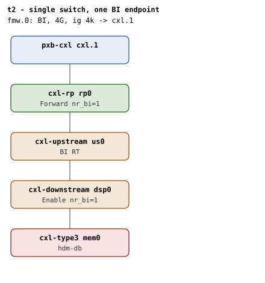

# t2 — single-switch happy path, one BI-capable endpoint

| | |
|---|---|
| Topology script | `topos/t2-switch.sh` |
| Checks | `guest/run-tests.sh` (`t2)` case) + `guest/unbindrebind-phase.sh` (phase 2) + `guest/lifecycle-race-phase.sh` (phase 3) |
| Mode | guest-driven |
| Outputs | `t2.tap`, `t2.dmesg`, `t2-unbindrebind.tap`, `t2-unbindrebind.dmesg`, `t2-lifecycle.tap`, `t2-lifecycle.dmesg` (plus `t2.kmemleak` only when the host-side kmemleak scan reports unreferenced objects) |

## What it tests

Beyond t1: the full DSP->USP->RP walk in `cxl_bi_setup`, including the
USP's optional BI Route Table cap (present here, absent in t6);
`cap_back_invalidate` is only on root decoder(s), switch decoders must
not have the file; an HDM-DB region commits under the switch and
survives a full teardown + re-create. Phase 2 drives an unbind/rebind
cycle to prove the `cxl_bi_dealloc`/`cxl_bi_setup` lifecycle: post-unbind
BI must be disabled on device and dports, post-rebind it must be back.
Phase 3 races a decoder-attribute reader against repeated memdev-driven
teardown with a committed HDM-DB region live at each unbind, to pin the
endpoint-vs-cxlds lifecycle orderings.

## Topology

`pxb-cxl cxl.1` -> `cxl-rp rp0` -> `cxl-upstream us0` ->
`cxl-downstream dsp0` -> `cxl-type3 mem0` (1G volatile, `hdm-db=on`),
every port and the device with `x-256b-flit=on`. One CFMWS: 4G,
`interleave-granularity=4k`, `back-invalidate=on`. Roles per
[topologies.md](../topologies.md#t2--single-switch): RP Forward
`nr_bi=1`, DSP Enable `nr_bi=1`, USP carries the BI RT. Phases 2 and 3
reuse this boot (both counts 1->0->1 in phase 2).

## Semantics

**Main body.** ABI presence on root and endpoint decoders, absence on
switch decoders, and at least one non-root `cxl_port` (proves the switch
layer showed up). On the BI root decoder, `create_ram_region` must be
present when `cap_ram=1` (and `create_pmem_region` when `cap_pmem=1`).
A 1-way 256M HDM-DB region is created and committed; the endpoint
decoder reads `back_invalidate=1` and the endpoint port's
`decoders_committed` rises by one. No `BI setup failed` and no
`region mismatch` WARN (`cxl_rr_free_decoder`'s WARN_ONCE must not fire
across BI attach/detach cycling). Destroy returns `bi=0` and
`decoders_committed` to its pre-value. A second create/commit cycle
proves `cxl_bi_setup`/`dealloc` did not toggle BI on the topology and a
fresh region reaches `bi=1`. Finally the boot dmesg must show the BI
capability walk: at least 3 `found BI Decoder capability` lines
(endpoint, RP, DSP), a `found BI RT capability` line (USP), and a
`BI-ID commit wait took` line backing the region commits. The RP role by
position (Forward above a switch, Table 8-157 / 9.14.2 allocate step 6)
is asserted by register readback in phase 2 and in t24.

**Phase 2 (unbind/rebind, run only if the main body passed).**
`cxl_bi_setup` registers `cxl_bi_dealloc` as a devm action on the
endpoint port. A `cxl_pci`/`cxl_mem` unbind reaches it through the
endpoint teardown; a `cxl_port` unbind of the endpoint runs it up front,
before the detach cascades into the memdev. Either way dealloc must
clear BI on the device and every dport in the path, and rebind must
re-enable BI and re-arm the endpoint decoder to reach `bi=1` when the
region is rebuilt. Cycle 1: commit an HDM-DB region (`bi=1`), tear it
down, unbind `cxl_pci` (fallback `cxl_mem`), check that the endpoint
decoder reap precedes the `BI requests disabled` line in dmesg (BI must
outlive the decoders it serves), read the RP's BI Decoder Control via
`/dev/mem` (cap ID 0xC through the cap array) and expect it all-clear
(dealloc step 6 clear-at-zero); rebind, expect the RP back to Forward
only (`0x1`), the endpoint decoder back, and a fresh region committing
with `bi=1`. Cycle 2 (port-cycle): with a region committed, unbind the
endpoint's `cxl_port` driver; `BI requests disabled` must appear, the
teardown must cascade into the memdev unbind, and the disable must
precede `disconnect` in the log; a `cxl_mem` rebind must bring the
decoder back and a fresh region to `bi=1`. No `BI setup failed` in either
cycle.

**Phase 3 (lifecycle reader race, run only if the main body passed).**
`cxl_memdev_unregister()` tears the endpoint down (delete_endpoint ->
endpoint devres -> `cxl_bi_dealloc`) before nulling `cxlmd->cxlds`, and
decoder attributes like `bi_show` rely on that ordering (no NULL check).
A background reader loops over every decoder's `back_invalidate` and
`target_type` and the root's `cap_back_invalidate` while `CYCLES`
(default 8) iterations each build and commit a fresh 1-way HDM-DB
region, unbind `cxl_pci` with it committed, and rebind. Any cycle whose
commit fails or whose decoder does not return counts as a failure. After
the churn a region must still commit with `bi=1`, and dmesg must be free
of `BUG:`, `Oops`, `kernel NULL pointer`, `WARNING:`,
`possible circular` and `inconsistent lock`.

## Checks

### Main body (`t2.tap`)

| # | Check (TAP text) | Expected | Why |
|---|---|---|---|
| 1 | cap_back_invalidate present on all root decoders (N found) | ok; `not ok` as `DECODER/cap_back_invalidate missing` or `... has bogus value 'V'` | Every root decoder must expose it |
| 2 | back_invalidate present on all endpoint decoders (N found) | ok; `not ok` variants: `.../back_invalidate missing`, `... has bogus value 'V'`, `no endpoint decoders enumerated` | - |
| 3 | no cap_back_invalidate/back_invalidate on switch decoders | 0 | Those files live only on root/endpoint decoders |
| 4 | switch cxl_port present (N) | ok (N >= 1); `not ok - no switch cxl_port` | Proves the switch layer showed up in the topology |
| 5 | RD: create_ram_region present (cap_ram=1, cap_back_invalidate=1) | ok; `not ok - RD: create_ram_region missing despite cap_ram=1`. Preceded by `not ok - no BI root decoder` + exit if no BI root | Visibility algebra matches the cap flags |
| 5b | RD: create_pmem_region present (cap_pmem=1, cap_back_invalidate=1) | only emitted when `cap_pmem=1`; `not ok - ... missing despite cap_pmem=1` | - |
| 6 | create HDM-DB region | ok; `not ok` then exit | - |
| 7 | commit HDM-DB region under switch | ok | - |
| 8 | endpoint bi=1 (switched) | 1 | - |
| 9 | endpoint decoders_committed bumped | pre + 1 | Backstops the "commit succeeded" check |
| 10 | no 'BI setup failed' in dmesg | ok | - |
| 11 | no 'region mismatch' WARN across BI attach | ok | cxl_rr_free_decoder's WARN_ONCE must not fire |
| 12 | endpoint bi=0 after destroy | 0 | Endpoint bi returns to 0 |
| 13 | endpoint decoders_committed back to pre | pre | - |
| 14 | re-create + commit HDM-DB after full teardown | ok | setup/dealloc must not have toggled BI on the topology |
| 15 | endpoint bi=1 (recreated region) | 1 | - |
| 16 | no 'region mismatch' WARN across BI attach | ok | - |
| 17 | BI Decoder caps discovered (ep+rp+dsp) | ok (>= 3 lines); `not ok - BI Decoder caps discovered (got N, want >= 3)` | Boot dmesg must show the capability walk |
| 18 | dmesg: 'found BI RT capability' (USP) | ok | - |
| 19 | dmesg: 'BI-ID commit wait took' | ok | BI-ID commits backed the region commits above |

Host-side (run-all.sh), folded into `t2.tap` only on failure:
`not ok - qemu BI oracle silent` if "CXL BI oracle" lines appear in
`qemu.log` across the whole suite, phases included.

### Phase 2 (`t2-unbindrebind.tap`)

Bail-outs before any check: `Bail out! prereq missing`,
`Bail out! create_region failed`, `Bail out! initial commit failed`.

| # | Check (TAP text) | Expected | Why |
|---|---|---|---|
| 1 | pre-unbind: endpoint bi=1 | 1 | - |
| 2 | dmesg: BI requests disabled on unbind / dmesg: BI unbind message optional | both ok | Not fatal: dyndbg for cxl_core may not be on |
| 3 | unbind order: decoders reaped before BI came down | ok; `ok - unbind order: decoders before BI # SKIP marker missing (dyndbg off?)` when either marker is absent; `not ok - unbind order: BI came down before the decoders (line X < Y)` | BI must outlive the decoders it serves |
| 4 | post-unbind: RP BI ctrl cleared (dealloc step 6) | 0x0; `ok - post-unbind: RP BI ctrl cleared # SKIP no /dev/mem MMIO` when unreadable | The last (only) BI holder went away |
| 5 | post-rebind: RP BI Forward restored | 0x1; `ok - post-rebind: RP BI Forward restored # SKIP no /dev/mem MMIO` | Table 8-157 / 9.14.2 allocate step 6 |
| 6 | endpoint decoder returned after rebind (DEC) | ok; `not ok` then exit | - |
| 7 | post-rebind commit succeeded | ok; `not ok - post-rebind commit` (or `not ok - post-rebind region create` + exit) | BI got re-enabled on the topology |
| 8 | post-rebind: endpoint bi=1 | 1 (only after a successful commit) | - |
| 9 | no 'BI setup failed' across unbind/rebind cycle | ok | - |
| 10 | port-cycle: HDM-DB region up (bi=X) | ok; `not ok` then exit | - |
| 11 | port-cycle: BI disabled on endpoint port unbind | ok | BI-ID allocation lives with the endpoint port |
| 12 | port-cycle: teardown cascaded into memdev unbind | ok | - |
| 13 | port-cycle: BI disable precedes memdev disconnect | ok; `not ok - ... (dis=X dc=Y)` | Port devres runs dealloc ahead of the memdev detach |
| 14 | port-cycle: endpoint decoder returned after rebind (DEC) | ok | - |
| 15 | port-cycle: post-rebind endpoint bi=1 | 1; `not ok - port-cycle: post-rebind commit` if the commit failed | - |
| 16 | port-cycle: no 'BI setup failed' | ok | - |

### Phase 3 (`t2-lifecycle.tap`)

Bail-out before any check: `Bail out! prereq missing`.

| # | Check (TAP text) | Expected | Why |
|---|---|---|---|
| 1 | committed-region unbind cycles clean | 0 | Every cycle must commit, unbind and come back |
| 2 | post-churn HDM-DB commit | ok | Function proof after the churn |
| 3 | post-churn endpoint bi=1 | 1 | - |
| 4 | dmesg clean of 'BUG:' | ok | Any ordering regression shows up here |
| 5 | dmesg clean of 'Oops' | ok | - |
| 6 | dmesg clean of 'kernel NULL pointer' | ok | - |
| 7 | dmesg clean of 'WARNING:' | ok | - |
| 8 | dmesg clean of 'possible circular' | ok | - |
| 9 | dmesg clean of 'inconsistent lock' | ok | - |

## Skips and limitations

Phase 2 SKIPs the two RP register readbacks without `/dev/mem` MMIO
(e.g. `CONFIG_IO_STRICT_DEVMEM`) and the unbind-order check when the
cxl_core dyndbg markers are missing. Phases 2 and 3 run only when the
main body exits 0. Phase 3 reader errors mid-teardown are expected and
swallowed. README diagnostics: `-EBUSY` on the second bind in phase 2
means the dport BI Decoder mapping leaked on unbind.

## Related

- [t1](t1.md) — the no-switch baseline.
- [t6](t6.md) — same shape, USP BI RT absent (when QEMU allows it).
- [t3](t3.md), [t4](t4.md), [t7](t7.md), [t8](t8.md), [t11](t11.md),
  [t21](t21.md), [t23](t23.md) — vary one axis of t2's shape.
- [t24](t24.md) — also asserts the RP role by register readback.
