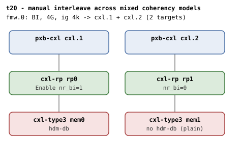

# t20 — manual interleave across mixed coherency models

| | |
|---|---|
| Topology script | `topos/t20-manual-mixed.sh` |
| Checks | `guest/run-tests.sh` (`t20)` case) |
| Mode | guest-driven |
| Outputs | `t20.tap`, `t20.dmesg` |

## What it tests

The regular (sysfs-driven) counterpart of t16's mixed committed set: a
2-way HDM-DB region attempted across one BI-capable and one
host-only-coherent device must reject the plain target (the device gates
in `cxl_region_attach`: "BI not enabled on device" / "HDM is host-only
coherent") without WARNs and with nothing left committed, in either
wiring order. Flit stays on for both devices so coherency model is the
only mixed axis.

## Topology

t19's shape: two host bridges (`cxl.1`, `cxl.2`), each `cxl-rp` -
`cxl-type3` with a 1G volatile memdev and flit on; one 4G BI window at
4k granularity with two targets. The difference: `mem1` under `rp1` has
no `hdm-db` (PLAIN). Per
[topologies.md](../topologies.md#t19--t20--window-level-2-way-interleave),
`rp1` stays nr_bi=0.

## Semantics

No 1-way fallback exists under a 2-target window, so the BI device is
classified from the `BI requests enabled` dmesg line (its BDF) instead of
a probe commit: exactly one such line is expected, its BDF maps to
`m_bi`, and the other memdev is `m_nobi`. The topology script's note that
a 1-way HDM-DB region on the BI-capable endpoint alone "still commits"
is not exercised by the case (see the comment: no 1-way fallback exists
under this window).

With `CR_IG=4096`, a 2-way region is attempted twice, once per wiring
order (`m_bi, m_nobi` then `m_nobi, m_bi`); the create (target write) or
the commit must fail each time, and any region shell left behind is
destroyed. dmesg must carry one of the device coherency gate
diagnostics, no region may be left with `commit=1`, the host-only
endpoint's decoder must still exist with `back_invalidate=0`, and the
`region mismatch` WARN must not have fired.

## Checks

| # | Check (TAP text) | Expected | Why |
|---|---|---|---|
| 1 | `cap_back_invalidate present on all root decoders (N found)` (or `DECODER/cap_back_invalidate missing` / `... has bogus value 'V'`) | ok | - |
| - | `no BI root decoder` | not ok, exit 1 (bail-out only) | - |
| 2 | `two memdevs enumerated` | ok (count = 2) | - |
| 3 | `exactly one endpoint enabled BI` | ok (`grep -c 'BI requests enabled'` = 1) | only the hdm-db device enables BI |
| 4 | `classified BI (MEM_BI) vs host-only (MEM_NOBI) endpoints` (fail text: `classified BI vs host-only endpoints`, then exit 1) | ok | BI device classified from the 'BI requests enabled' BDF |
| 5 | `mixed 2-way rejected (order MEM_BI,MEM_NOBI)` | ok (create or commit fails) | the plain target must be rejected |
| 6 | `mixed 2-way rejected (order MEM_NOBI,MEM_BI)` | ok (create or commit fails) | in either wiring order |
| 7 | `device coherency gate diagnostic present` | ok (dmesg matches `BI not enabled on device` or `HDM is host-only coherent`) | the device gates in `cxl_region_attach` |
| 8 | `nothing left committed after mixed attempts` | ok (0 regions with `commit=1`) | - |
| 9 | `host-only endpoint survives, bi=0` | ok (0) | - |
| 10 | `no 'region mismatch' WARN across BI attach` | ok | no WARNs |

`expect_eq` failures append ` (got 'X' want 'Y')`. run-all.sh may fold in
`not ok N - qemu BI oracle silent` and prints a `# kmemleak: ...`
diagnostic.

## Skips and limitations

- No SKIP lines; baseline QEMU knobs plus a multi-target CFMWS.
- Check 3 reads boot dmesg (`BI requests enabled` from the initial
  `cxl_mem` probe); run-all.sh deliberately does not `dmesg -C` before
  the suite for this reason.

## Related

- [t19](t19.md) - the paired positive control (same window shape, both devices hdm-db).
- [t16](t16.md) - the firmware-committed mixed set this suite mirrors.
- [t12](t12.md) - BI + non-BI siblings under one switch, 1-target window.
- [t4](t4.md) - the "BI not enabled on device" gate on its own.
