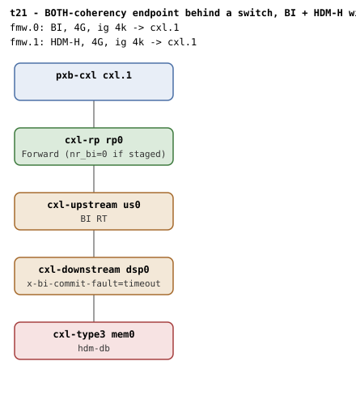

# t21 — BOTH-coherency endpoint behind a switch, BI + HDM-H windows on one pxb

| | |
|---|---|
| Topology script | `topos/t21-bi-fail-fallback.sh` |
| Checks | `guest/run-tests.sh` (`t21)` case) |
| Mode | guest-driven |
| Outputs | `t21.tap`, `t21.dmesg` |

## What it tests

The `hdm-db` device advertises `CXL_HDM_DECODER_COHERENCY_BOTH`: its
decoders default to host-only and only flip to device-coherent when an
HDM-DB region claims them. The suite verifies that when BI setup fails
at endpoint probe (staged via `x-bi-commit-fault=timeout` on the switch
DSP, so its BI Decoder commit times out) the device fails closed for
HDM-DB ("BI not enabled on device") but still commits host-only regions
on the same decoder. On a QEMU without the knob BI setup succeeds and
the fallback checks SKIP.

## Topology

t2's shape plus a second window: `cxl.1` - `rp0` - `us0` - `dsp0` -
`mem0` (`hdm-db=on`, 1G volatile memdev, flit on everywhere). Windows:
`cxl-fmw.0` (BI, `targets=cxl.1`) and `cxl-fmw.1` (HDM-H,
`targets=cxl.1`), both 4G at 4k granularity. The topology script appends
`,x-bi-commit-fault=timeout` to `dsp0` only if
`$QEMU -device cxl-downstream,help` lists `x-bi-commit-fault`.

Per [topologies.md](../topologies.md#t21--both-coherency-fallback): with
the knob, BI setup fails at boot and the rollback returns every count to
0; without it the path enables (t2's counts: `rp0` Forward, `dsp0`
Enable, nr_bi=1 each).

## Semantics

The case branches on whether boot dmesg contains `BI setup failed`.

If it does not (stock QEMU commits within the advertised timeout), the
fallback cannot be staged and a single SKIP line is emitted; the case
ends there.

If it does, the staged branch runs: dmesg must also show
`BI-ID commit timed out`; the endpoint decoder reads `back_invalidate=0`
and `target_type=expander` (the BOTH default). An HDM-DB attach on the
BI window must fail closed, either at create (target write) or at
commit, with `BI not enabled on device` in dmesg. A failed attach leaves
an uncommitted region shell behind, which is deleted under the BI root
so the HDM-H half starts clean. Then a host-only region on the HDM-H
root must create and commit on the same decoder, with `back_invalidate`
still 0 and `target_type` still `expander`; it is destroyed and the
`region mismatch` WARN must not have fired.

## Checks

### Common prologue

| # | Check (TAP text) | Expected | Why |
|---|---|---|---|
| 1 | `cap_back_invalidate present on all root decoders (N found)` (or `DECODER/cap_back_invalidate missing` / `... has bogus value 'V'`) | ok | - |
| 2 | `back_invalidate present on all endpoint decoders (N found)` (or `DECODER/back_invalidate missing` / `... has bogus value 'V'` / `no endpoint decoders enumerated`) | ok | - |
| - | `no BI root decoder` / `no HDM-H root decoder` | not ok, exit 1 (bail-out only) | - |
| 3 | `both BI and HDM-H root decoders present` | ok | - |
| - | `no endpoint decoder for MEM` | not ok, exit 1 (bail-out only) | - |

### Not staged (no `BI setup failed` in dmesg)

| # | Check (TAP text) | Expected | Why |
|---|---|---|---|
| 4 | `fallback staging # SKIP needs qemu BI commit-latency mod` | ok (SKIP); last line of the suite | stock qemu commits within the advertised timeout, so setup succeeded and the fallback cannot be staged |

### Staged (`BI setup failed` in dmesg)

| # | Check (TAP text) | Expected | Why |
|---|---|---|---|
| 4 | `BI setup failed at boot (staged commit timeout)` | ok | - |
| 5 | `BI-ID commit timed out logged` | ok | the DSP's BI Decoder commit times out |
| 6 | `endpoint bi=0 after failed setup` | ok (0) | - |
| 7 | `decoder defaults to expander (BOTH)` | ok (`expander`) | BOTH-coherency decoders default to host-only |
| 8 | `HDM-DB attach rejected with BI down` (fail text: `HDM-DB region committed with BI down`) | ok (create fails, or commit fails) | fail closed for HDM-DB |
| 9 | `attach gate: 'BI not enabled on device'` | ok | the attach gate diagnostic |
| - | `HDM-H region create after BI failure` | not ok, exit 1 (bail-out only) | - |
| 10 | `HDM-H commit after BI failure` | ok | the same decoder must still serve host-only regions |
| 11 | `endpoint bi=0 (HDM-H)` | ok (0) | - |
| 12 | `decoder type stays expander` | ok (`expander`) | - |
| 13 | `no 'region mismatch' WARN across BI attach` | ok | - |

`expect_eq` failures append ` (got 'X' want 'Y')`. run-all.sh may fold in
`not ok N - qemu BI oracle silent` and prints a `# kmemleak: ...`
diagnostic.

## Skips and limitations

- SKIPs (one `ok N - # SKIP ...` line after the prologue) whenever boot
  dmesg lacks `BI setup failed`, i.e. on a QEMU without
  `x-bi-commit-fault` on `cxl-downstream`, or any QEMU whose commit does
  not time out.
- README Known limitations: "Commit-timeout injection has no QEMU knob
  either: t21 stages it with a local QEMU modification that latches the
  BI commit past the advertised 2s timeout, and records itself as a SKIP
  on stock QEMU." The README QEMU section lists `x-bi-commit-fault`
  among the knobs the `cxl-bi-tests` QEMU branch carries.
- The staged branch does not check `BI setup failed` absence (it is the
  premise); `no_setup_failure` is not called in this suite.

## Related

- [t15](t15.md) - the same BI + HDM-H window pair without a switch.
- [t23](t23.md) - `x-bi-commit-fault=error|timeout` at the DSP and USP in t2's shape, host-driven.
- [t2](t2.md) - the shape and counts when the fault is not staged.
