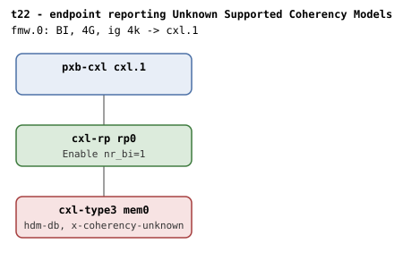

# t22 — BI endpoint that reports Unknown in Supported Coherency Models

| | |
|---|---|
| Topology script | `topos/t22-unknown-coherency.sh` |
| Checks | `guest/run-tests.sh` (`t22)` case); the topology script emits the knob-missing SKIP |
| Mode | guest-driven |
| Outputs | `t22.tap`, `t22.dmesg` |

## What it tests

Table 8-116 lets a device report 00b (Unknown) rather than naming the
coherency models it supports, and that says nothing about whether the
HDM Decoder Target Range Type bit is writable - Host+Device means RW, a
single model means the bit may be hardwired to it, Unknown declares
neither. The kernel does not refuse such a device: a Type 3 decoder
defaults to host-only and inherits device-coherent when it joins an
HDM-DB region, with `cxlds->bi` as the gate. Refusing on Unknown would
also exclude devices that support both models without saying so. Every
other topology uses a device reporting Host+Device, so this is the only
coverage of the Unknown path.

## Topology

t1's direct-attach shape: `cxl.1` - `rp0` - `mem0` (`hdm-db=on`, 1G
volatile memdev, flit on) with `x-coherency-unknown=on` on the endpoint;
one BI window. Per
[topologies.md](../topologies.md#t22--unknown-supported-coherency-models),
`rp0` nr_bi=1 and the endpoint advertises 00b in Supported Coherency
Models.

Before launching, the topology script checks
`$QEMU -device cxl-type3,help` for `x-coherency-unknown`; if absent it
prints `1..0 # SKIP qemu lacks cxl-type3 x-coherency-unknown` and exits
0 without starting QEMU.

## Semantics

Pre-region state: the endpoint decoder defaults to `expander` ("the
default is host-only, as for any Type 3 decoder that does not report
device-coherent only") with `back_invalidate=0`, and BI setup must have
succeeded (no `BI setup failed`). A 1-way 256M HDM-DB region is created
under the BI root; the inheritance under test is observed at attach,
before commit: `target_type` becomes `accelerator` and `back_invalidate`
reads 1. The region then commits (bi still 1), and after destroy the
decoder is back to `expander`. The `region mismatch` WARN must not fire.

## Checks

| # | Check (TAP text) | Expected | Why |
|---|---|---|---|
| 1 | `cap_back_invalidate present on all root decoders (N found)` (or `DECODER/cap_back_invalidate missing` / `... has bogus value 'V'`) | ok | - |
| 2 | `back_invalidate present on all endpoint decoders (N found)` (or `DECODER/back_invalidate missing` / `... has bogus value 'V'` / `no endpoint decoders enumerated`) | ok | - |
| - | `no BI root decoder` | not ok, exit 1 (bail-out only) | - |
| - | `no endpoint decoder for MEM` | not ok, exit 1 (bail-out only) | - |
| 3 | `decoder defaults to expander` | ok (`expander`) | the default is host-only |
| 4 | `endpoint bi=0 before attach` | ok (0) | - |
| 5 | `no 'BI setup failed' in dmesg` | ok | the kernel must still enable BI on an Unknown device |
| 6 | `HDM-DB region create (Unknown coherency)` | ok (not ok exits 1) | - |
| 7 | `decoder inherits accelerator on attach` | ok (`accelerator`) | the inheritance under test: host-only default -> device-coherent |
| 8 | `endpoint bi=1 on attach` | ok (1) | - |
| 9 | `HDM-DB commit (Unknown coherency)` | ok | - |
| 10 | `endpoint bi=1 committed` | ok (1) | - |
| 11 | `decoder back to expander after destroy` | ok (`expander`) | - |
| 12 | `no 'region mismatch' WARN across BI attach` | ok | - |

`expect_eq` failures append ` (got 'X' want 'Y')`. run-all.sh may fold in
`not ok N - qemu BI oracle silent` and prints a `# kmemleak: ...`
diagnostic.

## Skips and limitations

- Host-side SKIP: `1..0 # SKIP qemu lacks cxl-type3 x-coherency-unknown`
  from the topology script when QEMU has no knob to stage it (README:
  "SKIPs when QEMU lacks the knob"). `x-coherency-unknown` is among the
  knobs carried by the `cxl-bi-tests` QEMU branch.
- Otherwise no SKIP lines.
- README Known limitations: nothing in `cxl_region_attach()` would
  refuse a `cxl-accel` with `x-coherency-unknown=on` from an HDM-H
  window; no topology tries it.

## Related

- [t1](t1.md) - the same direct-attach shape with a Host+Device device.
- [t15](t15.md) - the same expander -> accelerator -> expander cycle, driven by window choice.
- [t26](t26.md) - the device-coherent-only (`cxl-accel`) counterpart of the coherency gate.
