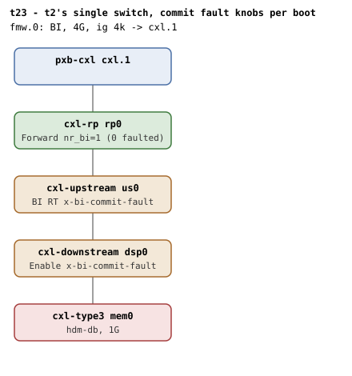

# t23 — BI-ID commit error/timeout legs (9.14.2)

| | |
|---|---|
| Topology script | `topos/t23-commit-fault.sh` |
| Checks | the topology script itself (host-driven, 6 boots) |
| Mode | host-driven |
| Outputs | `t23.tap`, `t23-dsp-err.dmesg`, `t23-rt-err.dmesg`, `t23-dsp-tmo.dmesg`, `t23-rt-tmo.dmesg`, `t23-adopt-rt.dmesg`, `t23-dealloc-err.dmesg` (one per boot) |

## What it tests

The allocate/deallocate implementation notes make the DSP BI Decoder
commit (steps 4d-4f) and the USP BI RT commit (steps 5d-5f) fallible:
Error Not Committed and commit timeout must both be treated as error
conditions. QEMU's `x-bi-commit-fault` knob (cxl-downstream: BI Decoder,
cxl-upstream: BI RT) forces those outcomes, which are otherwise
unreachable — the emulated commit always succeeds. Each scenario asserts
the kernel refuses BI cleanly: the specific commit diagnostic, BI setup
failure, endpoint `bi=0` with the endpoint otherwise alive, and a silent
qemu BI oracle throughout (the programming is topology-valid; only the
commit outcome is forced, and the failure path must restore, not
mis-program). Two further boots cover a firmware-committed DSP with an
uncommitted route table, and a dealloc-time commit fault.

## Topology

t2's single-switch shape (`rp0 - us0 - dsp0 - mem0`), 1G volatile
memdev, `hdm-db=on`, `x-256b-flit=on` on every port and device, one 4G
BI window (`cxl-fmw.0`, ig 4k, `back-invalidate=on`). Re-launched per
scenario with the fault knobs:

| Boot | tag | DSP (`dsp0`) extra | USP (`us0`) extra |
|---|---|---|---|
| 1 | `dsp-err` | `x-bi-commit-fault=error` | - |
| 2 | `rt-err` | - | `x-bi-commit-fault=error` |
| 3 | `dsp-tmo` | `x-bi-commit-fault=timeout` | - |
| 4 | `rt-tmo` | - | `x-bi-commit-fault=timeout` |
| 5 | `adopt-rt` | `x-bi-committed=on` | - |
| 6 | `dealloc-err` | `x-bi-commit-fault=error,x-bi-commit-fault-after=1` | - |

Counts, per [topologies.md](../topologies.md#t23--commit-faults-six-boots-host-driven):
the four fault legs roll back to 0 everywhere (a failing level never
increments); adopt-rt and dealloc-err reach t2's steady state
(`dsp0`/`rp0` nr_bi=1); only dealloc-err then tears down (cxl_pci
unbind), adopt-rt ends at steady state.

## Semantics

- **Boots 1-4 (fault legs)**: BI setup must fail at the faulted commit
  with the specific diagnostic — "BI-ID commit rejected by hardware"
  from `pcieport` for the DSP decoder error (alloc step 4e), from
  `portN` for the RT error (alloc step 5d), "BI-ID commit timed out"
  for either timeout (steps 4f/5f) — followed by "BI setup failed".
  For the RT error, the DSP decoder commit succeeds first; the RT
  rejection must undo the DSP enablement (register restore, oracle
  stays silent). After the refusal the endpoint decoder reads
  `back_invalidate=0` but still has a `mode`, and no "CXL BI oracle"
  line appears in qemu.log.
- **Boot 5 (adopt-rt)**: `x-bi-committed` presents a DSP that firmware
  already programmed and committed (9.14.2 allocate steps 3-4). The
  kernel may adopt it, but the switch's route table carries its own
  commit (Table 8-152) that the DSP's Committed bit says nothing about.
  Left uncommitted here, so an adopt that trusts the DSP alone leaves
  BI-ID routing unactivated — readable as BI RT Status.Committed still
  0. The script reads the USP's BI RT status (component block BAR0,
  cachemem at +0x1000, capability offset from the "found BI RT
  capability (0x..)" probe log, Committed = bit 0 of status at +8) via
  `/dev/mem` and expects Committed set, plus "BI requests enabled"
  without "BI setup failed".
- **Boot 6 (dealloc-err)**: `x-bi-commit-fault-after=1` lets the
  allocate-time commit succeed and fails the next one, which is the
  deallocation commit issued by the `cxl_mem` unbind (dealloc step 4d).
  No region here, so decoder `back_invalidate` stays 0 by design (it
  requires an attached DEVMEM region); the device-level allocate is what
  must have succeeded ("BI requests enabled"). The script unbinds the
  memdev from `cxl_pci`; the dealloc path is best-effort: it must log
  the failed dport disable ("BI dport disable failed") and still tear the
  endpoint down (no `endpoint*` left), with the oracle silent.

## Checks

### Preamble

| # | Check (TAP text) | Expected | Why |
|---|---|---|---|
| 1 | `# SKIP qemu lacks x-bi-commit-fault` | SKIP, exit 0 (plan 1..1) | the knob forces otherwise-unreachable outcomes |

### Boot 1 — `dsp-err`: DSP BI Decoder commit error (alloc step 4e)

| # | Check (TAP text) | Expected | Why |
|---|---|---|---|
| 1 | `dsp-err: launch` | `not ok` only on launch failure (exit 1) | - |
| 2 | `dsp-err: guest booted` | ok (fail exits) | - |
| 3 | `dsp-err: commit diagnostic` | dmesg matches `pcieport.*BI-ID commit rejected by hardware` | Error Not Committed is an error condition |
| 4 | `dsp-err: BI setup refused` | dmesg "BI setup failed" | - |
| 5 | `dsp-err: endpoint bi=0` | `endpoint*/decoder*.0/back_invalidate` = 0 | - |
| 6 | `dsp-err: endpoint survives` | `endpoint*/decoder*.0/mode` non-empty | endpoint otherwise alive |
| 7 | `dsp-err: qemu BI oracle silent` | 0 "CXL BI oracle" in qemu.log | failure path must restore, not mis-program |

### Boot 2 — `rt-err`: USP BI RT commit error (alloc step 5d)

| # | Check (TAP text) | Expected | Why |
|---|---|---|---|
| 1 | `rt-err: launch` | `not ok` only on launch failure (exit 1) | - |
| 2 | `rt-err: guest booted` | ok (fail exits) | - |
| 3 | `rt-err: commit diagnostic` | dmesg matches `port[0-9]+: BI-ID commit rejected by hardware` | - |
| 4 | `rt-err: BI setup refused` | dmesg "BI setup failed" | - |
| 5 | `rt-err: endpoint bi=0` | `back_invalidate` = 0 | - |
| 6 | `rt-err: endpoint survives` | `mode` non-empty | - |
| 7 | `rt-err: qemu BI oracle silent` | 0 oracle lines | RT rejection must undo the DSP enablement |

### Boot 3 — `dsp-tmo`: DSP BI Decoder commit timeout (alloc step 4f)

| # | Check (TAP text) | Expected | Why |
|---|---|---|---|
| 1 | `dsp-tmo: launch` | `not ok` only on launch failure (exit 1) | - |
| 2 | `dsp-tmo: guest booted` | ok (fail exits) | - |
| 3 | `dsp-tmo: commit diagnostic` | dmesg matches `BI-ID commit timed out` | commit timeout is an error condition |
| 4 | `dsp-tmo: BI setup refused` | dmesg "BI setup failed" | - |
| 5 | `dsp-tmo: endpoint bi=0` | `back_invalidate` = 0 | - |
| 6 | `dsp-tmo: endpoint survives` | `mode` non-empty | - |
| 7 | `dsp-tmo: qemu BI oracle silent` | 0 oracle lines | - |

### Boot 4 — `rt-tmo`: USP BI RT commit timeout (alloc step 5f)

| # | Check (TAP text) | Expected | Why |
|---|---|---|---|
| 1 | `rt-tmo: launch` | `not ok` only on launch failure (exit 1) | - |
| 2 | `rt-tmo: guest booted` | ok (fail exits) | - |
| 3 | `rt-tmo: commit diagnostic` | dmesg matches `BI-ID commit timed out` | - |
| 4 | `rt-tmo: BI setup refused` | dmesg "BI setup failed" | - |
| 5 | `rt-tmo: endpoint bi=0` | `back_invalidate` = 0 | - |
| 6 | `rt-tmo: endpoint survives` | `mode` non-empty | - |
| 7 | `rt-tmo: qemu BI oracle silent` | 0 oracle lines | - |

### Boot 5 — `adopt-rt`: firmware-committed DSP, uncommitted route table

| # | Check (TAP text) | Expected | Why |
|---|---|---|---|
| 1 | `# SKIP adopt-rt: qemu lacks x-bi-committed` | SKIP when cxl-downstream lacks `x-bi-committed` (boot not attempted) | - |
| 2 | `# SKIP adopt-rt: BI enabled through the adopted path` | SKIP, paired with #1 | - |
| 1' | `adopt-rt: launch` | `not ok` only on launch failure (exit 1) | - |
| 2' | `adopt-rt: guest booted` | `not ok` only on boot failure (exit 1); no ok line on success | - |
| 3' | `# SKIP adopt-rt: BI RT committed by the kernel (no RT/USP found)` | SKIP when the RT cap offset or the USP BDF cannot be resolved | - |
| 3'' | `# SKIP adopt-rt: BI RT committed by the kernel (no /dev/mem)` | SKIP when the status readback is empty | - |
| 3''' | `adopt-rt: BI RT committed by the kernel` | BI RT Status bit 0 = 1 (fail text appends `(sts=RTSTS)`) | the RT carries its own commit (Table 8-152) |
| 4' | `adopt-rt: BI enabled through the adopted path` | dmesg "BI requests enabled" and no "BI setup failed" | - |

### Boot 6 — `dealloc-err`: dealloc-time DSP commit error (dealloc step 4d)

| # | Check (TAP text) | Expected | Why |
|---|---|---|---|
| 1 | `# SKIP qemu cxl-downstream lacks x-bi-commit-fault-after (dealloc scenario)` | SKIP, then exit (status = any earlier failure) | - |
| 2 | `dealloc-err: launch` | `not ok` only on launch failure (exit 1) | - |
| 3 | `dealloc-err: guest booted` | ok (fail exits) | - |
| 4 | `dealloc-err: BI allocated (fault armed for dealloc only)` | dmesg "BI requests enabled" | the device-level allocate must have succeeded |
| 5 | `dealloc-err: dealloc commit diagnostic` | after `cxl_pci` unbind, dmesg "BI-ID commit rejected by hardware" | - |
| 6 | `dealloc-err: best-effort disable logged` | dmesg "BI dport disable failed" | dealloc path is best-effort |
| 7 | `dealloc-err: endpoint torn down despite commit error` | no `endpoint*` left in /sys/bus/cxl/devices | - |
| 8 | `dealloc-err: qemu BI oracle silent` | 0 oracle lines | - |

## Skips and limitations

- Skips wholesale (one SKIP, exit 0) when `cxl-downstream` lacks
  `x-bi-commit-fault`.
- Boot 5 emits two SKIPs (no boot) when `cxl-downstream` lacks
  `x-bi-committed`; its register check SKIPs when the RT capability
  offset or USP BDF cannot be found, or when `/dev/mem` yields nothing.
- Boot 6 emits one SKIP and ends the suite when `cxl-downstream` lacks
  `x-bi-commit-fault-after`.
- Any launch or boot failure fails that line and exits; the EXIT trap
  still emits the plan and summary.
- Commit-timeout injection has no stock-QEMU knob (README Known
  limitations); the knobs here come from the `cxl-bi-tests` QEMU branch.

## Related

- [t2](t2.md) — the single-switch shape and steady state this suite
  re-launches.
- [t16](t16.md) — the host-driven multi-boot style.
- [t21](t21.md) — BOTH-coherency fallback, which stages a DSP commit
  timeout at boot.
- [t24](t24.md) — firmware adoption legs.
