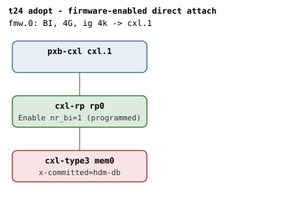
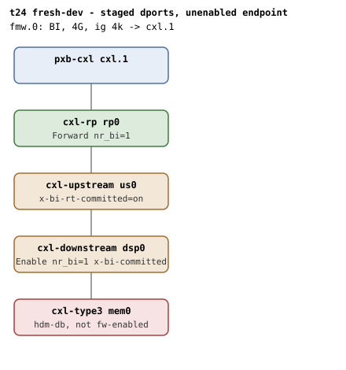
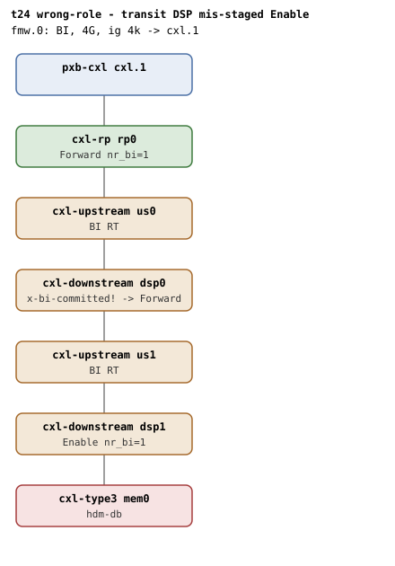
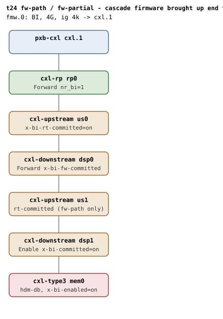
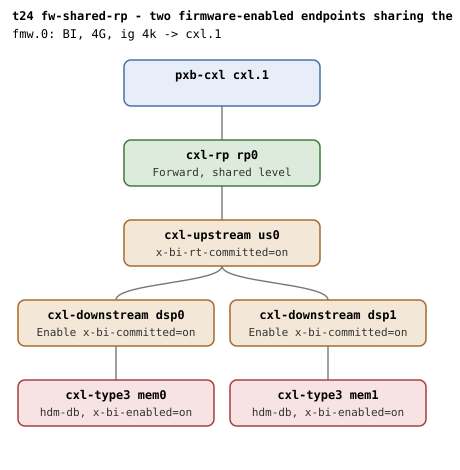
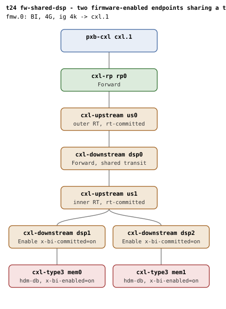
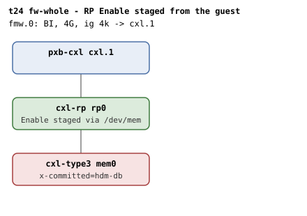
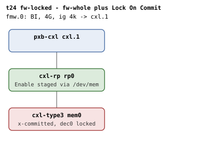
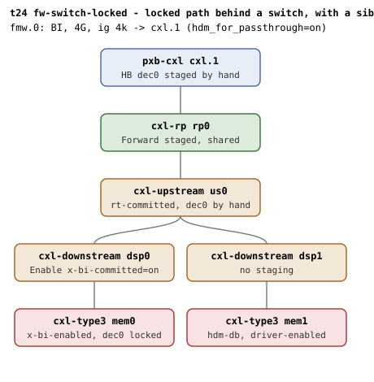

# t24 — firmware adoption (auto-commit) of the BI path

| | |
|---|---|
| Topology script | `topos/t24-adopt.sh` |
| Checks | the topology script itself (host-driven, 10 boots: one per scenario) |
| Mode | host-driven |
| Outputs | `t24.tap`; one dmesg per boot: `t24-adopt.dmesg`, `t24-fresh-dev.dmesg`, `t24-wrong-role.dmesg`, `t24-fw-path.dmesg`, `t24-fw-partial.dmesg`, `t24-fw-shared-rp.dmesg`, `t24-fw-shared-dsp.dmesg`, `t24-fw-whole.dmesg`, `t24-fw-locked.dmesg`, `t24-fw-switch-locked.dmesg` (no combined `t24.dmesg`, per README) |

## What it tests

Adoption is a path property: only a device firmware itself enabled (endpoint
BI Enable=1) may have its dports adopted as-is, since only then does each
level's committed state cover this device's BI-ID. Any other device is new
below every level and owes the DSP decoder and USP RT commits regardless of
register values (Table 8-152, Table 8-156: "whenever a new BI device is
enabled anywhere below this port"), and firmware programming that contradicts
the topology-derived role (Enable adjacent to the device, Forward on every
level above, Table 9-13/7-97) must be corrected, not adopted. Each scenario
ends with the qemu BI oracle silent, and scenarios 1-2 and 8-10 verify
teardown through the adopted/programmed bookkeeping on unbind.

## Topology

Ten boots over nine shapes (fw-path and fw-partial share one). All boots use
one BI window (`cxl-fmw.0`: 4G, ig 4k, `back-invalidate=on`, target `cxl.1`),
`x-256b-flit=on` on every port and endpoint, `hdm-db=on` on every endpoint,
and 1G memory backends. See [topologies.md](../topologies.md#t24--firmware-adoption-five-boots-host-driven)
for the nr_bi counts of the first five boots.

| Scenario | Image | Staging knobs |
|---|---|---|
| 1 adopt |  | `mem0` `x-committed=hdm-db` under `rp0` (direct attach) |
| 2 fresh-dev |  | `us0` `x-bi-rt-committed=on`, `dsp0` `x-bi-committed=on`; `mem0` NOT firmware-enabled |
| 3 wrong-role |  | cascade `rp0 - us0 - dsp0 - us1 - dsp1 - mem0`; the transit `dsp0` is `x-bi-committed=on` (Enable+committed on a level whose role is Forward) |
| 4 fw-path / 5 fw-partial |  | `us0` `x-bi-rt-committed=on`, `dsp0` `x-bi-fw-committed=on`, `dsp1` `x-bi-committed=on`, `mem0` `x-bi-enabled=on`; fw-path also stages `us1` `x-bi-rt-committed=on`, fw-partial leaves the inner RT (`us1`) uncommitted |
| 6 fw-shared-rp |  | one switch, `dsp0`/`dsp1` `x-bi-committed=on`, `mem0`/`mem1` `x-bi-enabled=on`; the only shared level is `rp0` |
| 7 fw-shared-dsp |  | inner switch `us1` under transit `dsp0` (`x-bi-fw-committed=on`), both USPs `x-bi-rt-committed=on`, `dsp1`/`dsp2` `x-bi-committed=on`, `mem0`/`mem1` `x-bi-enabled=on`; shared level is `dsp0` |
| 8 fw-whole |  | adopt shape; RP Enable staged from the guest via `/dev/mem` |
| 9 fw-locked |  | adopt shape; RP Enable and endpoint HDM decoder 0 (Lock On Commit) staged from the guest |
| 10 fw-switch-locked |  | `pxb-cxl` `hdm_for_passthrough=on`; `us0` `x-bi-rt-committed=on`, `dsp0` `x-bi-committed=on`, `mem0` `x-bi-enabled=on`, sibling `mem1` under `dsp1` unstaged; HB, USP and endpoint decoders committed by hand from the guest |

`x-bi-enabled=on` sets only the endpoint's BI Enable, so unlike `x-committed`
it composes with any topology (topologies.md: `x-bi-fw-committed=on` stages
the transit DSP's Forward+committed, `x-bi-committed=on` the adjacent DSP's
Enable+committed, `x-bi-rt-committed=on` a USP's route table). QEMU stages
committed state for directly attached devices only
(`ct3d_committed_decoder_init`), and cannot stage an RP at all.

### Guest-side staging via /dev/mem

Scenarios 8-10 stage what QEMU cannot, from the guest, behind the driver.
Each helper maps the device's BAR0 component block (`resource` line 0 +
0x1000) through `/dev/mem` and walks the capability array to find the
capability by ID:

- `bi_regs <bdf> <capid>` (all scenarios): reads "caps ctrl sts" of the BI
  RT (0xB) or BI Decoder (0xC) capability; empty without `/dev/mem`, which
  is what produces the register-readback SKIPs.
- `bi_set_enable <bdf>` (8, 9): BI Decoder Control (cap 0xC) `|= 2, &= ~1`,
  i.e. BI Enable=1, Forward=0 - written on the endpoint AND the RP.
- `hdm_dec0 <bdf> [lock]` (9, and readback in 10): HDM decoder capability
  (cap 5). With `lock` it re-commits decoder 0 at base `0x190000000`, size
  1G, DPA skip 0, with HDM Decoder Enable set and control = Commit | BI |
  Lock On Commit (TRT=0); it prints decoder 0's control word either way.
- `stage_switch_path <usp> <ep> <rp> <rpid> <dspid>` (10): commits the whole
  path by hand - host bridge decoder 0 (CHBCR from the ACPI CEDT CHBS,
  target list = `rpid`), switch USP decoder 0 (target list = `dspid`), and
  endpoint decoder 0 with Lock On Commit, all at the same 1G range with
  Commit | BI; then sets the device's BI Enable (Forward=0) and the RP's BI
  Forward (Enable=0). Prints the "hb usp ep rp" control words.
- `topo_ids` (10): resolves the BDF path above `mem0` and the `dportN` ids
  the HB and switch target lists must carry.

The cycles in 9 and 10 go through `cxl_mem` unbind/bind so `cxlds` survives;
scenario 10 also unbinds/rebinds the host bridge `cxl_port` around the
staging so its decoders are re-enumerated.

## Semantics

Adopted paths show "adopting firmware-enabled BI" and no "BI requests
enabled" (nothing written); commit cycles are counted by "BI-ID commit wait
took" lines, and the kernel names the dport it commits (`pcieport <bdf>:
BI-ID commit wait` for a DSP decoder, `cxl_port portN: BI-ID commit wait`
for a route table). Register readbacks use BI Decoder Control bits: `ctrl &
3 == 2` is Enable, `== 1` is Forward, `== 0` cleared; `sts & 1` is Committed.

1. **adopt**: zero commit cycles, no endpoint write, registers untouched;
   only the unstageable RP is programmed Enable (no commit exists at an RP,
   Table 8-156). Because that RP write makes the path only partly adopted,
   the kernel owns it from there up and deallocates device-first on unbind:
   both the endpoint and the RP are cleared.
2. **fresh-dev**: the endpoint is not firmware-enabled, so the staged DSP/RT
   committed state covers somebody else's BI-ID at best: adoption must be
   declined and both commits run with unchanged register values. The staged
   Commit bit cannot witness this (Table 8-158 ties Committed to the last
   0->1 of it), so the dmesg dport name is used instead. Unbind leaves
   the DSP as it was found, with no dealloc commit: only a level the
   driver brought up from zero is ever cleared.
3. **wrong-role**: the transit DSP staged Enable+committed must be
   reprogrammed to Forward and committed, and the adjacent DSP given the
   Enable (at least 2 commit cycles: correction + adjacent).
4. **fw-path**: every level correct and committed; adoption runs the whole
   way up with no commit at either switch level, both DSP roles kept.
5. **fw-partial**: inner RT uncommitted; adoption dies at the adjacent DSP,
   and the transit DSP above it - staged perfectly - must still program and
   commit (adjacent decoder + inner RT, then transit decoder + outer RT: 4
   commits, not 2).
6. **fw-shared-rp**: nr_bi counts every endpoint routed through a level, so
   the second firmware-enabled endpoint is refused adoption at the RP the
   first already holds; the value is already in place and a root port never
   commits: zero commit cycles, both endpoints adopt.
7. **fw-shared-dsp**: the shared level is the transit DSP; the second
   endpoint is refused there and from that level up programs and commits as
   for a new device: exactly two commit cycles (transit decoder and outer
   route table), none on the adjacent DSPs, both endpoints adopt, transit
   keeps Forward.
8. **fw-whole**: after the boot binding's unbind (which cleared both
   levels), endpoint and RP Enable are staged behind the driver and the
   device re-bound: adopted, nothing written, RP untouched. The mapping is
   not locked (unbind reset the decoder), so the next unbind deallocates
   the device: its Enable is cleared and "BI requests disabled" reported.
   The RP was found up by the rebind's walk, so it is kept as found: only
   a level the driver brought up from zero is ever cleared.
9. **fw-locked**: scenario 8 plus Lock On Commit on the committed endpoint
   decoder. The mapping outlives the driver, so BI must too: the decoder
   enumerates `locked`, the device keeps BI Enable, the RP keeps Enable, no
   "BI requests disabled", the decoder stays committed; a rebind adopts it
   all back with no commit and no write, still reporting `back_invalidate`.
10. **fw-switch-locked**: scenario 9 behind a switch with a driver-enabled
    sibling under the same switch. The shared root port must keep Forward
    when the sibling goes away and when the locked device itself unbinds:
    every reference is released, and the shared level is held for the
    locked device below it. A rebind owes no commit, writes nothing, and
    the region is still locked.

## Checks

Shell variables are rendered generically. Where the `not ok` text differs
beyond an appended value it is given in the Expected column.

### Scenario 1: adopt (11-line SKIP block: "adopt: qemu cxl-type3 lacks x-committed")

| # | Check (TAP text) | Expected | Why |
|---|---|---|---|
| 1 | adopt: guest booted | ok (fail exits the suite) | - |
| 2 | adopt: zero commit cycles | no "BI-ID commit wait took" | zero commit cycles for a firmware-enabled direct-attach device |
| 3 | adopt: endpoint adopted | "adopting firmware-enabled BI" | - |
| 4 | adopt: endpoint register untouched | no "BI requests enabled" | no endpoint write |
| 5 | adopt: no setup failure | no "BI setup failed" | - |
| 6 | adopt: RP programmed Enable (direct attach) | RP ctrl&3 == 2; SKIP "adopt: RP programmed Enable (no /dev/mem)" | the RP cannot be staged and takes the Enable write |
| 7 | adopt: endpoint Enable staged | EP ctrl&2 == 2; SKIP "adopt: endpoint Enable staged (no /dev/mem)" | - |
| 8 | adopt: endpoint disabled on unbind (RP was programmed) | "BI requests disabled" after `cxl_pci` unbind | the kernel programmed the RP, owns the path from there up, deallocates device-first |
| 9 | adopt: endpoint Enable cleared post-teardown | EP ctrl&2 == 0; SKIP "adopt: endpoint Enable cleared (no /dev/mem)" | - |
| 10 | adopt: no splat across teardown | no `SPLAT_RE` match | - |
| 11 | adopt: RP cleared post-teardown | RP ctrl&3 == 0; SKIP "adopt: RP cleared post-teardown (no /dev/mem)" | - |
| 12 | adopt: qemu BI oracle silent | no "CXL BI oracle" in qemu.log | - |

### Scenario 2: fresh-dev (15-line SKIP block: "fresh-dev: qemu lacks x-bi-committed/x-bi-rt-committed")

| # | Check (TAP text) | Expected | Why |
|---|---|---|---|
| 1 | fresh-dev: guest booted | ok (fail exits) | - |
| 2 | fresh-dev: commits ran for the new device (N1) | >= 2 "BI-ID commit wait took"; not ok: "fresh-dev: staged dports wrongly adopted (N1 commits)" | adoption must be declined |
| 3 | fresh-dev: endpoint enabled by the kernel | "BI requests enabled" | the endpoint is not firmware-enabled |
| 4 | fresh-dev: no setup failure | no "BI setup failed" | - |
| 5-10 | (6-line SKIP block: "fresh-dev: register readback (no /dev/mem)") when any of DSP/USP/RP readback is empty | | |
| 5 | fresh-dev: RP programmed Forward (switch below) | RP ctrl&3 == 1; not ok: "fresh-dev: RP role bits wrong" | - |
| 6 | fresh-dev: DSP keeps the adjacent Enable | DSP ctrl&3 == 2; not ok: "fresh-dev: DSP role bits wrong" | - |
| 7 | fresh-dev: DSP commit sequence ran | "pcieport DSP: BI-ID commit wait"; not ok: "fresh-dev: DSP commit skipped" | the staged Commit bit cannot witness this (Table 8-158); the kernel names the dport it commits |
| 8 | fresh-dev: DSP committed | DSP sts&1 == 1; not ok: "fresh-dev: DSP not committed" | - |
| 9 | fresh-dev: RT commit sequence ran | "cxl_port port*: BI-ID commit wait"; not ok: "fresh-dev: RT commit skipped" | - |
| 10 | fresh-dev: RT committed | USP RT sts&1 == 1; not ok: "fresh-dev: RT not committed" | - |
| 11 | fresh-dev: endpoint disabled on unbind | "BI requests disabled" (polled up to 30 times) | - |
| 12 | fresh-dev: no dealloc commit on a level found up (N1 -> N2) | commit count unchanged after unbind | the DSP was found up at first use |
| 13 | fresh-dev: no splat across teardown | no `SPLAT_RE` match | - |
| 14 | fresh-dev: DSP kept Enable post-teardown (found up) | DSP ctrl&3 == 2; SKIP "fresh-dev: DSP kept Enable post-teardown (no /dev/mem)" | only a level brought up from zero is cleared |
| 15 | fresh-dev: qemu BI oracle silent | no "CXL BI oracle" | - |

### Scenario 3: wrong-role (10-line SKIP block: "wrong-role: qemu lacks x-bi-committed")

| # | Check (TAP text) | Expected | Why |
|---|---|---|---|
| 1 | wrong-role: guest booted | ok (fail exits) | - |
| 2 | wrong-role: BI enabled end-to-end | "BI requests enabled" | - |
| 3 | wrong-role: no setup failure | no "BI setup failed" | - |
| 4 | wrong-role: commits ran (correction + adjacent) | >= 2 "BI-ID commit wait took"; not ok: "wrong-role: expected commit cycles missing" | wrong programming must be corrected and committed, never adopted |
| 5-9 | (5-line SKIP block: "wrong-role: register readback (no /dev/mem)") | | |
| 5 | wrong-role: transit corrected to Forward | dsp0 ctrl&3 == 1; not ok: "wrong-role: transit role bits wrong" | firmware claims Enable+committed on a level whose role is Forward |
| 6 | wrong-role: transit correction committed | "pcieport DSP0: BI-ID commit wait"; not ok: "wrong-role: transit correction not committed" | - |
| 7 | wrong-role: transit committed status | dsp0 sts&1 == 1 | - |
| 8 | wrong-role: adjacent DSP programmed Enable | dsp1 ctrl&3 == 2; not ok: "wrong-role: adjacent role bits wrong" | - |
| 9 | wrong-role: adjacent committed | dsp1 sts&1 == 1 | - |
| 10 | wrong-role: qemu BI oracle silent | no "CXL BI oracle" | - |

### Scenarios 4-5: fw-path and fw-partial (one 9-line SKIP block for both: "fw-path: qemu lacks x-bi-enabled/x-bi-fw-committed")

| # | Check (TAP text) | Expected | Why |
|---|---|---|---|
| 1 | fw-path: guest booted | ok (launch or boot failure exits) | - |
| 2 | fw-path: endpoint adopted | "adopting firmware-enabled BI" | - |
| 3 | fw-path: zero commit cycles behind two switches | 0 "BI-ID commit wait took"; not ok: "fw-path: zero commit cycles (got NFW)" | every level correct and committed: adoption runs the whole way up |
| 4 | fw-path: no setup failure | no "BI setup failed" | - |
| 5 | fw-path: adjacent kept Enable | adjacent DSP ctrl&3 == 2; SKIP "fw-path: adjacent kept Enable (no /dev/mem)"; not ok: "fw-path: adjacent role changed" | - |
| 6 | fw-path: transit kept Forward | transit DSP ctrl&3 == 1; SKIP "fw-path: transit kept Forward (no /dev/mem)"; not ok: "fw-path: transit role changed" | - |
| 7 | fw-path: qemu BI oracle silent | no "CXL BI oracle" | - |
| 8 | fw-partial: guest booted | ok (exits on failure) | - |
| 9 | fw-partial: failed level forces commits above it (NPART) | >= 4 "BI-ID commit wait took"; not ok: "fw-partial: transit adopted despite a failed level below (NPART)" | adjacent decoder + inner RT, then transit decoder + outer RT (Table 8-152, 8-156) |
| 10 | fw-partial: the transit level itself committed | "pcieport TRANSIT: BI-ID commit wait" | - |
| 11 | fw-partial: qemu BI oracle silent | no "CXL BI oracle" | - |

### Scenario 6: fw-shared-rp (8-line SKIP block: "fw-shared-rp: qemu lacks x-bi-enabled/x-bi-committed")

| # | Check (TAP text) | Expected | Why |
|---|---|---|---|
| 1 | fw-shared-rp: guest booted | ok (exits on failure) | - |
| 2 | fw-shared-rp: both endpoints adopted | exactly 2 "adopting firmware-enabled BI"; not ok appends "(got NAD)" | - |
| 3 | fw-shared-rp: zero commit cycles, shared level is the RP | 0 commits; not ok: "fw-shared-rp: zero commit cycles (got NC)" | a root port never commits (Table 8-156) |
| 4 | fw-shared-rp: no setup failure | no "BI setup failed" | - |
| 5 | fw-shared-rp: both endpoints enumerated | 2 `mem*` devices | - |
| 6 | fw-shared-rp: mem0 adjacent kept Enable | ctrl&3 == 2; SKIP "fw-shared-rp: mem0 adjacent kept Enable (no /dev/mem)"; not ok: "fw-shared-rp: mem0 adjacent role changed" | - |
| 7 | fw-shared-rp: mem1 adjacent kept Enable | as above for mem1 | - |
| 8 | fw-shared-rp: qemu BI oracle silent | no "CXL BI oracle" | - |

### Scenario 7: fw-shared-dsp (11-line SKIP block: "fw-shared-dsp: qemu lacks x-bi-enabled/x-bi-fw-committed")

| # | Check (TAP text) | Expected | Why |
|---|---|---|---|
| 1 | fw-shared-dsp: guest booted | ok (exits on failure) | - |
| 2 | fw-shared-dsp: both endpoints adopted | exactly 2 "adopting firmware-enabled BI" | - |
| 3 | fw-shared-dsp: exactly two commit cycles for the second endpoint | exactly 2; not ok: "fw-shared-dsp: exactly two commit cycles (got NC)" | the transit decoder and the outer route table |
| 4 | fw-shared-dsp: the shared transit decoder committed | "pcieport TRANSIT: BI-ID commit wait" | - |
| 5 | fw-shared-dsp: the outer route table committed | "cxl_port OPORT: BI-ID commit wait" (OPORT from "pcieport OUTER: portN added") | - |
| 6 | fw-shared-dsp: nothing below the shared level committed | no other "BI-ID commit wait" lines | none on the adjacent DSPs |
| 7 | fw-shared-dsp: no setup failure | no "BI setup failed" | - |
| 8 | fw-shared-dsp: transit kept Forward | ctrl&3 == 1; SKIP "fw-shared-dsp: transit kept Forward (no /dev/mem)"; not ok: "fw-shared-dsp: transit role changed" | - |
| 9 | fw-shared-dsp: mem0 adjacent kept Enable | as in scenario 6 | - |
| 10 | fw-shared-dsp: mem1 adjacent kept Enable | as in scenario 6 | - |
| 11 | fw-shared-dsp: qemu BI oracle silent | no "CXL BI oracle" | - |

### Scenario 8: fw-whole (10-line SKIP block: "fw-whole: qemu cxl-type3 lacks x-committed")

| # | Check (TAP text) | Expected | Why |
|---|---|---|---|
| 1 | fw-whole: guest booted | ok (exits on failure); then `cxl_pci` unbind | the boot binding programmed the RP: unbind clears both levels |
| 2-9 | (8-line SKIP block: "fw-whole: staging needs /dev/mem") when `bi_set_enable` returns empty | | |
| 2 | fw-whole: endpoint and RP Enable staged behind the driver | both ctrl&3 == 2; not ok: "fw-whole: staging (ep=.. rp=..)" | qemu cannot stage an RP |
| 3 | fw-whole: endpoint adopted on bind | "adopting firmware-enabled BI" after `cxl_pci` bind (dmesg cleared first) | - |
| 4 | fw-whole: nothing written on bind | no "BI requests enabled" | the driver writes nothing |
| 5 | fw-whole: RP Enable untouched on bind | RP ctrl&3 == 2 | - |
| 6 | fw-whole: endpoint Enable cleared on unbind (unlocked) | EP ctrl&2 == 0 after unbind | not locked: unbind resets the decoder, nothing is live, the device is deallocated |
| 7 | fw-whole: RP kept Enable on unbind (found up) | RP ctrl&2 == 2 | the RP was found up by the rebind's walk; only a level brought up from zero is cleared |
| 8 | fw-whole: endpoint disabled on unbind | "BI requests disabled" | - |
| 9 | fw-whole: no splat across teardown | no `SPLAT_RE` match | - |
| 10 | fw-whole: qemu BI oracle silent | no "CXL BI oracle" | - |

### Scenario 9: fw-locked (16-line SKIP block: "fw-locked: qemu cxl-type3 lacks x-committed")

| # | Check (TAP text) | Expected | Why |
|---|---|---|---|
| 1 | fw-locked: guest booted | ok (exits on failure); then `cxl_mem` unbind | this unbind clears both levels, as in scenario 8; cycles go through cxl_mem so cxlds survives |
| 2-15 | (14-line SKIP block: "fw-locked: staging needs /dev/mem") when any of `bi_set_enable` x2 / `hdm_dec0 lock` is empty | | |
| 2 | fw-locked: Enable and locked decoder staged behind the driver | EP and RP ctrl&3 == 2, HDM ctrl&0x500 == 0x500; not ok: "fw-locked: staging (ep=.. rp=.. hdm=..)" | Enable on both levels, decoder committed with Lock On Commit |
| 3 | fw-locked: endpoint adopted on bind | "adopting firmware-enabled BI" after `cxl_mem` bind | - |
| 4 | fw-locked: nothing written on bind | no "BI requests enabled" | - |
| 5 | fw-locked: endpoint decoder enumerated locked | `endpoint*/decoder*.0/locked` == 1 | - |
| 6 | fw-locked: region locked | `region*/locked` all 1; SKIP "fw-locked: region locked (no region assembled)" when no region exists | - |
| 7 | fw-locked: endpoint kept Enable across unbind | EP ctrl&2 == 2 after `cxl_mem` unbind | locked: the mapping outlives the driver, so nothing is released |
| 8 | fw-locked: RP kept Enable across unbind | RP ctrl&2 == 2 | - |
| 9 | fw-locked: no endpoint disable on unbind | no "BI requests disabled" | - |
| 10 | fw-locked: decoder still committed after unbind | HDM ctrl&0x400 == 0x400 | - |
| 11 | fw-locked: no splat across teardown | no `SPLAT_RE` match | - |
| 12 | fw-locked: rebind owes no commit | 0 "BI-ID commit wait took" after `cxl_mem` bind | teardown released the references but kept the registers, so the walk adopts every level |
| 13 | fw-locked: rebind writes nothing | no "BI requests enabled" | - |
| 14 | fw-locked: HDM-DB still reported after the rebind | `endpoint*/decoder*.0/back_invalidate` == 1 | - |
| 15 | fw-locked: registers unchanged across rebind | EP and RP ctrl&3 == 2 | - |
| 16 | fw-locked: qemu BI oracle silent | no "CXL BI oracle" | - |

### Scenario 10: fw-switch-locked (21-line SKIP block: "fw-switch-locked: qemu lacks the needed knobs" - needs `x-bi-committed` on cxl-downstream and `hdm_for_passthrough` on pxb-cxl)

| # | Check (TAP text) | Expected | Why |
|---|---|---|---|
| 1 | fw-switch-locked: guest booted | ok (exits on failure) | - |
| 2-20 | (19-line SKIP block: "fw-switch-locked: topology ids unreadable") when `topo_ids` fails | | |
| 2 | fw-switch-locked: path HBPORT/dportRPID -> SWPORT/dportDSPID -> mem0 | always ok once ids resolve; then mem0, mem1 (`cxl_mem`) and the HB port (`cxl_port`) are unbound and the path staged | stage with both devices detached so cxlds survives but no binding holds the decoders; the HB port outlives a cxl_mem unbind so its decoders must be re-enumerated |
| 3-20 | (18-line SKIP block: "fw-switch-locked: staging needs /dev/mem") when `stage_switch_path` returns empty | | |
| 3 | fw-switch-locked: whole path committed by hand, endpoint locked | HB and USP ctrl&0x2400 == 0x2400, EP ctrl&0x2500 == 0x2500, RP ctrl&3 == 1; not ok: "fw-switch-locked: staging (hb=.. usp=.. ep=.. rp=..)" | every decoder committed+BI, the endpoint also locked, the shared root port forwarding |
| 4 | fw-switch-locked: host bridge decoder re-enumerated at the staged range | `decoderN.0/size` == 0x40000000 (polled) after HB port bind and mem0 bind | the HB port's decoders appear once an endpoint below it binds |
| 5 | fw-switch-locked: endpoint adopted on bind | "adopting firmware-enabled BI" | - |
| 6 | fw-switch-locked: nothing written on bind | no "BI requests enabled" | - |
| 7 | fw-switch-locked: endpoint decoder enumerated locked | `endpoint*/decoder*.0/locked` == 1 | - |
| 8 | fw-switch-locked: region locked | `region*/locked` all 1; SKIP "fw-switch-locked: region locked (none assembled)" | - |
| 9 | fw-switch-locked: sibling enabled by the driver | "BI requests enabled" after mem1 `cxl_mem` bind | the sibling the driver enables, sharing the root port |
| 10 | fw-switch-locked: shared RP still forwarding with both bound | RP ctrl&3 == 1; not ok: "fw-switch-locked: shared RP role with both bound" | - |
| 11 | fw-switch-locked: shared RP kept Forward when the sibling left | RP ctrl&1 == 1 after mem1 unbind; not ok: "fw-switch-locked: shared RP lost Forward to the sibling" | the locked device still holds the level |
| 12 | fw-switch-locked: endpoint Enable survived the sibling | EP ctrl&2 == 2 | - |
| 13 | fw-switch-locked: endpoint kept Enable across unbind | EP ctrl&2 == 2 after mem0 unbind | the locked mapping outlives the driver, so the device keeps BI Enable |
| 14 | fw-switch-locked: shared RP kept Forward across unbind | RP ctrl&1 == 1 | - |
| 15 | fw-switch-locked: no endpoint disable on unbind | no "BI requests disabled" | - |
| 16 | fw-switch-locked: decoder still committed after unbind | EP HDM ctrl&0x400 == 0x400 | - |
| 17 | fw-switch-locked: rebind owes no commit | 0 "BI-ID commit wait took" after mem0 bind | - |
| 18 | fw-switch-locked: rebind writes nothing | no "BI requests enabled" | - |
| 19 | fw-switch-locked: region still locked after the rebind | `region*/locked` all 1 | - |
| 20 | fw-switch-locked: no splat across teardown | no `SPLAT_RE` match | - |
| 21 | fw-switch-locked: qemu BI oracle silent | no "CXL BI oracle" | - |

## Skips and limitations

- Per-scenario wholesale SKIPs when QEMU lacks the staging knobs (probed
  via `-device <dev>,help`): `x-committed` on cxl-type3 (adopt, fw-whole,
  fw-locked); `x-bi-committed` on cxl-downstream and `x-bi-rt-committed` on
  cxl-upstream (fresh-dev); `x-bi-committed` (wrong-role);
  `x-bi-enabled` on cxl-type3 plus `x-bi-fw-committed` (fw-path/fw-partial,
  fw-shared-dsp) or `x-bi-committed` (fw-shared-rp); `x-bi-committed` plus
  `hdm_for_passthrough` on pxb-cxl (fw-switch-locked). README: anything
  else runs against stock QEMU with the affected scenarios reporting
  themselves as skipped.
- Register readbacks and all guest-side staging need `/dev/mem` in the
  guest; without it the readback lines SKIP individually and scenarios 8-10
  SKIP their post-staging blocks wholesale.
- A guest boot failure in any scenario exits the suite (`exit 1`), so later
  scenarios do not run.
- Scenario 10 exists because qemu's `x-committed` cannot stage a locked
  path behind a switch (`ct3d_committed_decoder_init` needs direct attach
  under a passthrough host bridge).
- The region-locked lines (9.6, 10.8) SKIP when no region was assembled.

## Related

- [t27](t27.md): resets t24's adopt shape (`x-committed=hdm-db`) and checks
  that recovery enables from scratch with no re-adopt of the wiped seed.
- [t23](t23.md): the adopt-rt leg (committed decoder, uncommitted RT) in
  the commit-fault suite; t16/t23 are the host-driven multi-boot style t24
  follows.
- [t25](t25.md): cascade routing invariants (shared transit DSP, nr_bi).
