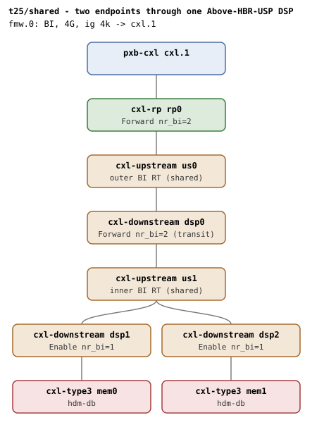
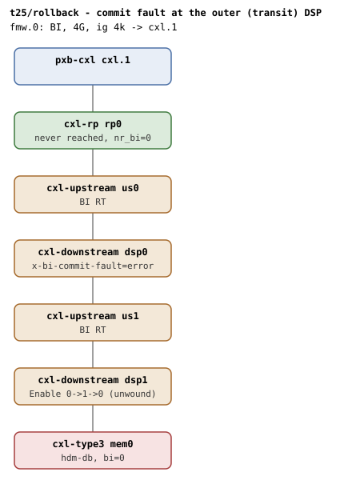
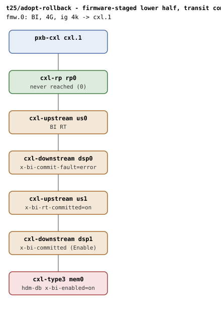
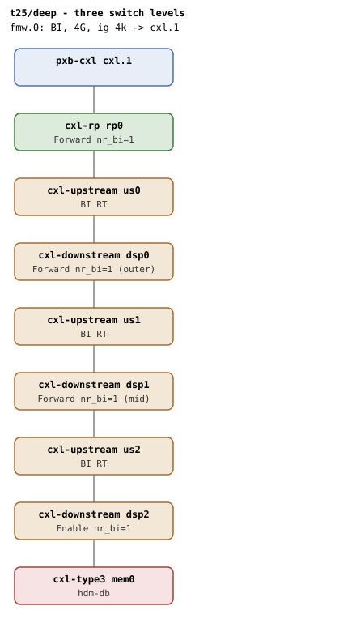
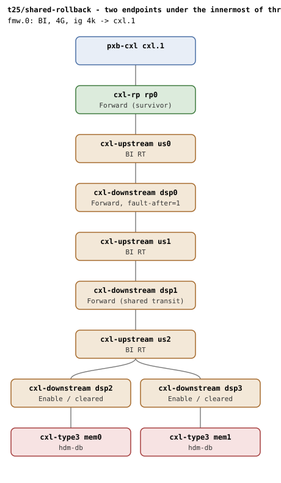

# t25 — multi-level switch BI invariants

| | |
|---|---|
| Topology script | `topos/t25-multiswitch.sh` |
| Checks | the topology script itself (host-driven, 5 boots) |
| Mode | host-driven |
| Outputs | `t25.tap`, `t25-shared.dmesg`, `t25-rollback.dmesg`, `t25-adopt-rollback.dmesg`, `t25-deep.dmesg`, `t25-shared-rollback.dmesg` (one per boot) |

## What it tests

What the spec defines for cascades, pinned by register readback rather
than inferred. Table 7-93: BISnp/BIRsp routing "relies on its vPPB
binding at each switch level" with the BI-ID carrying the adjacent
DSP's BusNum end to end — which requires Enable only at the adjacent
DSPs and Forward at the shared transit (Table 7-97 "Above HBR USP":
Propagate). A commit is owed per new device (Table 8-152/8-156), so a
shared transit sees one commit edge per endpoint, and teardown of the
first endpoint must NOT clear the shared transit (nr_bi refcount) while
the last one must. A commit fault at the transit level must unwind the
already-enabled adjacent level (and leave an adopted adjacent level
exactly as firmware had it), and the walk must be depth-agnostic across
three switch levels, including a rollback that must not clear a level a
survivor still holds.

## Topology

Shared conventions throughout: `x-256b-flit=on` on every port and
device, 1G volatile memdevs with `hdm-db=on`, one 4G BI window
(`cxl-fmw.0`, ig 4k, `back-invalidate=on`). See
[topologies.md](../topologies.md#t25--multi-level-switch-invariants-three-boots)
for the nr_bi transition table of the shared scenario.

### Scenario 1 — `shared`

`rp0 - us0 - dsp0 - us1 - {dsp1 - mem0, dsp2 - mem1}`: two endpoints
below different inner DSPs of the same inner switch, both reaching
through ONE outer (transit) DSP. Steady state (topologies.md): `rp0`
Forward nr_bi=2, `dsp0` Forward nr_bi=2, `dsp1`/`dsp2` Enable nr_bi=1.

### Scenario 2 — `rollback`

t9-shape cascade `rp0 - us0 - dsp0 - us1 - dsp1 - mem0` with
`x-bi-commit-fault=error` on the OUTER (transit) DSP `dsp0`.

### Scenario 3 — `adopt-rollback`

Scenario 2's cascade with the lower half staged by firmware: `mem0`
`x-bi-enabled=on`, `dsp1` `x-bi-committed=on`, `us1`
`x-bi-rt-committed=on`; `dsp0` still `x-bi-commit-fault=error`.

### Scenario 4 — `deep`

Three switch levels: `rp0 - us0 - dsp0 - us1 - dsp1 - us2 - dsp2 -
mem0`. Steady state (topologies.md): `dsp0`/`dsp1` Forward nr_bi=1,
`dsp2` Enable nr_bi=1; five BI decoders, three route tables, six
commits.

### Scenario 5 — `shared-rollback`

Three switch levels with two endpoints under the innermost one: `rp0 -
us0 - dsp0 - us1 - dsp1 - us2 - {dsp2 - mem0, dsp3 - mem1}`. The OUTER
transit `dsp0` carries `x-bi-commit-fault=error,x-bi-commit-fault-after=1`
so it faults its second commit.

## Semantics

Register roles are read from the BI Decoder capability (cap ID 0xC)
control register via `/dev/mem` (component block BAR0, cachemem at
+0x1000): `ctrl & 3` = 0 cleared, 1 Forward, 2 Enable. Dports on a
device's path are located from the memdev's resolved sysfs path
(adjacent = 2 levels up, transit = 4, and so on). Every boot ends with
the qemu BI oracle silent (qemu.log is per launch).

- **shared**: both endpoints must have probed before any BI state means
  anything (two memdevs under one switch race to create the ports they
  share, and the loser's `cxl_mem` probe can come back -EBUSY); the boot
  is retried once if a probe is incomplete, and the probe error is
  reported rather than the symptoms if it persists. Then: two "BI
  requests enabled", no "BI setup failed", at least 8 "BI-ID commit wait
  took" lines (per endpoint: adjacent decoder + inner RT, transit decoder
  + outer RT = 4 commit waits; the transit edges repeat per device), and
  transit Forward / adjacent A, B Enable / RP Forward. Unbinding the
  first endpoint from `cxl_pci`: "BI requests disabled", the commit count
  grows (dealloc commit at the adjacent), the transit holds Forward for
  the survivor, the first adjacent reads cleared, the survivor's adjacent
  stays Enable. Unbinding the last: transit and RP clear (dealloc step 6
  only once no device below holds a BI-ID). No splat (`SPLAT_RE`) across
  the teardown.
- **rollback**: the adjacent level enables and commits first (9.14.2
  allocate order); the transit commit failure ("BI-ID commit rejected by
  hardware", "BI setup failed") must unwind it: endpoint `bi=0` but
  present, adjacent reads 0 (was enabled), transit reads 0 (restored).
- **adopt-rollback**: the walk adopts the adjacent level (no write, no
  commit) and only the outer transit is programmed, where the commit
  faults. Unwinding must leave the adopted level exactly as firmware had
  it (adjacent still Enable = 2, since the driver never wrote it), the
  faulted transit restored (0), and the RP never reached (0). Scenario 2
  is the contrast, where nothing is adopted and the adjacent level is
  cleared.
- **deep**: "BI requests enabled" three levels down, no setup failure,
  at least 5 "found BI Decoder capability" (ep + rp + 3 dsp), at least 3
  "found BI RT capability" (3 USPs), at least 6 "BI-ID commit wait took";
  roles land by position: adjacent Enable, mid and outer transit
  Forward, RP Forward.
- **shared-rollback**: the first endpoint comes up whole; the second
  gets its own adjacent DSP and the shared inner transit, then fails
  above them at the outer transit's second commit. Its unwind must clear
  only what it programmed for itself: the shared inner transit drops a
  reference and keeps Forward, the refused endpoint's adjacent reads
  cleared, the survivor's adjacent keeps Enable, the outer transit holds
  Forward and the RP Forward. The enabled/refused endpoints are named
  from the "cxl_pci BDF: BI requests enabled" line (back_invalidate only
  tracks region membership). The survivor's path must still work end to
  end: a 256M, iw=1, ig=256 ram region created on the BI root decoder
  with the survivor's endpoint decoder commits. No splat.

## Checks

### Scenario 1 — `shared`: shared transit DSP refcount

| # | Check (TAP text) | Expected | Why |
|---|---|---|---|
| 1 | `shared: guest booted` | ok (fail exits) | - |
| 1' | `shared: guest booted (retry)` | `not ok` only when the retried boot fails (exit 1) | probe race retry |
| 2 | `shared: both endpoints probed` | mem0 and mem1 each have a driver link and an endpoint port (fail exits, probe errors echoed) | the loser's cxl_mem probe can come back -EBUSY |
| 3 | `shared: both endpoints BI enabled` | exactly 2 "BI requests enabled" | - |
| 4 | `shared: no setup failure` | no "BI setup failed" | - |
| 5 | `shared: commit edges per device (N1)` | N1 = count of "BI-ID commit wait took" >= 8 | 4 commit waits per endpoint; transit edges repeat per device |
| 6-9 | `# SKIP shared: register truth (no /dev/mem)` (x4) | four SKIPs when the transit role readback is empty | needs /dev/mem |
| 6' | `shared: transit Forward` | transit `ctrl & 3` = 1 | Table 7-97 Above HBR USP: Propagate |
| 7' | `shared: adjacent A Enable` | adjacent of mem0 = 2 | - |
| 8' | `shared: adjacent B Enable` | adjacent of mem1 = 2 | - |
| 9' | `shared: RP Forward` | RP = 1 | - |
| 10 | `shared: first endpoint disabled` | after unbinding mem0's BDF from cxl_pci, "BI requests disabled" (polled up to 30 times) | - |
| 11 | `shared: dealloc commit at adjacent (N1 -> N2)` | commit-wait count N2 > N1 | adjacent DSP clears and commits |
| 12-14 | `# SKIP shared: survivor register truth (no /dev/mem)` (x3) | three SKIPs when readback is empty | - |
| 12' | `shared: transit holds Forward for the survivor` | transit = 1 (fail text: `shared: transit cleared under the survivor`) | nr_bi refcount |
| 13' | `shared: first adjacent cleared` | adjacent of mem0 = 0 | - |
| 14' | `shared: survivor adjacent intact` | adjacent of mem1 = 2 | - |
| 15-16 | `# SKIP shared: last-out register truth (no /dev/mem)` (x2) | two SKIPs when readback is empty (after unbinding mem1, waiting for 2 "BI requests disabled") | - |
| 15' | `shared: transit cleared last-out` | transit = 0 | dealloc step 6 once no device below holds a BI-ID |
| 16' | `shared: RP cleared last-out` | RP = 0 | - |
| 17 | `shared: no splat across teardown` | dmesg has no `SPLAT_RE` match | - |
| 18 | `shared: qemu BI oracle silent` | 0 "CXL BI oracle" in qemu.log | - |

### Scenario 2 — `rollback`: transit commit fault, measured rollback

| # | Check (TAP text) | Expected | Why |
|---|---|---|---|
| 1-8 | `# SKIP rollback: qemu lacks x-bi-commit-fault` (x8) | eight SKIPs, no boot, when cxl-downstream lacks the knob | - |
| 1' | `rollback: guest booted` | ok (fail exits) | - |
| 2' | `rollback: transit commit diagnostic` | dmesg "BI-ID commit rejected by hardware" | - |
| 3' | `rollback: BI setup refused` | dmesg "BI setup failed" | - |
| 4' | `rollback: endpoint bi=0` | `endpoint*/decoder*.0/back_invalidate` = 0 | - |
| 5' | `rollback: endpoint survives` | mem0 sysfs path resolves | - |
| 6'-7' | `# SKIP rollback: register truth (no /dev/mem)` (x2) | two SKIPs when the adjacent readback is empty | - |
| 6'' | `rollback: adjacent unwound (was enabled)` | adjacent = 0 | adjacent enabled first (9.14.2 order); fault must unwind it |
| 7'' | `rollback: transit restored` | transit = 0 | - |
| 8' | `rollback: qemu BI oracle silent` | 0 oracle lines | - |

### Scenario 3 — `adopt-rollback`: adopted prefix survives a rollback

| # | Check (TAP text) | Expected | Why |
|---|---|---|---|
| 1-8 | `# SKIP adopt-rollback: qemu lacks the BI staging knobs` (x8) | eight SKIPs, no boot, unless cxl-type3 has `x-bi-enabled`, cxl-downstream `x-bi-committed` and `x-bi-commit-fault`, cxl-upstream `x-bi-rt-committed` | - |
| 1' | `adopt-rollback: guest booted` | ok (fail exits) | - |
| 2' | `adopt-rollback: transit commit diagnostic` | dmesg "BI-ID commit rejected by hardware" | - |
| 3' | `adopt-rollback: BI setup refused` | dmesg "BI setup failed" | - |
| 4' | `adopt-rollback: endpoint bi=0` | `back_invalidate` = 0 | - |
| 5'-7' | `# SKIP adopt-rollback: register truth (no /dev/mem)` (x3) | three SKIPs when the adjacent readback is empty | - |
| 5'' | `adopt-rollback: adopted level left as firmware had it` | adjacent = 2 | adopted, so this driver never wrote it: firmware's Enable stands |
| 6'' | `adopt-rollback: faulted transit restored` | transit = 0 | - |
| 7'' | `adopt-rollback: RP never reached` | RP = 0 | - |
| 8' | `adopt-rollback: qemu BI oracle silent` | 0 oracle lines | - |

### Scenario 4 — `deep`: three switch levels

| # | Check (TAP text) | Expected | Why |
|---|---|---|---|
| 1 | `deep: guest booted` | ok (fail exits) | - |
| 2 | `deep: BI enabled three levels down` | dmesg "BI requests enabled" | - |
| 3 | `deep: no setup failure` | no "BI setup failed" | - |
| 4 | `deep: BI decoder caps (ep+rp+3 dsp)` | >= 5 "found BI Decoder capability" | caps scale with depth |
| 5 | `deep: BI RT caps (3 USPs)` | >= 3 "found BI RT capability" | - |
| 6 | `deep: commits at all three levels (N)` | >= 6 "BI-ID commit wait took" | commits scale with depth |
| 7-10 | `# SKIP deep: register truth (no /dev/mem)` (x4) | four SKIPs when the adjacent readback is empty | - |
| 7' | `deep: adjacent Enable` | adjacent = 2 | roles land by position |
| 8' | `deep: mid transit Forward` | mid = 1 | - |
| 9' | `deep: outer transit Forward` | outer = 1 | - |
| 10' | `deep: RP Forward` | RP = 1 | - |
| 11 | `deep: qemu BI oracle silent` | 0 oracle lines | - |

### Scenario 5 — `shared-rollback`: rollback across a level a survivor holds

| # | Check (TAP text) | Expected | Why |
|---|---|---|---|
| 1-10 | `# SKIP shared-rollback: qemu lacks x-bi-commit-fault-after` (x10) | ten SKIPs, no boot, when cxl-downstream lacks the knob | - |
| 1' | `shared-rollback: guest booted` | ok (fail exits) | - |
| 2' | `shared-rollback: outer transit commit diagnostic` | dmesg "BI-ID commit rejected by hardware" | the outer transit faults its second commit |
| 3' | `shared-rollback: one endpoint refused` | dmesg "BI setup failed" | - |
| 4' | `shared-rollback: one endpoint BI enabled (UP), one not (DOWN)` | one memdev's BDF matches the "BI requests enabled" line, the other does not | back_invalidate only tracks region membership |
| 5'-9' | `# SKIP shared-rollback: register truth (no /dev/mem)` (x5) | five SKIPs when the inner-transit readback is empty | - |
| 5'' | `shared-rollback: shared transit holds Forward` | inner transit = 1 (fail text: `shared-rollback: shared transit cleared under the survivor`) | the shared transit drops a reference and keeps Forward |
| 6'' | `shared-rollback: refused endpoint's adjacent cleared` | refused endpoint's adjacent = 0 | unwind clears only what it programmed for itself |
| 7'' | `shared-rollback: survivor adjacent Enable` | survivor's adjacent = 2 | - |
| 8'' | `shared-rollback: outer transit holds Forward` | outer = 1 (fail text: `shared-rollback: outer transit (ROLE)`) | - |
| 9'' | `shared-rollback: RP Forward` | RP = 1 | - |
| 10' | `shared-rollback: survivor commits an HDM-DB region` | a 256M ram region on the BI root decoder with the survivor's endpoint decoder reads `commit` = 1 | the survivor's path still works end to end |
| 11' | `shared-rollback: no splat` | no `SPLAT_RE` match | - |
| 12' | `shared-rollback: qemu BI oracle silent` | 0 oracle lines | - |

## Skips and limitations

- Scenario 2 SKIPs (x8) when `cxl-downstream` lacks `x-bi-commit-fault`;
  scenario 3 SKIPs (x8) when any of `x-bi-enabled` (cxl-type3),
  `x-bi-committed` / `x-bi-commit-fault` (cxl-downstream),
  `x-bi-rt-committed` (cxl-upstream) is missing; scenario 5 SKIPs (x10)
  when `cxl-downstream` lacks `x-bi-commit-fault-after`. Scenarios 1 and
  4 need no extra knob.
- Every "register truth" block SKIPs when the `/dev/mem` readback of the
  first dport's BI Decoder control is empty.
- Scenario 1's boot is retried once when either endpoint's `cxl_mem`
  probe is incomplete; if it persists the suite fails and exits with the
  probe errors as TAP diagnostics.
- Any boot failure fails that line and exits; the EXIT trap still emits
  the plan and summary.
- Region data behind cascaded switches depends on the `cxl-bi-tests`
  QEMU branch routing CXL.mem through switches at any depth (README).

## Related

- [t9](t9.md) — the two-level cascade shape scenario 2 reuses.
- [t5](t5.md) — shared root port nr_bi refcount (the shared
  Above-HBR-USP variant is t25/shared).
- [t23](t23.md), [t24](t24.md) — the host-driven multi-boot style and
  the commit-fault / adoption knobs.
