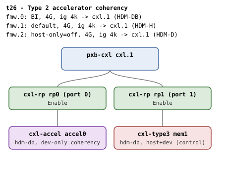

# t26 — Type 2 accelerator coherency (cxl-accel + HDM-DB)

| | |
|---|---|
| Topology script | `topos/t26-type2.sh` |
| Checks | the topology script itself (host-driven, 1 boot) |
| Mode | host-driven |
| Outputs | `t26.tap`, `t26.dmesg` |

## What it tests

The `cxl-accel` qemu device is a type3 subtype whose HDM Decoder
Capability advertises Supported Coherency Models = device-coherent
only. Positive arm: the accelerator commits an HDM-DB region with
`bi=1` - a Type 2 device on device-coherent memory, end to end.
Negative arm: the same accelerator is refused an HDM-H attach ("HDM is
device-coherent only") - the reject no other model can reach, since
type3 advertises host+dev - while the plain type3 attaches to the same
window as a control. The HDM-D window documents today's kernel gap: its
root decoder carries `cap_type2` without `cap_back_invalidate`, and
`can_create_ram()` offers no create attr for the DEVMEM-without-BI
combo, so the window is enumerable but not yet usable.

## Topology

One `pxb-cxl` with two RPs: `rp0` - `cxl-accel accel0` (`hdm-db=on`,
1G), `rp1` - `cxl-type3 mem1` (`hdm-db=on`, 1G). Three 4G windows at
4k granularity, all targeting `cxl.1`: `fmw.0` with
`back-invalidate=on` (HDM-DB), `fmw.1` default (HDM-H), `fmw.2` with
`host-only=off` (HDM-D). See
[topologies.md, t26](../topologies.md#t26--type-2-accelerator-coherency-one-boot).

## Semantics

The accelerator is found as the memdev whose PCI function has device
id `0x0d94`. The three windows are classified by root decoder flags:
`cap_back_invalidate=1` is the BI window, `cap_type2=1` with
`cap_type3=0` the HDM-D window, `cap_type3=1` the HDM-H window.

- The HDM-D root decoder must have no `create_ram_region` attr (the
  kernel gap, documented as a pass).
- Positive arm: a 1-way 256M region on the BI window with the
  accelerator's decoder `.0` must commit; the decoder reads
  `back_invalidate=1` and `target_type=accelerator`.
- Negative arm: on the HDM-H window, writing the accelerator's decoder
  `.1` to `target0` must fail, and dmesg must contain `HDM is
  device-coherent only`. The type3's decoder `.0` then attaches to the
  same region and commits.
- No splat, and the qemu BI oracle stays silent.

## Checks

| # | Check (TAP text) | Expected | Why |
|---|---|---|---|
| 0 | `# SKIP qemu lacks the cxl-accel device - suite reserved` | emitted alone, exit 0, when `$QEMU -device help` lacks `cxl-accel` | graceful skip rather than a boot timeout |
| 1 | guest booted | ok; `# SKIP qemu rejected the type2 topology - suite reserved` (exit 0) when the boot fails and the qemu/console log matches `not a valid device`, `invalid parameter` or `Property.*not found`; otherwise not ok + exit | a parameter rejection is an unsupported-qemu condition |
| 2 | accelerator memdev bound by the CXL core (MEM) | ok (exit on fail) | memdev whose PCI device id is 0x0d94 |
| 3 | windows classified (BI=.. H=.. D=..) | all three root decoders found | - |
| 4 | HDM-D window has no create attr (kernel gap documented) | `create_ram_region` absent on the HDM-D root decoder | can_create_ram() offers no create attr for DEVMEM-without-BI |
| 5 | accel HDM-DB region committed | `commit` = 1 | positive arm |
| 6 | accel back_invalidate=1 | `1` | - |
| 7 | accel decoder target_type=accelerator | `accelerator` | - |
| 8 | accel refused HDM-H attach | write to `target0` fails | negative arm |
| 9 | refusal names device-coherent-only HDM | dmesg `HDM is device-coherent only` | the reject no other model can reach |
| 10 | type3 control commits on the same HDM-H window | `commit` = 1 | control |
| 11 | no splat | no `SPLAT_RE` match | - |
| 12 | qemu BI oracle silent | no `CXL BI oracle` in `qemu.log` | - |

## Skips and limitations

- SKIPs when qemu lacks `cxl-accel` (one line) or rejects the topology
  at launch, e.g. no `host-only` window knob (one line after the boot
  attempt).
- The class-keyed HDM-H refusal ("HDM-H requires a Type 3 device") is
  out of reach from QEMU: every QEMU CXL endpoint model, `cxl-accel`
  included, keeps the Type 3 class code and binds `cxl_pci`. The
  refusal t26 exercises is the HDM `supported_coherency` check (README
  Known limitations).
- The HDM-D window is enumerable but not usable (kernel gap); the suite
  asserts the gap rather than a region on it.

## Related

[t29](t29.md) (Type 2 and Type 3 mixed under switches), [t27](t27.md)
(a `cxl-accel` reset scenario), [t30](t30.md) (HDM-D decoder vs window
restriction), [t16](t16.md) (shape (d), an HDM-D-committed accelerator
in a staged interleave set).
