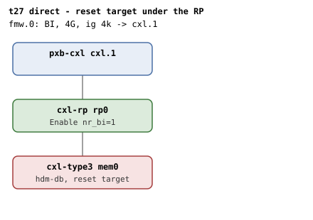
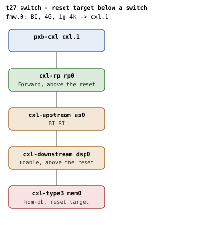
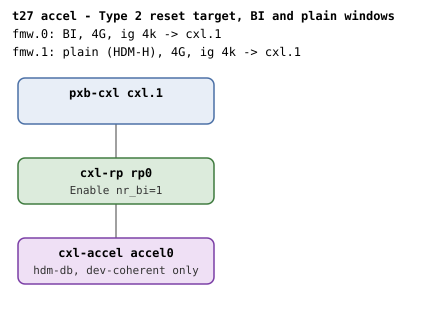

# t27 — BI state across a device reset

| | |
|---|---|
| Topology script | `topos/t27-reset.sh` |
| Checks | the topology script itself (host-driven, 8 boots) |
| Mode | host-driven |
| Outputs | `t27.tap`; one dmesg per boot: `t27-no-region.dmesg`, `t27-with-region.dmesg`, `t27-flr.dmesg`, `t27-flr-region.dmesg`, `t27-switch.dmesg`, `t27-adopt-reset.dmesg`, `t27-accel.dmesg`, `t27-held-reset.dmesg` (no combined `t27.dmesg`, per README) |

## What it tests

BI is enabled at endpoint probe, independently of any region, while the
kernel's only reset detection (`cxl_reset_done()` ->
`cxl_endpoint_decoder_reset_detected()`) keys off a previously committed
decoder. A reset that wipes the device's BI Decoder Control with no region
committed is therefore invisible: `cxlds->bi` stays true against BI Enable=0
in hardware, and a later HDM-DB region attach passes the `!cxlds->bi` gate on
a device that can no longer issue BISnp. The kernel compares `cxlds->bi`
against the hardware in `.reset_done` (`cxl_bi_reset_detected`) and fails
closed, and `cxl_bi_dealloc()` unwinds unconditionally so the invalidated
flag cannot leak the dport refcounts. Both are asserted hard; only the wipe
premise itself (does the emulated reset clear the register) still SKIPs. The
reset is driven through the kernel's own sysfs `reset` so the
`pci_error_handlers` `.reset_prepare`/`.reset_done` path runs; a raw setpci
poke would bypass it entirely. README: verified discriminating, the
invalidation assertions fail against a kernel without the fix.

## Topology

Three shapes over seven boots. All boots use `x-256b-flit=on` on every port
and endpoint, `hdm-db=on` on the endpoint, a 1G memory backend and one BI
window (`cxl-fmw.0`: 4G, ig 4k, `back-invalidate=on`, target `cxl.1`). See
[topologies.md](../topologies.md#t27--bi-across-a-device-reset-seven-boots).

| Boots | Scenario tags | Image | Particulars |
|---|---|---|---|
| 1-4, 6 | no-region, with-region, flr, flr-region, adopt-reset |  | direct attach, `cxl-type3 mem0` under `rp0`; adopt-reset adds `x-committed=hdm-db` (t24's adopt shape) |
| 5 | switch |  | `rp0 - us0 - dsp0 - mem0`, no staging knobs |
| 7 | accel |  | `cxl-accel accel0` under `rp0`, plus a second plain window `cxl-fmw.1` (4G, ig 4k, no back-invalidate) |
| 8 | held-reset |  | the switch shape, with `us0` `x-bi-rt-committed=on` and `dsp0` `x-bi-committed=on` (Enable + committed); `mem0` not firmware-enabled |

Direct attach puts the reset strictly below the RP, which is the
device-adjacent dport (Table 8-157) and must be untouched by the reset.

### Reset method and register readback

`do_reset <tag> <ep>` writes `cxl_bus` to the endpoint's `reset_method`
(pinning the CXL-aware SBR: with DEVCAP FLR advertised, `flr` outranks
`cxl_bus` and a bare reset write would FLR), echoes the method actually in
use as a `# <tag>: reset_method='...'` diagnostic, then writes 1 to
`/sys/bus/pci/devices/<ep>/reset`. The FLR legs instead write `flr` to
`reset_method`, SKIPping when the device does not advertise FLR.

`bi_ctrl <bdf>` reads BI Decoder Control (cap ID 0xC) from the device's
BAR0 component block (`resource` line 0 + 0x1000) via `/dev/mem`; it is
empty without `/dev/mem`, which produces the "(no /dev/mem)" SKIPs. Nothing
is staged from the guest in this suite - `/dev/mem` is read-only use here.
Bits: `ctrl&2` is BI Enable, `ctrl&3 == 2` Enable, `== 1` Forward, `== 0`
cleared.

Regions are built the same way the guest phase helpers do: geometry
(`interleave_granularity=256`, `interleave_ways=1`, size 256M), DPA reserved
on the endpoint decoder (`mode=ram`, `dpa_size`), attach as `target0`, then
`commit`. The BI root decoder is the `decoder0.*` with
`cap_back_invalidate=1`; the plain one (accel) is the first `decoder0.*`
with `create_ram_region` and no `cap_back_invalidate=1`.

## Semantics

1. **no-region** (SBR, nothing committed): the hardware clears BI Enable
   (qemu re-runs `cxl_component_register_init_common()` on device reset) and
   the RP's programming is untouched. `.reset_done` must notice and fail the
   software state closed ("BI disabled by reset"). The fail-closed
   consequence end to end: an HDM-DB attach must refuse ("BI not enabled on
   device"). The invalidated flag must not leak the dport refcounts: a
   `cxl_pci` unbind still clears the RP, quietly (no "BI already disabled in
   hardware" - hardware and software agree on off). Recovery is a rebind:
   no reprogramming in the handler, the enable path re-runs from scratch at
   probe ("BI requests enabled", endpoint and RP registers back), and the
   refused attach now commits with `bi=1`. If the emulated reset did not
   wipe the register the staleness premise is absent and the whole arc
   SKIPs.
2. **with-region** (SBR, HDM-DB region committed): the pre-existing
   decoder-based detection fires ("SBR happened without memory regions
   removal") - SKIP rather than fail if the emulated reset does not decommit
   the decoder - and the BI invalidation is reported alongside, with no
   fatal splat (`SPLAT_FATAL_RE`).
3. **flr** (FLR, nothing committed): an FLR leaves the CXL.cache/mem
   component registers alone, so `.reset_done` should find BI Enable still
   set and stay silent. Written hardware-first: warn iff the register was
   actually wiped (`wiped == warned`), so it lands correctly under either
   FLR model.
4. **flr-region** (FLR, HDM-DB region live): its own boot because leg 1
   leaves BI down on a qemu whose FLR wipes. Nothing may come down:
   decoder-loss detection silent, BI invalidation silent, BI Enable
   survived, region still committed with `bi=1`.
5. **switch** (SBR below a switch): the bus reset lands on the endpoint's
   bus, so the DSP keeps Enable and the RP keeps Forward (and their nr_bi);
   invalidation still fires, and the later unbind must unwind BOTH levels
   despite the invalidated flag - the multi-level form of the leak the
   unconditional dealloc exists to prevent.
6. **adopt-reset** (SBR of a firmware-adopted path): `x-committed=hdm-db`
   seeds the adopt (endpoint Enable set, decoder committed, region
   auto-assembled) and the SBR wipes that inheritance. Invalidation must
   fire exactly as for a driver-enabled path, and recovery must come up
   FRESH: the adopt seed is the endpoint Enable bit the reset just cleared,
   so the rebind window must show "BI requests enabled" and no "adopting
   firmware-enabled BI". The unbind also tears the dead auto-region down
   through a wiped decoder - a path no other scenario walks.
7. **accel** (SBR of a Type 2 accelerator with a committed HDM-DB region): a
   DEV-only device has no HDM-H fallback. Once the reset invalidates
   `cxlds->bi`, the HDM-DB gate refuses (reset consequence) and the
   coherency gate refuses the plain window (device nature) - nothing
   attachable remains until a rebind, after which the HDM-DB region commits
   again. The dead region is deleted first (the admin remedy the
   decoder-loss `dev_crit` implies).
8. **held-reset** (SBR below a held level): the staged DSP is found up at
   first use, so it is held; the walk writes nothing there and commits
   for the new device, brings the RP up from zero and enables the device.
   The SBR wipes the endpoint's BI and `.reset_done` invalidates
   `cxlds->bi`. The unbind that follows must leave the device alone (no
   "BI requests disabled"), keep the held DSP as found (Enable) and clear
   only the RP it brought up. A rebind starts from scratch: nothing
   adopted (the reset cleared the adoption seed), the DSP decoder and
   route table committed again (2 commit waits) with no write, the RP
   brought up again and the device enabled again.

## Checks

Shell variables are rendered generically. Where the `not ok` text differs
beyond an appended value it is given in the Expected column.

### Scenario 1: no-region

| # | Check (TAP text) | Expected | Why |
|---|---|---|---|
| 1 | no-region: guest booted | ok (fail exits the suite) | - |
| 2 | no-region: BI enabled at probe | "BI requests enabled" | BI is enabled at endpoint probe, independently of any region |
| 3-4 | (2-line SKIP block: "no-region: baseline registers (no /dev/mem)"; sets HAVE_MMIO=0) | | |
| 3 | no-region: endpoint BI Enable set | EP ctrl&2 == 2 | - |
| 4 | no-region: RP Enable (direct attach) | RP ctrl&3 == 2 | the RP is the device-adjacent dport (Table 8-157) |
| 5 | no-region: reset issued through the kernel | `do_reset` wrote the sysfs `reset` (fail exits) | so the pci_error_handlers path runs |
| 6 | no-region: memdev survives the reset | `mem0` present (polled 30x) | - |
| 7 | no-region: hardware cleared endpoint BI | EP ctrl&2 == 0 -> WIPED=1; SKIP "no-region: reset did not clear endpoint BI (CTRL)" if still set (WIPED=0); SKIP "no-region: hardware cleared endpoint BI (readback lost)" if readback empty; SKIP "no-region: hardware cleared endpoint BI (no /dev/mem)" without MMIO | not a kernel bug: the emulation simply did not wipe the BI Decoder |
| 8 | no-region: RP programming untouched by the reset | RP ctrl unchanged; not ok: "no-region: RP programming changed (A -> B)"; SKIP (same text) when readback lost or no MMIO | the reset is below the RP |
| 9-19 | (11-line SKIP block when WIPED != 1: "no-region: kernel invalidates cxlds->bi (premise absent)", "no-region: post-reset HDM-DB attach fails closed", "no-region: refusal names the device gate", "no-region: unbind quiet after invalidation", "no-region: post-reset unbind unwinds the RP", "rebind: endpoint re-probed", "rebind: BI re-enabled from scratch", "rebind: endpoint BI Enable back in hardware", "rebind: RP re-programmed Enable", "rebind: HDM-DB region commits again", "rebind: endpoint bi=1") | | |
| 9 | no-region: kernel invalidates cxlds->bi | "BI disabled by reset" | hardware lost BI Enable behind the driver's back, .reset_done must fail closed |
| 10 | no-region: post-reset HDM-DB attach fails closed | `echo DEC > REGION/target0` fails | must refuse rather than commit device-coherent memory over a device that can no longer issue BISnp |
| 11 | no-region: refusal names the device gate | "BI not enabled on device" | - |
| 12 | no-region: unbind quiet after invalidation | no "BI already disabled in hardware" after `cxl_pci` unbind (region deleted first) | the endpoint disable sees hardware and software agreeing on off |
| 13 | no-region: post-reset unbind unwinds the RP | RP ctrl&3 == 0; SKIP "no-region: post-reset unbind unwinds the RP (no /dev/mem)" | dealloc always unwinds |
| 14 | rebind: endpoint re-probed (MEM2) | a `mem*` appears under the endpoint after `cxl_pci` bind (polled 60x) | recovery is a rebind |
| 15 | rebind: BI re-enabled from scratch | "BI requests enabled" | dmesg was cleared before the reset, so the only enable this window can hold is the rebind's own |
| 16 | rebind: endpoint BI Enable back in hardware | EP ctrl&2 != 0; SKIP "... (no /dev/mem)" | - |
| 17 | rebind: RP re-programmed Enable | RP ctrl&3 == 2; SKIP "... (no /dev/mem)" | - |
| 18 | rebind: HDM-DB region commits again | new region `commit` == 1 | the attach the invalidated flag refused must now work end to end |
| 19 | rebind: endpoint bi=1 | new endpoint decoder `back_invalidate` == 1 | - |
| 20 | no-region: no splat across the reset | no `SPLAT_RE` match | - |
| 21 | no-region: qemu BI oracle silent | no "CXL BI oracle" in qemu.log | - |

### Scenario 2: with-region

| # | Check (TAP text) | Expected | Why |
|---|---|---|---|
| 1 | with-region: guest booted | ok (fail exits) | - |
| 2 | with-region: BI root decoder present (RD) | a `decoder0.*` with `cap_back_invalidate=1` (fail exits) | - |
| 3 | with-region: HDM-DB region committed | `commit` == 1 | - |
| 4 | with-region: endpoint bi=1 before the reset | `back_invalidate` == 1 | - |
| 5 | with-region: reset issued through the kernel | `do_reset` ok (not ok: "with-region: reset issued", exits) | - |
| 6 | with-region: decoder-loss detection fired | "SBR happened without memory regions removal" (polled 30x); SKIP "with-region: decoder-loss detection fired (decoder not decommitted by the emulated reset)" | the pre-existing decoder-based detection; nothing to see if the emulated reset does not decommit the decoder |
| 7 | with-region: BI invalidation reported alongside | "BI disabled by reset" | - |
| 8 | with-region: no BUG across the reset | no `SPLAT_FATAL_RE` match | - |
| 9 | with-region: qemu BI oracle silent | no "CXL BI oracle" | - |

### Scenario 3: flr

| # | Check (TAP text) | Expected | Why |
|---|---|---|---|
| 1 | flr: guest booted | ok (fail exits) | - |
| 2-3 | (2-line SKIP block when `echo flr > reset_method` fails: "flr: FLR issued (device does not advertise FLR)", "flr: invalidation tracks the hardware across FLR") | | |
| 2 | flr: FLR issued | `echo 1 > reset` succeeds | - |
| 3 | flr: invalidation tracks the hardware across FLR (wiped=W) | (ctrl&2 == 0) == ("BI disabled by reset" present); not ok: "flr: warn/wipe mismatch (ctrl=.. warned=..)"; SKIP "flr: invalidation tracks the hardware across FLR (no /dev/mem)" | hardware-first: warn iff the register was actually wiped |

### Scenario 4: flr-region

| # | Check (TAP text) | Expected | Why |
|---|---|---|---|
| 1 | flr-region: guest booted | ok (fail exits) | - |
| 2 | flr-region: HDM-DB region committed | `commit` == 1 | - |
| 3-7 | (5-line SKIP block when `flr` is not accepted as reset_method: "flr-region: post-FLR state (device does not advertise FLR)") | | |
| 3 | flr-region: FLR issued with the region live | always ok after the reset write | - |
| 4 | flr-region: decoder-loss detection stays silent | no "SBR happened without memory regions removal" | an FLR that preserved the committed decoder must leave that path silent too |
| 5 | flr-region: BI invalidation stays silent | no "BI disabled by reset" | - |
| 6 | flr-region: BI Enable survived the FLR | EP ctrl&2 != 0; not ok: "flr-region: BI Enable wiped by the FLR"; SKIP "flr-region: BI Enable survived (no /dev/mem)" | - |
| 7 | flr-region: region still committed, bi=1 | `commit` == 1 and `back_invalidate` == 1; not ok: "flr-region: region survived (commit=.. bi=..)" | - |

No oracle or splat line in scenarios 3-4.

### Scenario 5: switch

| # | Check (TAP text) | Expected | Why |
|---|---|---|---|
| 1 | switch: guest booted | ok (fail exits) | - |
| 2 | switch: reset issued through the kernel | `do_reset` ok (fail exits) | - |
| 3-8 | (6-line SKIP block when EP readback is empty or Enable still set: "switch: post-reset state (premise absent: ctrl='..')") | | |
| 3 | switch: hardware cleared endpoint BI | EP ctrl&2 == 0 | - |
| 4 | switch: kernel invalidates cxlds->bi | "BI disabled by reset" | - |
| 5 | switch: DSP keeps Enable | DSP ctrl&3 == 2 | levels above the reset boundary keep their programming |
| 6 | switch: RP keeps Forward | RP ctrl&3 == 1 | - |
| 7 | switch: unbind unwinds the DSP | DSP ctrl&3 == 0 after `cxl_pci` unbind | the invalidated flag must not leak either level |
| 8 | switch: unbind unwinds the RP | RP ctrl&3 == 0 | - |
| 9 | switch: no splat | no `SPLAT_RE` match | - |
| 10 | switch: qemu BI oracle silent | no "CXL BI oracle" | - |

### Scenario 6: adopt-reset (11-line SKIP block: "adopt-reset: qemu cxl-type3 lacks x-committed")

| # | Check (TAP text) | Expected | Why |
|---|---|---|---|
| 1 | adopt-reset: guest booted | ok (fail exits) | - |
| 2 | adopt-reset: endpoint adopted at probe | "adopting firmware-enabled BI" | t24 proves adoption; every reset above hits a driver-enabled path |
| 3 | adopt-reset: reset issued through the kernel | `do_reset` ok (fail exits) | - |
| 4-9 | (6-line SKIP block when EP readback is empty or Enable still set: "adopt-reset: post-reset state (premise absent: ctrl='..')") | | |
| 4 | adopt-reset: hardware cleared the adopted Enable | EP ctrl&2 == 0 | the SBR wipes that inheritance |
| 5 | adopt-reset: invalidation fires on an adopted path | "BI disabled by reset" | exactly as for a driver-enabled path |
| 6 | adopt-reset: endpoint re-probed (MEM2) | `mem*` reappears after `cxl_pci` unbind, dmesg clear, bind | the unbind also tears the dead auto-region down through a wiped decoder |
| 7 | adopt-reset: recovery enables from scratch | "BI requests enabled" | the adopt seed is the Enable bit the reset just cleared |
| 8 | adopt-reset: no re-adopt of the wiped seed | no "adopting firmware-enabled BI" | a rebind that "adopts" anything is reading state that no longer exists |
| 9 | adopt-reset: endpoint Enable back | EP ctrl&2 != 0; SKIP "adopt-reset: endpoint Enable back (no /dev/mem)" | - |
| 10 | adopt-reset: no splat | no `SPLAT_RE` match | - |
| 11 | adopt-reset: qemu BI oracle silent | no "CXL BI oracle" | - |

### Scenario 7: accel (14-line SKIP block: "accel: qemu lacks the cxl-accel device"; a second 14-line block "accel: qemu rejected the type2 topology" when the boot fails and qemu.log/console show "not a valid device", "invalid parameter" or "Property.*not found" - the suite then exits)

| # | Check (TAP text) | Expected | Why |
|---|---|---|---|
| 1 | accel: guest booted | ok within 200s (otherwise the rejection SKIP block above, or fail + exit) | - |
| 2 | accel: memdev is the accel function (0x0d94) | PCI `device` == 0x0d94 | - |
| 3 | accel: BI enabled at probe | "BI requests enabled" | - |
| 4 | accel: HDM-DB region committed | `commit` == 1 on the BI window | both windows exist so both refusals are reachable |
| 5 | accel: reset issued through the kernel | `do_reset` ok (fail exits) | - |
| 6-11 | (6-line SKIP block when EP readback is empty or Enable still set: "accel: post-reset state (premise absent: ctrl='..')") | | |
| 6 | accel: hardware cleared endpoint BI | EP ctrl&2 == 0 | - |
| 7 | accel: kernel invalidates cxlds->bi | "BI disabled by reset" | - |
| 8 | accel: post-reset HDM-DB attach fails closed | after deleting the dead region, a fresh BI-window region's `target0` attach fails | the dead region blocks the decoder; its delete is the admin remedy the decoder-loss dev_crit implies |
| 9 | accel: no HDM-H window left either | attach to a region on the plain window fails; SKIP "accel: no HDM-H window left either (no plain window)" if no plain root decoder is found | the device-coherent-only gate closes the other window |
| 10 | accel: endpoint re-probed (MEM2) | `mem*` reappears after `cxl_pci` unbind/bind | - |
| 11 | accel: rebind HDM-DB region commits again | new region `commit` == 1 | the refused HDM-DB attach must work end to end again |
| 12 | accel: no splat | no `SPLAT_RE` match | - |
| 13 | accel: qemu BI oracle silent | no "CXL BI oracle" | - |

### Scenario 8: held-reset (12-line SKIP block: "held-reset: qemu lacks x-bi-committed/x-bi-rt-committed")

| # | Check (TAP text) | Expected | Why |
|---|---|---|---|
| 1 | held-reset: guest booted | ok (fail exits) | - |
| 2 | held-reset: staged DSP found up, device enabled by the driver | DSP ctrl&3 == 2, RP ctrl&3 == 1, "BI requests enabled", no "adopting firmware-enabled BI" | the device is not firmware-enabled, so nothing is adopted |
| 3 | held-reset: reset issued through the kernel | `do_reset` ok (fail exits) | - |
| 4-10 | (7-line SKIP block when EP readback is empty or Enable still set: "held-reset: post-reset state (premise absent: ctrl='..')") | | |
| 4 | held-reset: hardware cleared endpoint BI | EP ctrl&2 == 0 | - |
| 5 | held-reset: kernel invalidates cxlds->bi | "BI disabled by reset" | - |
| 6 | held-reset: unbind leaves the reset device alone | no "BI requests disabled" | `cxlds->bi` was invalidated |
| 7 | held-reset: unbind keeps the held DSP as found | DSP ctrl&3 == 2 | a level found up is never cleared |
| 8 | held-reset: unbind clears the RP it brought up | RP ctrl&3 == 0 | - |
| 9 | held-reset: rebind enables from scratch | "BI requests enabled", no "adopting firmware-enabled BI" | the reset cleared the adoption seed |
| 10 | held-reset: rebind commits the held DSP again, path up | exactly 2 "BI-ID commit wait took", DSP ctrl&3 == 2, RP ctrl&3 == 1 | a commit is owed per device newly enabled below |
| 11 | held-reset: no splat | no `SPLAT_RE` match | - |
| 12 | held-reset: qemu BI oracle silent | no "CXL BI oracle" | - |

## Skips and limitations

- Wipe premise: scenarios 1, 5, 6 and 7 SKIP their post-reset blocks when
  the emulated reset does not clear the endpoint's BI Decoder Control (or
  the readback is unavailable); scenario 2 SKIPs the decoder-loss line when
  the emulated reset does not decommit the decoder. README: a guest
  secondary bus reset returns hardware defaults instead of re-applying the
  firmware staging, which is what lets t27 reset a firmware-adopted path.
- FLR legs (3, 4) SKIP when the cxl-type3 does not advertise DEVCAP FLR
  (`flr` rejected as `reset_method`); they run live against the
  faithful-FLR qemu (CXL.cache/mem component registers preserved).
- The SBR scenarios pin `reset_method=cxl_bus`; `do_reset` only reports the
  method in use as a diagnostic and does not fail if the pin did not take.
- Register readbacks need `/dev/mem` in the guest; without it the baseline
  lines SKIP and, since the wipe cannot be observed, the premise-dependent
  blocks SKIP too.
- Scenario 6 SKIPs without `x-committed` on cxl-type3; scenario 7 without
  the `cxl-accel` device, or when qemu rejects the type2 topology.
- Boot or reset-issue failures `exit 1`, ending the suite early.
- README (Known limitations): the accelerator refusal t27 exercises is the
  HDM `supported_coherency` check; the class refusal is covered by ndctl's
  `test/cxl-back-invalidate.sh` under `cxl_test type2_test=1`.

## Related

- [t24](t24.md): firmware adoption; scenario 6 here resets t24's adopt shape.
- [t28](t28.md): the same direct-attach shape under AER fatal-error recovery,
  a path that never runs `.reset_prepare`/`.reset_done`.
- [t26](t26.md): the `cxl-accel` device-coherent-only refusal in a non-reset
  setting.
- [t34](t34.md): BI Enable cleared behind the driver via `/dev/mem` standing
  in for a reset `.reset_done` never sees, and an SBR between attach and
  commit.
