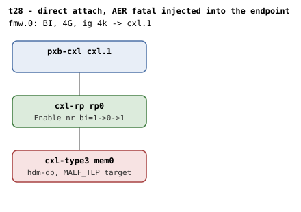

# t28 — BI across AER fatal-error recovery (bounce -> wipe -> rebind)

| | |
|---|---|
| Topology script | `topos/t28-aer.sh` |
| Checks | the topology script itself (host-driven, 2 boots) |
| Mode | host-driven |
| Outputs | `t28.tap`, `t28-aer.dmesg`, `t28-region.dmesg` (one per boot) |

## What it tests

A sysfs reset (t27) runs the `pci_error_handlers` `.reset_done` path;
an AER Uncorrectable Fatal takes an entirely different one. The chain,
end to end: the endpoint reports the error, the root port's AER irq
thread runs `pcie_do_recovery(io_frozen)`, `cxl_error_detected()`
bounces the memdev driver (`device_release_driver`) BEFORE the link
reset — tearing region, decoders and BI down through the normal devres
cascade — then `aer_root_reset()` pulses a secondary bus reset with
`PCI_RESET_NO_RESTORE`, so `.reset_prepare`/`.reset_done` NEVER run and
`cxl_bi_reset_detected()` has no role by construction: the unbind
precedes the wipe. `cxl_slot_reset()` then restores config space and
`device_attach()` rebinds the memdev synchronously, re-running the BI
enable path from scratch. Scenario A follows the whole chain with no
region; scenario B does it with a committed HDM-DB region live.

## Topology

t27's direct-attach shape: `cxl.1 - rp0 - mem0` (1G, `hdm-db=on`,
`x-256b-flit=on` on RP and device), one 4G BI window (`cxl-fmw.0`, ig
4k, `back-invalidate=on`). The guest boots with `pcie_ports=native`
(prepended to `EXTRA_APPEND`) so the OS claims AER regardless of _OSC.
Both boots inject `pcie_aer_inject_error mem0 MALF_TLP` through qemu's
HMP (MALF_TLP is fatal by the device's default Uncorrectable Error
Severity register; INTN would be masked by default and never reach the
guest). See
[topologies.md](../topologies.md#t28--aer-fatal-error-recovery-two-boots)
for the `rp0` nr_bi round-trip (1 -> 0 at the bounce -> 1 after slot
reset + attach).

## Semantics

Recovery runs in the AER irq thread, async to the injection; the script
clears dmesg before injecting and polls (up to 90 s) for the terminal
verdict from pcie/err.c ("device recovery successful|failed").

- **Scenario A (`aer`, no region)**: after the premise checks (AER
  sysfs attrs on the RP, `cxl_error_detected` in kallsyms) and an
  optional readback that the endpoint's BI Decoder Control (cap ID 0xC,
  via `/dev/mem`) has BI Enable (bit 1) set at probe, the fatal error is
  injected and the chain is followed by its always-on printks: the root
  port saw "Uncorrectable (Fatal) error message received",
  `cxl_error_detected` logged "frozen state error detected, disable
  CXL.mem", BI came down orderly ("BI requests disabled"), "Root Port
  link has been reset (0)", "restart CXL.mem after slot reset", "error
  resume successful", "device recovery successful". Because of
  `PCI_RESET_NO_RESTORE`, neither "BI disabled by reset" nor "SBR
  happened without" may appear (`.reset_done` is not part of AER
  recovery, so neither invalidation nor the decoder-loss taint may
  fire). The rebind must log "BI requests enabled" again, the endpoint
  BI Enable must read back set in hardware and the RP control must read
  Enable (`ctrl & 3` = 2). Finally a fresh 256M, iw=1, ig=256 HDM-DB
  ram region on the BI-capable root decoder must commit with the
  endpoint decoder at `back_invalidate=1`.
- **Scenario B (`region`, committed HDM-DB region)**: the same region
  is created first, then the error is injected. The bounce must fire
  with the live region and recovery must succeed. A user-created region
  is not deleted by the bounce: the devres cascade detaches its
  endpoint decoder and the region decommits (`commit` = 0), but the
  region object is left for userspace to delete (the check also accepts
  the region being gone). A fresh region must then commit again
  post-recovery.
- **Splats**: any WARNING/BUG fails, except the one known upstream
  lockdep this suite itself surfaced — AER recovery takes `pci_bus_sem`
  (`pci_walk_bus`) then the memdev lock (`cxl_error_detected`),
  inverting the probe-side memdev -> port -> `pci_bus_sem` order.
  Pre-existing, no BI code in any chain; diagnosed (TAP comment), not
  failed. `SPLAT_FATAL_RE` matches always fail.
- The qemu BI oracle must stay silent on each boot.

## Checks

### Scenario A — `aer`: fatal error with no region

| # | Check (TAP text) | Expected | Why |
|---|---|---|---|
| 1 | `aer: launch` | `not ok` only on launch failure (exit 1) | - |
| 2 | `aer: guest booted` | ok (fail exits) | - |
| 3 | `# SKIP aer: premise absent (guest kernel lacks CONFIG_PCIEAER)` | SKIP + exit 0 when no `aer_rootport*` attr under the RP's PCI device | premise, not failure |
| 3' | `# SKIP aer: premise absent (guest kernel lacks CONFIG_CXL_RAS)` | SKIP + exit 0 when `cxl_error_detected` is not in /proc/kallsyms | else cxl_error_detected is a stub and the bounce never happens |
| 3'' | `aer: kernel AER + CXL_RAS present` | ok when both premises hold | - |
| 4 | `aer: BI enabled at probe` / `# SKIP aer: BI enabled at probe (no /dev/mem readback: 'EC')` | ok when endpoint BI ctrl bit 1 set; SKIP when the readback is empty or the bit is clear | - |
| 5 | `aer: MALF_TLP injected` / `# SKIP aer: qemu rejected AER injection: R` | ok when HMP answers "OK id: mem0"; else SKIP + exit 0 | qemu must accept the HMP injection |
| 6 | `aer: recovery reached a verdict` | `not ok` only when no verdict within 90 polls (exit 1, last 30 dmesg lines as diagnostics) | - |
| 6' | `aer: root port saw the fatal error` | dmesg "Uncorrectable (Fatal) error message received" | - |
| 7 | `aer: cxl_error_detected bounced the memdev` | dmesg "frozen state error detected, disable CXL.mem" | bounce before the link reset |
| 8 | `aer: bounce brought BI down orderly (devres)` | dmesg "BI requests disabled" | - |
| 9 | `aer: link reset pulsed` | dmesg "Root Port link has been reset (0)" | - |
| 10 | `aer: cxl_slot_reset re-attached the memdev` | dmesg "restart CXL.mem after slot reset" | - |
| 11 | `aer: error resume successful` | dmesg "error resume successful" | - |
| 12 | `aer: device recovery successful` | dmesg "device recovery successful" | - |
| 13 | `aer: .reset_done correctly absent from the AER path` | neither "BI disabled by reset" nor "SBR happened without" in dmesg | PCI_RESET_NO_RESTORE: unbind preceded the wipe |
| 14 | `aer: rebind re-ran the BI enable path` | dmesg "BI requests enabled" | - |
| 15 | `aer: endpoint BI Enable back in hardware` / `# SKIP aer: endpoint BI Enable back in hardware (no /dev/mem)` | endpoint ctrl bit 1 set; SKIP when readback empty | - |
| 16 | `aer: RP re-programmed Enable` / `# SKIP aer: RP re-programmed Enable (no /dev/mem)` | RP `ctrl & 3` = 2; SKIP when readback empty | - |
| 17 | `aer: HDM-DB region commits, bi=1 (REGION)` | fresh region `commit` = 1 and endpoint decoder `back_invalidate` = 1 (fail text `aer: HDM-DB region commits (no decoder)` when no decoder is found) | - |
| 18 | `aer: no splat` / `aer: no splat beyond the known upstream lockdep` | no WARNING, or only "possible circular locking" WARNINGs with `cxl_error_detected` in dmesg; any `SPLAT_FATAL_RE` fails | known upstream lockdep, diagnosed not failed |
| 19 | `aer: qemu BI oracle silent` | 0 "CXL BI oracle" in qemu.log | - |

### Scenario B — `region`: fatal error with a committed HDM-DB region

| # | Check (TAP text) | Expected | Why |
|---|---|---|---|
| 1 | `region: launch` | `not ok` only on launch failure (exit 1) | - |
| 2 | `region: guest booted` | ok (fail exits) | - |
| 3 | `region: HDM-DB region commits, bi=1 (REGION)` | region created and committed before injection (fail text `region: HDM-DB region commits (no decoder)`) | - |
| 4 | `# SKIP region: qemu rejected AER injection` | SKIP + exit 0 when HMP does not answer "OK id: mem0" | - |
| 5 | `region: recovery reached a verdict` | `not ok` only when no verdict within 90 polls (exit 1) | - |
| 5' | `region: bounce fired with a live region` | dmesg "frozen state error detected, disable CXL.mem" | - |
| 6 | `region: device recovery successful` | dmesg "device recovery successful" | - |
| 7 | `region: bounce detached and decommitted the live region` / `region: bounce detached and decommitted the live region (deleted)` | live region `commit` = 0, or the region is gone; fail text `region: bounce left the live region committed (C)` | user-created region is detached and decommitted, never deleted |
| 8 | `region: no splat` / `region: no splat beyond the known upstream lockdep` | as in scenario A | - |
| 9 | `region: post-recovery: HDM-DB region commits, bi=1 (REGION)` | a fresh region commits with `bi=1` after recovery | recovery must come back to a working BI path |
| 10 | `region: qemu BI oracle silent` | 0 oracle lines | - |

## Skips and limitations

- Premise SKIPs (suite exits 0): the guest kernel must have
  CONFIG_PCIEAER (`aer_rootport_*` sysfs attrs on the RP) and
  CONFIG_CXL_RAS (which needs ACPI_APEI_GHES, per README) — without them
  `cxl_error_detected` is a stub returning `PCI_ERS_RESULT_NONE` and
  recovery silently degrades to a bare link reset; and qemu must accept
  the HMP injection (either boot SKIPs and exits otherwise).
- Register readbacks (`BI enabled at probe`, `endpoint BI Enable back in
  hardware`, `RP re-programmed Enable`) SKIP without `/dev/mem`.
- The known upstream lockdep (AER recovery `pci_bus_sem` ->
  `cxl_memdev_key` vs cxl probe memdev -> port -> `pci_bus_sem`) is
  reported as a TAP diagnostic and does not fail the suite; any other
  splat does (README Known limitations).
- Any launch, boot, or missing-verdict failure exits; the EXIT trap
  still emits the plan and summary.

## Related

- [t27](t27.md) — sysfs reset through `.reset_prepare`/`.reset_done`,
  the path AER recovery does not take; same direct-attach shape.
- [t1](t1.md) — the direct-attach steady state (RP Enable, nr_bi=1).
