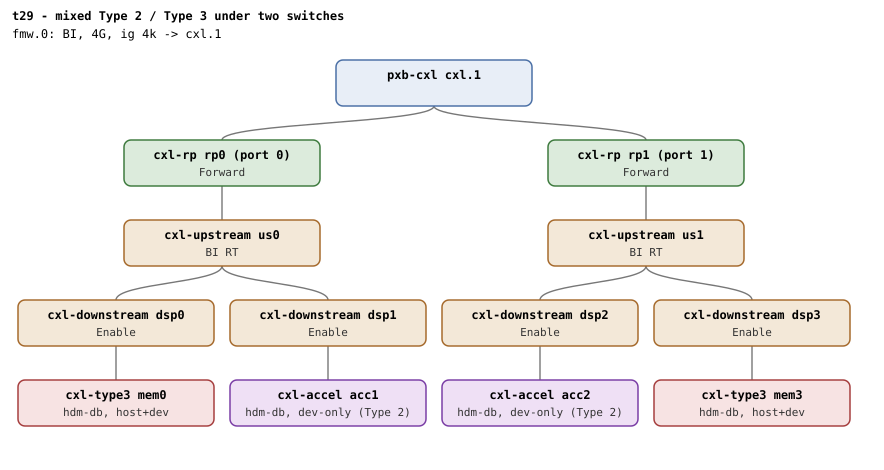

# t29 — complex topology mixing Type 2 and Type 3 devices

| | |
|---|---|
| Topology script | `topos/t29-mixed-type.sh` |
| Checks | the topology script itself (host-driven, 1 boot) |
| Mode | host-driven |
| Outputs | `t29.tap`, `t29.dmesg` |

## What it tests

BI where device coherency is heterogeneous: two switches, each carrying
one Type 2 accelerator and one Type 3 expander behind a shared BI
window. All four commit their own HDM-DB region; the two accelerators
inherit `target_type=accelerator`, the expanders too (HDM-DB is
device-coherent regardless of device class). A 2-way HDM-DB region
interleaves a Type 2 and a Type 3 target under one switch -
mixed-coherency back-invalidate in one region. Teardown leaves every
decoder reverted with no leak or splat.

## Topology

One `pxb-cxl` with two RPs, each with a USP and two DSPs: `rp0/us0`
carries `cxl-type3 mem0` (dsp0) and `cxl-accel acc1` (dsp1); `rp1/us1`
carries `cxl-accel acc2` (dsp2) and `cxl-type3 mem3` (dsp3). All four
`hdm-db=on` with 1G memdevs; one BI window. See
[topologies.md, t29](../topologies.md#t29--mixed-type-2--type-3-one-boot).

## Semantics

The script builds a device table (`memN type sw dec`) from sysfs: type
2 iff the PCI device id is `0x0d94`, `sw` the middle `cxl-port` of the
endpoint path, `dec` the endpoint decoder `.0`. It is printed as `#`
diagnostics. The BI root decoder is the first with
`cap_back_invalidate=1`.

- **Leg 1.** Each device gets its own 1-way 256M HDM-DB region; every
  `commit` must read 1 with `back_invalidate=1` and
  `target_type=accelerator` on every decoder (a failed commit prints
  `# memN(dec) commit failed`). No splat. The singletons are torn down
  and `dpa_size` reset before leg 2.
- **Leg 2.** The first switch group holding both a type 3 and a type 2
  is picked; a 2-way 512M region (256 granularity) with `target0` the
  type 3 and `target1` the type 2 must commit with `bi=1` on both. The
  region is deleted; no splat. If no switch holds both classes the leg
  is one SKIP.
- **Teardown hygiene.** After a 1s settle, no endpoint decoder may
  still read `back_invalidate=1`, and the qemu BI oracle must be
  silent.

## Checks

| # | Check (TAP text) | Expected | Why |
|---|---|---|---|
| 0 | `# SKIP qemu lacks the cxl-accel device - suite reserved` | emitted alone, exit 0, when `$QEMU -device help` lacks `cxl-accel` | - |
| 1 | guest booted | ok; `# SKIP qemu rejected the mixed topology - suite reserved` (exit 0) when the boot fails with `not a valid device`, `invalid parameter` or `Property.*not found` in the logs; otherwise not ok + exit | - |
| 2 | four devices bound: 2 Type 2, 2 Type 3 | 2 and 2 (fail text: `device mix (type2=N type3=M)`) | - |
| 3 | BI window present (RD) | a root decoder with `cap_back_invalidate=1` (exit on fail) | - |

Leg 1, each device commits its own HDM-DB region:

| # | Check (TAP text) | Expected | Why |
|---|---|---|---|
| 4 | every device (type2 and type3) commits HDM-DB, bi=1 | all four `commit=1`, `back_invalidate=1` (fail text: `every device commits HDM-DB, bi=1`) | - |
| 5 | every HDM-DB decoder inherits target_type=accelerator | `accelerator` on all four (fail text: `target_type=accelerator on all`) | HDM-DB is device-coherent regardless of device class |
| 6 | leg1: no splat | no `SPLAT_RE` match | - |

Leg 2, mixed 2-way interleave under one switch:

| # | Check (TAP text) | Expected | Why |
|---|---|---|---|
| 7 | mixed 2-way HDM-DB region commits (T3 + T2) | `commit=1`; the three leg-2 lines are replaced by one `# SKIP mixed interleave (no type2+type3 sharing a switch)` when no switch holds both | mixed-coherency back-invalidate in one region |
| 8 | both interleave targets bi=1 (type3 and type2) | `1` and `1` | - |
| 9 | leg2: no splat | no `SPLAT_RE` match | - |

Teardown hygiene:

| # | Check (TAP text) | Expected | Why |
|---|---|---|---|
| 10 | all decoders reverted after teardown | no endpoint decoder with `back_invalidate=1` (fail text: `decoders still bi=1 after teardown (N)`) | no leak |
| 11 | qemu BI oracle silent | no `CXL BI oracle` in `qemu.log` | - |

## Skips and limitations

- SKIPs wholesale when qemu lacks `cxl-accel`, or when it rejects the
  topology at launch.
- Leg 2 SKIPs if no switch group carries both device classes (with
  this topology both groups do, so the selection is topology-robust -
  topologies.md).
- Needs QEMU with CXL.mem routed through switches (README).

## Related

[t26](t26.md) (the single-accelerator coherency gate), [t5](t5.md)
(2-way under one switch, Type 3 only), [t33](t33.md) (same two-RP,
two-switch shape, 4-way).
