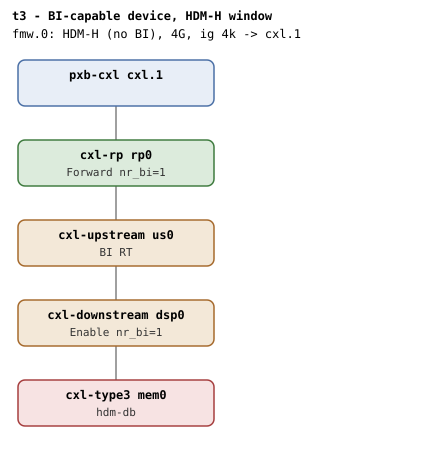

# t3 — BI-capable device under a plain (HDM-H) CFMWS

| | |
|---|---|
| Topology script | `topos/t3-hdmh-cfmws.sh` |
| Checks | `guest/run-tests.sh` (`t3)` case) |
| Mode | guest-driven |
| Outputs | `t3.tap`, `t3.dmesg` (plus `t3.kmemleak` only when the host-side kmemleak scan reports unreferenced objects) |

## What it tests

Same topology as t2 (BI-capable device under a switch), but the
machine's CFMWS carries no back-invalidate restriction. Models a
BI-capable Type 3 device attached to a host that doesn't expose an
HDM-DB window: the device stays functional as HDM-H. Expectations from
the script: `cxl_bi_setup` succeeds on the topology and `cxlds->bi=1`
(the device path is BI-capable end-to-end); the root decoder's
`cap_back_invalidate=0`; a ram region created via the root decoder is
HOSTONLYMEM and the endpoint decoder's `bi` stays 0 after commit;
forcing the endpoint decoder into an HDM-DB region is impossible because
no BI-restricted root decoder exists.

## Topology

t2's shape (`rp0` -> `us0` -> `dsp0` -> `mem0`, all `x-256b-flit=on`,
`mem0` with `hdm-db=on`), but the only window is 4G,
`interleave-granularity=4k`, with no `back-invalidate` flag. Per
[topologies.md](../topologies.md#t3--bi-capable-device-hdm-h-window) BI
setup is window-independent, so the path still enables (`dsp0`/`rp0`
nr_bi=1) even though no BI root decoder exists.

## Semantics

Single phase. ABI presence on root and endpoint decoders. There must be
no root decoder with `cap_back_invalidate=1`; the suite then takes the
first root decoder with `cap_back_invalidate=0` as the HDM-H root. A
1-way 256M ram region is created and committed there; the endpoint
decoder must read `target_type=expander` (HOSTONLYMEM) and
`back_invalidate=0`. The BI walk itself must have found the topology
capable (no `BI setup failed` in dmesg) but there was nothing on the
CFMWS side to commit BI decoders for. The region is destroyed at the
end; no post-destroy check is made.

## Checks

| # | Check (TAP text) | Expected | Why |
|---|---|---|---|
| 1 | cap_back_invalidate present on all root decoders (N found) | ok; `not ok` as `DECODER/cap_back_invalidate missing` or `... has bogus value 'V'` | - |
| 2 | back_invalidate present on all endpoint decoders (N found) | ok; `not ok` variants: `.../back_invalidate missing`, `... has bogus value 'V'`, `no endpoint decoders enumerated` | - |
| 3 | no BI root decoder present (as expected) | ok; `not ok - unexpected BI root decoder RD (CFMWS has no BI)` | CFMWS has no BI flag |
| 4 | create HDM-H region on HDM-H CFMWS | ok; `not ok - create HDM-H region` then exit. Preceded by `not ok - no HDM-H root decoder` + exit if none | - |
| 5 | commit HDM-H region | ok | - |
| 6 | endpoint decoder target_type=expander (HOSTONLYMEM) | expander | Region created under a non-BI root inherits HOSTONLYMEM |
| 7 | endpoint bi=0 (HDM-H) | 0 | - |
| 8 | no 'BI setup failed' in dmesg | ok | The BI walk must have found the topology capable |

Host-side (run-all.sh), folded into `t3.tap` only on failure:
`not ok - qemu BI oracle silent`.

## Skips and limitations

No SKIP lines. `cxlds->bi=1` is asserted only indirectly, through the
absence of `BI setup failed`; the dport `nr_bi=1` stated in topologies.md
is not read back by this suite.

## Related

- [t2](t2.md) — same topology with the BI window.
- [t14](t14.md), [t15](t15.md) — the other suites first-principles.md
  lists for "BI is optional for a Type 3 device" (rule 1.4).
