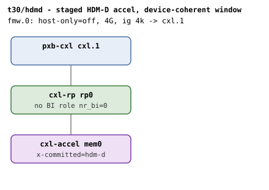
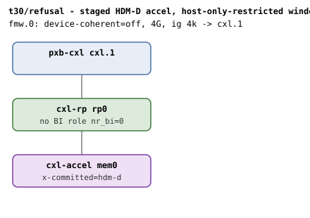
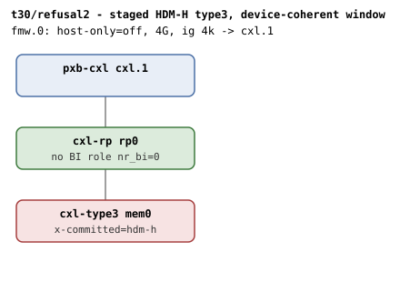

# t30 — a device-coherent decoder vs the window's coherency restriction, on auto-assembly

| | |
|---|---|
| Topology script | `topos/t30-hdmd-window.sh` |
| Checks | the topology script itself (host-driven, 3 boots) |
| Mode | host-driven |
| Outputs | `t30.tap`, `t30-hdmd.dmesg`, `t30-refusal.dmesg`, `t30-refusal2.dmesg` |

## What it tests

HDM-D is a Type 2 flow (a Type 3 device never decodes device
coherent), so the device under test is a `cxl-accel` staging a
firmware-committed HDM-D decoder (`x-committed=hdm-d`: TRT=0, BI=0 -
device coherent, no BISnp, no BI machinery). With a device-coherent
window present (`host-only=off`) the region must auto-assemble. With
only a host-only-restricted window (`device-coherent=off`) the staging
falls back to it, emulating firmware that committed a device-coherent
decoder where the platform declared host-only: the device and region
agree on coherency, so the device checks pass - only the window
contradicts, and region assembly must refuse ("coherency model not
permitted by the window"). This is the TRT axis of the same refusal
whose BI axis t16's "BI decoder in a non-BI window" test exercises. The
mirror arm stages a `cxl-type3` with a committed host-only decode
(`x-committed=hdm-h`) under only a device-coherent window: same
refusal, opposite direction.

## Topology

Three boots, each `pxb-cxl cxl.1` - `cxl-rp rp0` - one endpoint with a
1G memdev and one 4G window at 4k granularity:

| Boot | Image | Endpoint | Window |
|---|---|---|---|
| hdm-d |  | `cxl-accel mem0`, `x-committed=hdm-d` | `fmw.0` `host-only=off` |
| refusal |  | `cxl-accel mem0`, `x-committed=hdm-d` | `fmw.0` `device-coherent=off` |
| refusal2 |  | `cxl-type3 mem0`, `x-committed=hdm-h` | `fmw.0` `host-only=off` |

Not a BI topology: no window carries `back-invalidate`, no device
carries `hdm-db`, and neither `rp0` nor the endpoint carries
`x-256b-flit` (`rp0` has no BI role, `nr_bi=0` in all three). See
[topologies.md, t30](../topologies.md#t30--hdm-d-decoder-vs-window-coherency-restriction-three-boots).

## Semantics

- **Boot 1 (hdm-d).** The device under test is confirmed to be the
  accel (PCI device id `0x0d94`). A region must exist, be committed,
  and the endpoint decoder `.0` must read `back_invalidate=0` (HDM-D,
  not HDM-DB). dmesg must not contain `coherency model not permitted`,
  and no splat.
- **Boot 2 (refusal).** `device-coherent=off` narrows the sole window
  to host-only (a bare window defaults to both models, which
  legitimately permits either); the picker finds no device-coherent
  window and falls back. dmesg must contain `coherency model not
  permitted by the window` and `failed to add to region`, no region
  may exist, no splat.
- **Boot 3 (refusal2).** The Type 3's committed HDM-H decode under a
  window restricted to device-coherent: the picker finds no host-only
  window and falls back just the same; the same refusal must fire.

## Checks

Pre-flight: when `$QEMU -device help` lacks `cxl-accel` or
`-device cxl-accel,help` lacks `x-committed`, the suite emits 17 lines
of `# SKIP qemu lacks cxl-accel with x-committed` and exits 0. When the
first boot fails and the qemu/console log matches `x-committed must
be`, `not a valid` or `invalid parameter`, it emits 17 lines of
`# SKIP qemu cxl-accel lacks the hdm-d flavor` and exits 0.

Boot 1, hdm-d:

| # | Check (TAP text) | Expected | Why |
|---|---|---|---|
| 1 | hdm-d: guest booted | ok (not ok + exit on any other boot failure) | - |
| 2 | hdm-d: device under test is the accel (0x0d94) | PCI device id `0x0d94` | HDM-D is a Type 2 decode |
| 3 | hdm-d: region auto-assembled (REGION) | a `region*` exists | the legal T2xHDM-D cell |
| 4 | hdm-d: region committed | `commit` = 1 | - |
| 5 | hdm-d: endpoint decoder bi=0 (HDM-D, not HDM-DB) | `0` (fail text: `hdm-d: endpoint decoder bi=0 (got '...')`) | no BI machinery |
| 6 | hdm-d: no window refusal for the legal placement | no `coherency model not permitted` in dmesg | - |
| 7 | hdm-d: no splat | no `SPLAT_RE` match | - |

Boot 2, refusal:

| # | Check (TAP text) | Expected | Why |
|---|---|---|---|
| 8 | refusal: guest booted | ok (exit on fail) | - |
| 9 | refusal: window refused the staged HDM-D decode | dmesg `coherency model not permitted by the window` | only the window contradicts |
| 10 | refusal: no region assembled | no `region*` (fail text: `refusal: no region assembled (REGION)`) | - |
| 11 | refusal: discovery reported the refusal | dmesg `failed to add to region` | - |
| 12 | refusal: no splat | no `SPLAT_RE` match | - |

Boot 3, refusal2:

| # | Check (TAP text) | Expected | Why |
|---|---|---|---|
| 13 | refusal2: guest booted | ok (exit on fail) | - |
| 14 | refusal2: window refused the staged HDM-H decode | dmesg `coherency model not permitted by the window` | same refusal, opposite direction |
| 15 | refusal2: no region assembled | no `region*` | - |
| 16 | refusal2: discovery reported the refusal | dmesg `failed to add to region` | - |
| 17 | refusal2: no splat | no `SPLAT_RE` match | - |

## Skips and limitations

- SKIPs wholesale (17 lines) when qemu lacks `cxl-accel` with
  `x-committed`, or its `hdm-d` flavor.
- Needs the `cxl-fmw.N.host-only` / `device-coherent` window
  restriction knobs and `x-committed` from the `cxl-bi-tests` QEMU
  branch (README).
- No BI oracle check in this script (nothing in the topology is
  BI-capable), and as a `HOST_ONLY_SUITES` member run-all does not fold
  one in either.

## Related

[t16](t16.md) (the BI axis of the same refusal, and shape (d)'s mixed
HDM-D/HDM-H staged set), [t26](t26.md) (the HDM-D window on a live
`cxl-accel`), [t24](t24.md) (firmware adoption of committed decoders).
