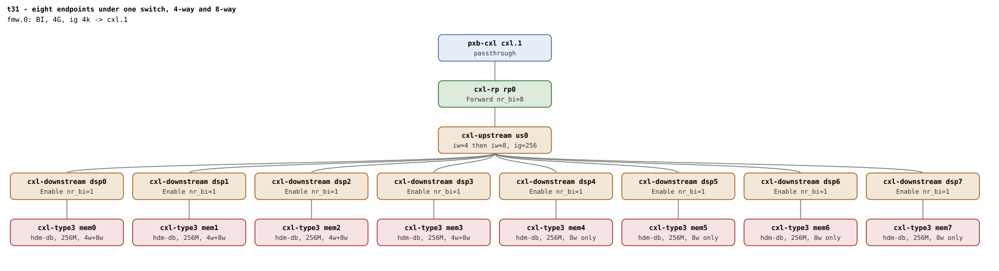

# t31 — eight BI-capable endpoints under one switch

| | |
|---|---|
| Topology script | `topos/t31-4way-switch.sh` |
| Checks | `guest/run-tests.sh` (`t31)` case) |
| Mode | guest-driven |
| Outputs | `t31.tap`, `t31.dmesg` |

## What it tests

Interleave wider than two under a single switch: a 4-way HDM-DB region
over four DSPs and an 8-way region over all eight, at region
granularity 256 (the window has one target, so the region granularity
is free). The USP decoder must be programmed `iw=4` then `iw=8` with
the target list reaching TARGET_LIST_HI, and the committed USP HDM
decoder must carry BI by register readback. Then `nr_bi` beyond two on
the shared RP: eight children raise it to eight; seven releases must
leave the RP forwarding for the survivor, the eighth must clear it, and
rebinding all eight must bring it back without a leaked dport mapping.

## Topology

One BI window (`cxl-fmw.0`, 4G, 4k granularity, one target `cxl.1`),
one RP, one USP with eight DSPs (`dsp0..dsp7`), one `cxl-type3` with
`hdm-db=on` under each. Deviation from the shared conventions: the
memdevs are 256M, not 1G. Every port and device carries
`x-256b-flit=on`. See [topologies.md, t31](../topologies.md#t31--eight-endpoints-under-one-switch-4-way-and-8-way-one-boot):
256 keeps the USP's eiw/eig inside its 256B interleave mask at both
widths, and the 8-way set is the widest a switch decoder takes.

## Semantics

The suite runs three legs on one boot:

1. **4-way over the first four DSPs.** The region and the endpoint
   decoder land `iw=4 ig=256`; the USP decoder serving the region lands
   `iw=4 ig=256`; `back_invalidate` reads `1` on the four members and
   `0` on the four idle endpoints; the USP's committed HDM decoder has
   its BI bit set (`/dev/mem` readback through `creg hdmbi`). Destroy
   returns all eight to `bi=0`.
2. **8-way across every DSP.** Same shape at `iw=8`; the USP target
   list spills into TARGET_LIST_HI. All eight read `bi=1`, then `0`
   after destroy.
3. **nr_bi beyond two.** With eight children the RP BI Decoder Control
   reads Forward (`v & 3 == 1`). Seven `cxl_pci` unbinds (BDF order)
   must leave the RP in Forward with no `BI dport disable failed` /
   `BI setup failed` / splat; the eighth unbind must clear it
   (`v & 3 == 0`). All eight are then rebound; one recovery `cxl_mem`
   rebind per endpoint is allowed for the sibling probe/reap race
   (README Known limitations) and reported as a `# recovered N
   endpoint(s) via rebind` diagnostic. The RP must read Forward again,
   no `BI setup failed` or `Failed to request region` may appear, and a
   4-way region must commit again.

The topology-level role/count expectations (RP Forward `nr_bi=8`, each
DSP Enable `nr_bi=1`) are those in topologies.md.

## Checks

Setup:

| # | Check (TAP text) | Expected | Why |
|---|---|---|---|
| 1 | cap_back_invalidate present on all root decoders (N found) | ok (fail: `.../cap_back_invalidate missing` or `has bogus value`) | every root decoder exposes the attr with a 0/1 value |
| 2 | back_invalidate present on all endpoint decoders (N found) | ok (fail: `no endpoint decoders enumerated`) | no decoders at all means enumeration failed |
| - | no BI root decoder | not ok, bail-out | - |
| 3 | root decoder iw=1 (one-target window) | `1` | the window has one target |
| 4 | eight memdevs enumerated | `8` (bail-out otherwise) | - |
| 5 | all eight endpoints bi=0 pre-region | `00000000` | - |

4-way:

| # | Check (TAP text) | Expected | Why |
|---|---|---|---|
| 6 | create 4-way HDM-DB region | ok (bail-out on fail) | - |
| 7 | commit 4-way HDM-DB region | ok | - |
| 8 | region iw=4 ig=256 | `4 256` | region granularity is free on a one-target window |
| 9 | four endpoints bi=1, four idle | `11110000` | - |
| 10 | endpoint decoder iw=4 ig=256 | `4 256` | - |
| 11 | USP decoder iw=4 ig=256 (4-way) | `4 256` | USP decoder must be programmed iw=4 |
| 12 | USP committed HDM decoder carries BI (4-way) | `1`; `# SKIP no /dev/mem MMIO for USP HDM readback` when `creg` returns nothing | Table 9-13 BI bit at the USP (topologies.md) |
| 13 | dmesg: 'created HDM-DB' region log | ok | - |
| 14 | no 'BI setup failed' in dmesg | ok | - |
| 15 | no 'region mismatch' WARN across BI attach | ok | cxl_rr_assign_decoder must unwind symmetrically |
| 16 | all eight bi=0 post-destroy (4-way) | `00000000` | - |

8-way:

| # | Check (TAP text) | Expected | Why |
|---|---|---|---|
| 17 | create 8-way HDM-DB region | ok (bail-out on fail) | - |
| 18 | commit 8-way HDM-DB region | ok | - |
| 19 | region iw=8 ig=256 | `8 256` | - |
| 20 | all eight endpoints bi=1 (8-way) | `11111111` | - |
| 21 | USP decoder iw=8 ig=256 (8-way) | `8 256` | the USP target list spills into TARGET_LIST_HI |
| 22 | USP committed HDM decoder carries BI (8-way) | `1`; `# SKIP no /dev/mem MMIO for USP HDM readback` | - |
| 23 | no 'region mismatch' WARN across BI attach | ok | - |
| 24 | all eight bi=0 post-destroy (8-way) | `00000000` | - |

nr_bi beyond two (seven releases, then the eighth):

| # | Check (TAP text) | Expected | Why |
|---|---|---|---|
| 25 | RP BI Decoder Forward with eight children | `1` (`v & 3`); `# SKIP no /dev/mem MMIO for RP BI Decoder readback` | eight children hold the RP in Forward |
| 26 | seven endpoints unbound | `7` | - |
| 27 | RP still Forward after seven releases | `1`; `# SKIP no /dev/mem MMIO for RP BI Decoder readback` | seven releases must not clear it |
| 28 | surviving endpoint still in BI | `0` (the survivor's `back_invalidate`) | - |
| 29 | no BI errors across seven releases | ok (no `BI dport disable failed`, `BI setup failed` or splat in dmesg) | - |
| 30 | eighth endpoint unbound | ok | - |
| 31 | RP cleared after the last release | `0`; `# SKIP no /dev/mem MMIO for RP BI Decoder readback` | the eighth must clear it |

Rebind all eight:

| # | Check (TAP text) | Expected | Why |
|---|---|---|---|
| 32 | all eight endpoints back after rebind (recovered=N) | `8` | one recovery rebind allowed per endpoint for the sibling probe/reap race |
| 33 | no 'BI setup failed' / dport mapping leak on rebind | ok (no `BI setup failed` or `Failed to request region`) | no leaked dport mapping |
| 34 | RP Forward again with eight children | `1`; `# SKIP no /dev/mem MMIO for RP BI Decoder readback` | - |
| 35 | 4-way HDM-DB region commits again after the rebind cycle | ok | - |

## Skips and limitations

- The five register readbacks (USP HDM BI bit twice, RP BI Decoder
  Control three times) SKIP individually when `/dev/mem` MMIO is not
  available in the guest (`creg` prints nothing).
- Needs QEMU with CXL.mem routed through switches (README: without it a
  region behind switches enumerates but never carries data; t31 is
  listed among the affected suites) and a USP HDM decoder whose BI bit
  is writable.
- A `cxl_mem` probe racing a sibling's switch-port reap can fail
  terminally; the suite converges through at most one recovery rebind
  per endpoint and reports it as a diagnostic (README Known
  limitations).

## Related

[t5](t5.md) (the 2-way, two-endpoint shape this widens), [t32](t32.md)
and [t33](t33.md) (4-way across two switches), [t25](t25.md) (shared
transit DSP refcount).
