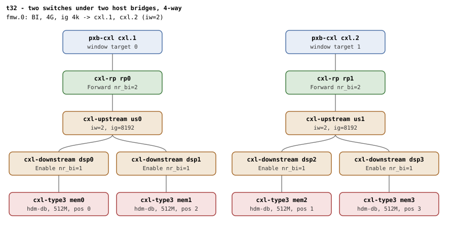

# t32 — 4-way HDM-DB interleave across two switches under two host bridges

| | |
|---|---|
| Topology script | `topos/t32-2switch-2hb.sh` |
| Checks | `guest/run-tests.sh` (`t32)` case) |
| Mode | guest-driven |
| Outputs | `t32.tap`, `t32.dmesg` |

## What it tests

Two interleave levels at once: window-level 2-way (a two-target BI
window at 4k) times switch-level 2-way. The root decoder is `iw=2`
across the host bridges, each USP decoder must land `iw=2` at
granularity 8k (window granularity times window ways), the endpoints
`iw=4`. Region positions are dport-major (`pos = hb + 2 * dsp`):
wiring the targets in plain BDF order puts two same-switch endpoints at
consecutive positions and must be refused before anything commits; the
dport-major order commits with `bi=1` on all four.

## Topology

Two `pxb-cxl` host bridges (`cxl.1` at `bus_nr=12`, `cxl.2` at
`bus_nr=64`), each a passthrough with one RP, one USP and two DSPs with
a `cxl-type3` (`hdm-db=on`) under each. The single BI window
`cxl-fmw.0` (4G, 4k granularity) has **two** targets, `cxl.1` and
`cxl.2`. Deviation: 512M memdevs. See
[topologies.md, t32](../topologies.md#t32--two-switches-under-two-host-bridges-4-way-one-boot)
for the position layout (position p goes to window target p % 2).

## Semantics

`CR_IG=4096` makes `create_region` program the region at the window
granularity. BDF order of the memdevs is hb0/dsp0, hb0/dsp1, hb1/dsp0,
hb1/dsp1; the dport-major order used for the positive leg is
`mems[0] mems[2] mems[1] mems[3]`.

1. **Refusal.** A 4-way region created with the targets in plain BDF
   order puts both hb0 endpoints at positions 0 and 1, but position 1
   belongs to window target 1: the attach must be refused
   (`create_region` returns empty). Any region shell left behind is
   deleted and all four endpoints must still read `bi=0`.
2. **Positive.** The dport-major wiring creates and commits: region
   and endpoint decoders `iw=4 ig=4096`, both USP decoders serving the
   region `iw=2 ig=8192`, all four `bi=1`, `created HDM-DB` logged, no
   `BI setup failed`, no `region mismatch` WARN. Destroy returns all
   four to `bi=0`.
3. **Re-create + commit** after the full teardown.

Roles/counts (each RP Forward `nr_bi=2`, each DSP Enable `nr_bi=1`)
are those in topologies.md.

## Checks

| # | Check (TAP text) | Expected | Why |
|---|---|---|---|
| 1 | cap_back_invalidate present on all root decoders (N found) | ok | - |
| 2 | back_invalidate present on all endpoint decoders (N found) | ok | - |
| - | no BI root decoder | not ok, bail-out | - |
| 3 | root decoder iw=2 (window-level interleave) | `2` | two-target window |
| 4 | four memdevs enumerated | `4` (bail-out otherwise) | - |
| 5 | BDF-order wiring refused (same host bridge at consecutive positions) | ok (region create fails) | position 1 belongs to window target 1 |
| 6 | nothing committed after the refusal | `0000` | must be refused before anything commits |
| 7 | create 4-way HDM-DB region (2 HBs x 2 DSPs) | ok (bail-out on fail) | dport-major order |
| 8 | commit 4-way HDM-DB region (2 HBs x 2 DSPs) | ok | - |
| 9 | region iw=4 ig=4096 | `4 4096` | region granularity must match the CFMWS |
| 10 | all four endpoints bi=1 post-commit | `1111` | - |
| 11 | endpoint decoder iw=4 ig=4096 | `4 4096` | - |
| 12 | first USP decoder iw=2 ig=8192 | `2 8192` | window granularity times window ways |
| 13 | second USP decoder iw=2 ig=8192 | `2 8192` | - |
| 14 | dmesg: 'created HDM-DB' region log | ok | - |
| 15 | no 'BI setup failed' in dmesg | ok | - |
| 16 | no 'region mismatch' WARN across BI attach | ok | - |
| 17 | all four endpoints bi=0 post-destroy | `0000` | - |
| 18 | re-create + commit after full teardown | ok | - |

## Skips and limitations

- No SKIP lines. Needs QEMU with CXL.mem routed through switches
  (README lists t32 among the suites that otherwise enumerate but never
  carry data) and the HDM decoder BI bit writable in host bridge and
  USP decoders.

## Related

[t19](t19.md) (window-level 2-way across two HBs, no switches),
[t5](t5.md) (switch-level 2-way), [t33](t33.md) (same shape one level
down, under one host bridge), [t31](t31.md).
