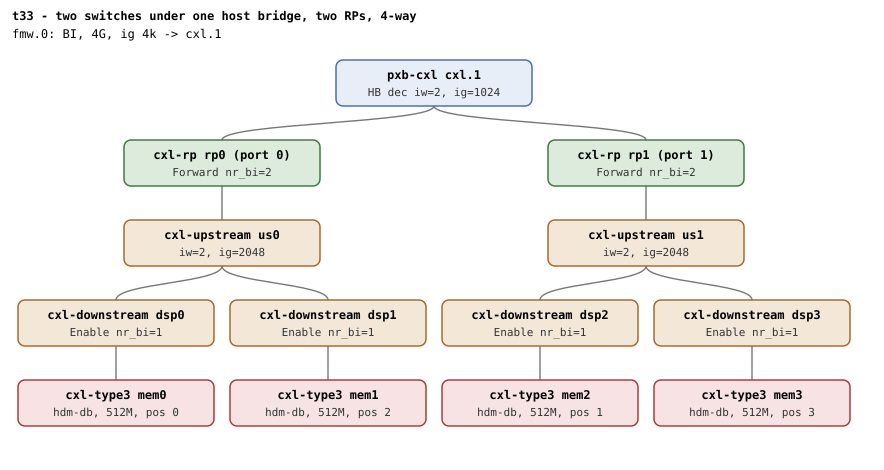

# t33 — 4-way HDM-DB interleave across two switches under one host bridge

| | |
|---|---|
| Topology script | `topos/t33-2switch-2rp.sh` |
| Checks | `guest/run-tests.sh` (`t33)` case) |
| Mode | guest-driven |
| Outputs | `t33.tap`, `t33.dmesg` |

## What it tests

Host-bridge decoder 2-way across two RPs times switch-level 2-way. The
host bridge is not passthrough (two RPs), so its own HDM decoder
interleaves `iw=2` across the RPs and each USP below lands `iw=2` at
twice the region granularity. The window has one target, so the region
granularity is free: 1k, a value no other suite uses. Same dport-major
position rule as t32 (`pos = rp + 2 * dsp`), with the refusal of
BDF-order wiring coming from the host-bridge level rather than the
window.

## Topology

One `pxb-cxl` (`cxl.1`) with two RPs (`rp0` port 0, `rp1` port 1),
each with a USP and two DSPs carrying a `cxl-type3` (`hdm-db=on`). One
BI window (`cxl-fmw.0`, 4G, 4k granularity, one target). Deviation:
512M memdevs. See
[topologies.md, t33](../topologies.md#t33--two-switches-under-one-host-bridge-two-rps-4-way-one-boot).

## Semantics

`CR_IG=1024`. BDF order of the memdevs is rp0/dsp0, rp0/dsp1,
rp1/dsp0, rp1/dsp1; the positive leg uses the dport-major order
`mems[0] mems[2] mems[1] mems[3]`.

1. **Refusal.** Plain BDF order reuses the rp0 dport at positions 0
   and 1, closer than the host-bridge stride of 2: refused at attach,
   nothing committed, shells deleted.
2. **Positive.** Dport-major wiring creates and commits: region and
   endpoint decoders `iw=4 ig=1024`, the host-bridge decoder serving
   the region `iw=2 ig=1024`, both USP decoders `iw=2 ig=2048`, all
   four `bi=1`. Both RP BI Decoder Controls read Forward by `/dev/mem`
   readback. `created HDM-DB` logged, no `BI setup failed`, no `region
   mismatch` WARN; destroy returns all four to `bi=0`.
3. **Re-create + commit** after the full teardown.

Roles/counts (each RP Forward `nr_bi=2`, each DSP Enable `nr_bi=1`)
are those in topologies.md.

## Checks

| # | Check (TAP text) | Expected | Why |
|---|---|---|---|
| 1 | cap_back_invalidate present on all root decoders (N found) | ok | - |
| 2 | back_invalidate present on all endpoint decoders (N found) | ok | - |
| - | no BI root decoder | not ok, bail-out | - |
| 3 | root decoder iw=1 (one-target window) | `1` | - |
| 4 | four memdevs enumerated | `4` (bail-out otherwise) | - |
| 5 | BDF-order wiring refused (same RP at consecutive positions) | ok (region create fails) | closer than the host-bridge stride of 2 |
| 6 | nothing committed after the refusal | `0000` | - |
| 7 | create 4-way HDM-DB region (2 RPs x 2 DSPs) | ok (bail-out on fail) | - |
| 8 | commit 4-way HDM-DB region (2 RPs x 2 DSPs) | ok | - |
| 9 | region iw=4 ig=1024 | `4 1024` | a granularity no other suite uses |
| 10 | all four endpoints bi=1 post-commit | `1111` | - |
| 11 | endpoint decoder iw=4 ig=1024 | `4 1024` | - |
| 12 | host-bridge decoder iw=2 ig=1024 | `2 1024` | the HB is not passthrough |
| 13 | first USP decoder iw=2 ig=2048 | `2 2048` | twice the region granularity |
| 14 | second USP decoder iw=2 ig=2048 | `2 2048` | - |
| 15 | both RPs Forward | `11` (`v0 & 3`,`v1 & 3`); `# SKIP no /dev/mem MMIO for RP BI Decoder readback` when either readback is empty | - |
| 16 | dmesg: 'created HDM-DB' region log | ok | - |
| 17 | no 'BI setup failed' in dmesg | ok | - |
| 18 | no 'region mismatch' WARN across BI attach | ok | - |
| 19 | all four endpoints bi=0 post-destroy | `0000` | - |
| 20 | re-create + commit after full teardown | ok | - |

## Skips and limitations

- Check 15 SKIPs without `/dev/mem` MMIO.
- Needs QEMU with CXL.mem routed through switches (README lists t33)
  and the HDM decoder BI bit writable in host bridge and USP decoders.

## Related

[t32](t32.md) (same shape under two host bridges), [t10](t10.md) (two
RPs on one host bridge, no switches), [t31](t31.md).
