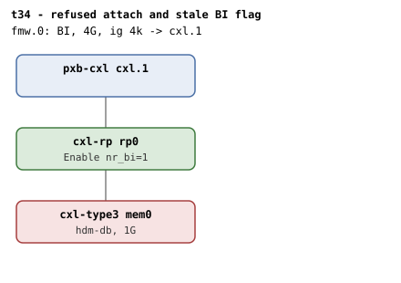

# t34 — refused attach and stale BI flag

| | |
|---|---|
| Topology script | `topos/t34-refused-attach.sh` |
| Checks | `guest/run-tests.sh` (`t34)` case) |
| Mode | guest-driven |
| Outputs | `t34.tap`, `t34.dmesg` |

## What it tests

t1's direct-attach shape, used for regressions the v8 review turned up.
A refused attach must leave the decoder alone: the endpoint decoder of
a committed HDM-DB region A, written into a second region's target, is
refused (-EBUSY) and must keep A's device-coherent type and `bi=1`; a
re-commit of A must still program the endpoint decoder with BI (the
error path of `cxl_region_attach_position()` used to reset the type to
the endpoint default although no inheritance had happened). BI dealloc
must not trust a flag the hardware no longer backs: BI Enable is
cleared behind the driver through `/dev/mem`, the endpoint port is
unbound, the disable must find the hardware already clear, and a
rebind must enable BI from scratch. A reset between attach and commit
must refuse the commit, BI Enable lost after the region's `cxlds->bi`
check must be caught by the decoder commit re-checking the device, and
an SBR fired at an in-flight commit in a loop must never leave a
decoder committed with BI on a device whose BI Enable is 0.

## Topology

`pxb-cxl cxl.1` - `cxl-rp rp0` - `cxl-type3 mem0` (`hdm-db=on`, 1G),
one BI window. The shared conventions apply; see
[topologies.md, t34](../topologies.md#t34--refused-attach-and-stale-bi-flag-one-boot).

## Semantics

Five arms on one boot, all on the one endpoint decoder (`dec`), its
BDF and its endpoint port. Register truth comes from `creg` over
`/dev/mem`: `bictrl` (BI Decoder Control), `biclear` (clear BI Enable
behind the driver), `hdmbi` (1 iff every committed HDM decoder has
BI=1, empty if none committed).

- **Arm 1, refused attach.** Region A (1-way, 256M) is created and
  committed; the decoder reads `target_type=accelerator`, `bi=1`.
  Region B is created and A's decoder is written to `B/target0`: the
  write must fail, and the decoder must still report region A,
  `accelerator`, `bi=1`, with A still committed. A is reset and
  re-committed; `hdmbi` must read 1. Both regions are destroyed; `bi`
  returns to 0 and no `region mismatch` WARN may have fired.
- **Arm 2, BI Enable cleared behind the driver.** BI Enable is
  confirmed set, cleared through `biclear`, and the endpoint port is
  unbound from `cxl_port`: dmesg must show `BI already disabled in
  hardware`. `cxl_mem` rebind must bring the endpoint back with `BI
  requests enabled` and a region commits with `bi=1`. Then a
  best-effort loop (20 passes) races `biclear` + port unbind against a
  `/sys/bus/pci/devices/<bdf>/reset`; no splat, and the endpoint comes
  back.
- **Arm 3, reset between attach and commit.** A region is created with
  its target attached but not committed (the decoder has inherited
  `accelerator`); `reset_method=cxl_bus` and a reset must log `BI
  disabled by reset`; the commit must be refused with `BI not enabled
  on device` and `hdmbi` must be empty (no decoder committed with BI).
  Recovery: `cxl_mem` unbind/bind, `BI requests enabled`, a region
  commits with `bi=1`.
- **Arm 4, BI Enable lost after the cxlds->bi check.** With a region
  attached and BI enabled, `biclear` clears the hardware while the
  decoder still reads `bi=1` (`cxlds->bi` still set). The commit must
  be refused, dmesg must show `BI disabled by reset during commit`,
  `hdmbi` must be empty, and the region must read `commit=0`. Recovery
  rebind (after letting the deferred `detach_memdev()` drain).
- **Arm 5, the race itself.** 10 passes: attach, commit in the
  background, fire a `cxl_bus` reset at it, then classify the pass as
  refused (`BI disabled by reset during commit`), timed out (commit
  rc != 0), flagged (`SBR happened without memory regions removal`),
  other, or **mismatch** (`hdmbi=1` while BI Enable reads 0). Counts
  are printed as a `# arm 5: ...` diagnostic; mismatch must be 0 and
  no splat may accumulate.

## Checks

Setup:

| # | Check (TAP text) | Expected | Why |
|---|---|---|---|
| 1 | cap_back_invalidate present on all root decoders (N found) | ok | - |
| 2 | back_invalidate present on all endpoint decoders (N found) | ok | - |
| - | no BI root decoder / no endpoint decoder for MEM | not ok, bail-out | - |

Arm 1, A's decoder written into B:

| # | Check (TAP text) | Expected | Why |
|---|---|---|---|
| 3 | region A created | ok (bail-out on fail) | - |
| 4 | region A committed | ok | - |
| 5 | decoder in A: accelerator | `accelerator` | - |
| 6 | decoder in A: bi=1 | `1` | - |
| 7 | attach of A's decoder to B refused | ok (write to `B/target0` fails) | -EBUSY |
| 8 | decoder still in A after the refusal | `A` (`dec/region`) | the refusal must leave the decoder alone |
| 9 | decoder keeps accelerator after the refusal | `accelerator` | the error path used to reset the type |
| 10 | decoder keeps bi=1 after the refusal | `1` | - |
| 11 | A still committed | `1` | - |
| 12 | A re-committed | ok | - |
| 13 | re-committed A programs the endpoint decoder with BI | `1`; `# SKIP no /dev/mem MMIO for HDM readback` | - |
| 14 | bi=0 after teardown | `0` | - |
| 15 | no 'region mismatch' WARN across BI attach | ok | - |

Arm 2, BI Enable cleared behind the driver, then the port unbound
(all replaced by `# SKIP no /dev/mem MMIO for BI Decoder Control`, 7
lines, when `bictrl` returns nothing):

| # | Check (TAP text) | Expected | Why |
|---|---|---|---|
| 16 | endpoint BI Enable set before the clear | `2` (`v & 2`) | - |
| 17 | BI Enable cleared behind the driver | `0` | stands in for a reset .reset_done never sees |
| 18 | dealloc saw the hardware already disabled | dmesg `BI already disabled in hardware` | the disable finds the hardware already clear |
| 19 | endpoint back after rebind | ok (bail-out on fail) | - |
| 20 | BI re-enabled from scratch on rebind | dmesg `BI requests enabled` | recovery by rebind must enable BI from scratch |
| 21 | HDM-DB region commits after recovery, bi=1 | `1` | - |
| 22 | no splat across unbind/reset races | `0` | best effort; deterministic proof needs the detach window widened |
| 23 | endpoint back after the races | ok | - |

Arm 3, reset between attach and commit:

| # | Check (TAP text) | Expected | Why |
|---|---|---|---|
| 24 | region attached before the reset | ok (bail-out on fail) | - |
| 25 | attached decoder inherited accelerator | `accelerator` | - |
| 26 | reset invalidated the device's BI | dmesg `BI disabled by reset`; checks 26-32 become `# SKIP no cxl_bus reset method` when `reset_method=cxl_bus` cannot be set | .reset_done invalidates cxlds->bi |
| 27 | commit refused after the reset | ok (commit fails) | must not program the decoder with BI on a device whose BI Enable is 0 |
| 28 | refusal names the device | dmesg `BI not enabled on device` | - |
| 29 | no endpoint decoder committed with BI | `hdmbi` empty | - |
| 30 | endpoint back after the reset recovery | ok (bail-out on fail) | - |
| 31 | BI re-enabled after the reset recovery | dmesg `BI requests enabled` | - |
| 32 | HDM-DB region commits after the reset recovery, bi=1 | `1` | - |

Arm 4, BI Enable lost after the cxlds->bi check (all replaced by
`# SKIP no /dev/mem MMIO for BI Decoder Control`, 7 lines, without
`/dev/mem`):

| # | Check (TAP text) | Expected | Why |
|---|---|---|---|
| 33 | region attached with BI enabled | ok (bail-out on fail) | - |
| 34 | BI Enable cleared behind the driver, cxlds->bi still set | `1` (`dec/back_invalidate`) | only the hardware knows |
| 35 | commit refused when the device lost BI Enable | ok (commit fails) | the commit must re-check the device and back out |
| 36 | refusal comes from the decoder commit | dmesg `BI disabled by reset during commit` | - |
| 37 | no endpoint decoder left committed with BI | `hdmbi` empty | nothing may be left committed with BI |
| 38 | region left uncommitted | `0` | - |
| 39 | endpoint back after the recovery rebind | ok | - |

Arm 5, SBR at an in-flight commit (3 lines; `# SKIP no /dev/mem MMIO
for BI Decoder Control` without `/dev/mem`, `# SKIP no cxl_bus reset
method` when `reset_method=cxl_bus` cannot be set):

| # | Check (TAP text) | Expected | Why |
|---|---|---|---|
| 40 | no decoder committed with BI on a device with BI Enable=0 (N passes) | `0` mismatches | the silent state the v8 review predicted |
| 41 | no splat across the commit/reset races | `0` | - |
| 42 | endpoint back after the races | ok | - |

## Skips and limitations

- Register legs SKIP without `/dev/mem` MMIO: check 13 (1 line), arm 2
  (7 lines), arm 4 (7 lines), arm 5 (3 lines).
- Arm 3 (7 lines) and arm 5 (3 lines) SKIP when the `cxl_bus` reset
  method cannot be selected.
- The unbind-versus-reset race (arm 2) and the commit-versus-SBR race
  (arm 5) are best effort at natural timing; the window is microseconds
  wide. The deterministic reproducer with a widened detach window lives
  in `~/code/cxl-bi-repro` (script header).
- Arms 4 and 5 sleep 0.5s between `cxl_mem` unbind and bind so the
  deferred `detach_memdev()` drains before the rebind (otherwise it
  releases the new binding).

## Related

[t1](t1.md) (the same shape, happy path), [t27](t27.md) (BI across a
device reset, multi-boot), [t15](t15.md) (decoder type reverting across
regions).
