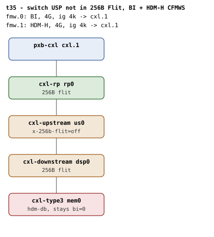

# t35 — switch USP not in 256B Flit, BI CFMWS + HDM-H CFMWS

| | |
|---|---|
| Topology script | `topos/t35-noflit-usp.sh` |
| Checks | `guest/run-tests.sh` (`t35)` case; sits between the `t7)` and `t8)` cases in the file) |
| Mode | guest-driven |
| Outputs | `t35.tap`, `t35.dmesg` |

## What it tests

The CXL 4.0 §9.14.3 mixed configuration that [t7](t7.md)/[t8](t8.md) cannot
reach: QEMU re-syncs a downstream-facing port's `LnkSta2` flit bit from its
child, so `cxl-rp` and `cxl-downstream` cannot be held at 68B, but a
`cxl-upstream` is never re-synced. With the USP at 68B and the DSP and
endpoint at 256B, `cxl_bi_probe_capable()` must stop at the USP hop ("BI not
supported by USP"), the endpoint stays `bi=0`, an HDM-DB attach fails closed
and an HDM-H region still commits.

## Topology

t2's shape with `x-256b-flit=off` on `cxl-upstream us0`; `rp0`, `dsp0` and
`mem0` stay `x-256b-flit=on`, `mem0` is `hdm-db=on` with a 1G volatile memdev.
Two windows over `cxl.1`: `fmw.0` (4G, ig 4k, `back-invalidate=on`) and
`fmw.1` (4G, ig 4k, plain HDM-H). topologies.md has no t35 entry.

## Semantics

Per the `t35)` case comment: `cxl_bi_probe_capable()` stops at the USP hop,
`cxlds->bi_capable` stays false, BI setup returns 0 without touching
hardware, and an HDM-DB attach fails closed while an HDM-H region still
commits. The suite reads the boot-time dmesg (run-all.sh does not clear it
before the guest run, so the `cxl_bi_setup` traces from the initial `cxl_mem`
probe are visible): it expects "BI not supported by USP" present and "BI
requests enabled" absent. It then tries a 1-way region on the BI root
decoder, which must fail at attach (`create_region` returns empty), and
expects "BI not enabled on device" in dmesg. Any region shell left by the
refused attach is deleted, then a 1-way region on the HDM-H root decoder must
create and commit with the endpoint decoder still at `back_invalidate=0`.

## Checks

| # | Check (TAP text) | Expected | Why |
|---|---|---|---|
| 1 | `cap_back_invalidate present on all root decoders (N found)` | ok (fail variants: `.../cap_back_invalidate missing`, `... has bogus value 'V'`) | - |
| 2 | `capability walk stopped at the 68B USP` | ok if dmesg has "BI not supported by USP" | `cxl_bi_probe_capable()` stops at the USP hop |
| 3 | `BI never enabled on the endpoint` | ok if dmesg has no "BI requests enabled" | `cxlds->bi_capable` stays false |
| - | `no BI root decoder` | not ok + exit, only if no root decoder has `cap_back_invalidate=1` | prerequisite |
| 4 | `endpoint bi=0 behind a 68B USP` | `back_invalidate` = 0 | - |
| 5 | `HDM-DB attach refused behind a 68B USP` | ok when `create_region` on the BI root returns empty | an HDM-DB attach fails closed |
| 6 | `refusal names the device` | ok if dmesg has "BI not enabled on device" | - |
| - | `no HDM-H root decoder` | not ok + exit, only if no root decoder has `cap_back_invalidate=0` | prerequisite |
| 7 | `HDM-H region commits on the plain window` | ok when the region on the HDM-H root creates and commits | an HDM-H region still commits |
| 8 | `endpoint stays bi=0 in the HDM-H region` | `back_invalidate` = 0 (emitted only after #7 passes) | - |

## Skips and limitations

- No SKIP lines. The suite depends on QEMU not re-syncing a `cxl-upstream`'s
  flit bit (README, Known limitations); it is the reachable form of the
  mixed configuration t7/t8 emit `# SKIP` for.
- `run-all.sh` folds a host-side `not ok - qemu BI oracle silent` into
  `t35.tap` if the QEMU BI oracle flags BI Decoder programming that
  contradicts the topology.

## Related

[t7](t7.md), [t8](t8.md) (the RP and DSP variants that SKIP today),
[t2](t2.md) (the underlying shape).
