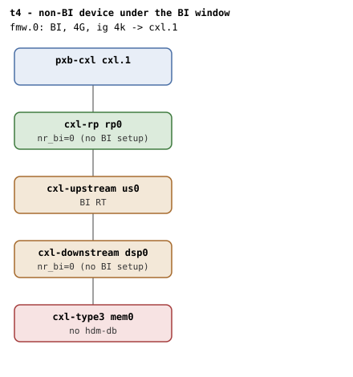

# t4 — non-BI device (no hdm-db) in a BI-restricted CFMWS

| | |
|---|---|
| Topology script | `topos/t4-nobi-dev.sh` |
| Checks | `guest/run-tests.sh` (`t4)` case) |
| Mode | guest-driven |
| Outputs | `t4.tap`, `t4.dmesg` (plus `t4.kmemleak` only when the host-side kmemleak scan reports unreferenced objects) |

## What it tests

Same switched topology as t2, but the endpoint has `hdm-db=off`. Models
a non-BI-capable Type 3 device placed against an HDM-DB window: the
mismatch must be caught at region attach. Script expectations:
`cxl_bi_setup` finds the endpoint's BI Decoder capability absent and
returns 0 silently, `cxlds->bi` stays 0; the root decoder's
`cap_back_invalidate=1` (CFMWS carries the flag); `create_ram_region`
under the BI root produces a DEVMEM region, but attaching the non-BI
endpoint to it fails: `cxl_region_attach` rejects with -ENXIO
("BI not enabled on device") because
`cxlr->type==DEVMEM && cxl_root_decoder_is_bi(cxlrd) && !cxlds->bi`.

## Topology

t2's shape (`rp0` -> `us0` -> `dsp0` -> `mem0`, all ports
`x-256b-flit=on`) with `mem0` carrying `x-256b-flit=on` but no `hdm-db`.
One CFMWS: 4G, `interleave-granularity=4k`, `back-invalidate=on`. Per
[topologies.md](../topologies.md#t4--non-bi-device-under-the-bi-window):
not BI-capable, no BI setup, nr_bi=0 everywhere.

## Semantics

Single phase. After the root-decoder ABI check the suite takes the BI
root decoder and the first memdev's endpoint decoder. `cxlds->bi` must
be false; the cleanest reachable proof from userspace is that attach to
a DEVMEM region fails and dmesg logs the rejection. `create_region` is
attempted (it wires `target0` itself). Two reject points are accepted:
some kernels reject at attach time inside `create_region` (the
`target0` write fails, so `create_region` returns empty), otherwise the
region exists and its commit must fail. If the commit unexpectedly
succeeds, the suite still reports the endpoint's `bi` (expected 0) and
then fails. Whichever branch ran, dmesg must carry
`BI not enabled on device`.

## Checks

| # | Check (TAP text) | Expected | Why |
|---|---|---|---|
| 1 | cap_back_invalidate present on all root decoders (N found) | ok; `not ok` as `DECODER/cap_back_invalidate missing` or `... has bogus value 'V'`. Followed by `not ok - no BI root decoder` + exit if there is no BI root | CFMWS carries the flag |
| 2 | one of: `non-BI device rejected at attach (target write)` (create_region returned empty) / `non-BI device rejected at region commit` (region created, commit failed) | ok | The mismatch must be caught at region attach |
| 2' | if the commit succeeds instead: `endpoint bi=0 on non-BI device` (expect 0) followed by `not ok - attach unexpectedly permitted for non-BI device` | failure path | Verify the endpoint did not end up in HDM-DB mode |
| 3 | dmesg: 'BI not enabled on device' | ok | cxl_region_attach rejects with -ENXIO |

Host-side (run-all.sh), folded into `t4.tap` only on failure:
`not ok - qemu BI oracle silent`.

## Skips and limitations

No SKIP lines. The TAP count is 3 on the pass path and 4 on the
unexpected-commit path. The `create_region` helper keeps the expected
-ENXIO on the `target` write off stderr (the reject is the behaviour
under test).

## Related

- [t2](t2.md) — the BI-capable counterpart on the same shape.
- [t12](t12.md) — BI + non-BI siblings under one switch.
- [t7](t7.md), [t8](t8.md) — the other fail-closed gates, which SKIP on
  upstream QEMU where t4 does not (first-principles.md rule 3.1).
