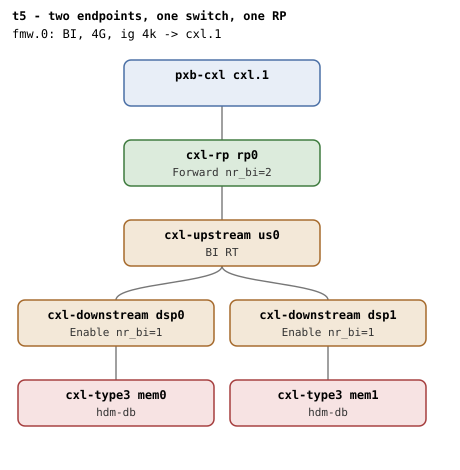

# t5 — two BI-capable endpoints under one switch, 2-way region

| | |
|---|---|
| Topology script | `topos/t5-2way.sh` |
| Checks | `guest/run-tests.sh` (`t5)` case) + `guest/nrbi-refcount-phase.sh` (phase 2) + `guest/multitarget-unbind-phase.sh` (phase 3) |
| Mode | guest-driven |
| Outputs | `t5.tap`, `t5.dmesg`, `t5-nrbi.tap`, `t5-nrbi.dmesg`, `t5-mtunbind.tap`, `t5-mtunbind.dmesg` (plus `t5.kmemleak` only when the host-side kmemleak scan reports unreferenced objects) |

## What it tests

Beyond t2: two independent `cxl_mem_probe`/`cxl_bi_setup` invocations
sharing the RP; both raise `dport->nr_bi` on the RP so the RP's BI
Decoder stays enabled while either endpoint is bound. A 2-way
interleaved HDM-DB region across mem0+mem1 commits with both endpoints
at `bi=1`. Phase 2 (nr_bi refcount) hot-removes one memdev and verifies
the RP's BI stays enabled for the surviving endpoint. Phase 3 unbinds an
endpoint that is a member of the committed 2-way region, so the
teardown runs `cxl_region_decode_reset()` over every target and walks a
dport the surviving peer still holds.

## Topology

`pxb-cxl cxl.1` -> `cxl-rp rp0` -> `cxl-upstream us0` with two
`cxl-downstream` ports (`dsp0` port 0 slot 4, `dsp1` port 1 slot 5),
each with a `cxl-type3` (`mem0`, `mem1`; 1G volatile, `hdm-db=on`); every
port and device `x-256b-flit=on`. One CFMWS: 4G,
`interleave-granularity=4k`, `back-invalidate=on`. Per
[topologies.md](../topologies.md#t5--two-endpoints-one-switch-one-rp):
`rp0` Forward `nr_bi=2`, `dsp0`/`dsp1` Enable `nr_bi=1` each; phase 2
takes `rp0` 2->1 and it must hold Forward for the survivor.

## Semantics

**Main body.** ABI presence, exactly two memdevs, both endpoint decoders
at `bi=0`. A 2-way, 2x256M HDM-DB region across both memdevs (BDF
order) is created and committed; both decoders must read `bi=1`; no
`BI setup failed`; destroying the region returns both to `bi=0`.

**Phase 2 (shared-RP nr_bi refcount, run only if the main body
passed).** The RP's BI Decoder Control state is refcounted via
`dport->nr_bi`; unbinding one endpoint must not flip the RP's BI off,
only the second unbind clears it. The phase does not build two
independent regions (the single USP does not have enough decoders for
two disjoint routings). Instead: commit a 1-way HDM-DB region on
`mems[1]` (mem_keep) only; unbind `mems[0]` (mem_unbind, bound but
region-less) via `cxl_pci` (fallback `cxl_mem`). If the RP dropped BI
naively, mem_keep's committed decoder would stop routing BI and its
`bi` would flip 0, or dmesg would carry `BI dport disable failed`. Then
rebind mem_unbind: a leaked dport BI Decoder mapping from the previous
bind would surface as -EBUSY / `Failed to request region` on the BI
mapping. mem_keep must stay `bi=1` with its region committed through
the whole cycle. No register readback in this phase.

**Phase 3 (committed multi-target member unbind, run only if the main
body passed).** The leaving endpoint (`mems[0]`) is a member of a
committed 2-way HDM-DB region, the only shape that reaches
`__cxl_decoder_detach()`'s `p->state > CXL_CONFIG_ACTIVE` arm, where
`cxl_region_decode_reset()` decommits every target,
`cxl_port_detach_region()` walks a path the surviving peer still holds,
and member decoders' `target_type` revert to `cxled_default_type()`.
What must hold: the region is decommitted (or reaped outright) but only
the leaver is detached, so the peer stays attached, keeps the inherited
DEVMEM `target_type=accelerator` and still reads `back_invalidate=1`
(it keys off attachment and `cxlds->bi`, not committed state); the
shared RP keeps BI Forward (`nr_bi` 2->1; the BI-specific claim); the
leaver's own DSP clears to 0; the surviving peer's DSP keeps BI Enable;
no BI dport-disable failure and no splat. Destroying the remnant region
detaches the peer, which is where its own `cxled_default_type()` revert
(to `expander`, `bi=0`) is observable, while BI enablement follows the
device bind: the RP stays Forward and the peer's DSP stays Enable. On
rebind the DSP comes back to Enable, the RP stays Forward, and a fresh
2-way region re-inherits on both members. Register readbacks use the
BI Decoder Control (cap ID 0xC) at BAR0 + 0x1000, masked to bits 0-1
(Forward=1, Enable=2) because a DSP also carries the commit bit.

## Checks

### Main body (`t5.tap`)

| # | Check (TAP text) | Expected | Why |
|---|---|---|---|
| 1 | cap_back_invalidate present on all root decoders (N found) | ok; `not ok` as `DECODER/cap_back_invalidate missing` or `... has bogus value 'V'` | - |
| 2 | back_invalidate present on all endpoint decoders (N found) | ok; `not ok` variants: `.../back_invalidate missing`, `... has bogus value 'V'`, `no endpoint decoders enumerated`. Followed by `not ok - no BI root decoder` + exit if no BI root | - |
| 3 | two memdevs enumerated | 2 | - |
| 4 | both endpoints bi=0 pre-region | 00 | - |
| 5 | create 2-way HDM-DB region | ok; `not ok` then exit | - |
| 6 | commit 2-way HDM-DB region | ok | - |
| 7 | both endpoints bi=1 post-commit | 11 | - |
| 8 | no 'BI setup failed' in dmesg | ok | - |
| 9 | both endpoints bi=0 post-destroy | 00 | Destroy resets both endpoints |

Host-side (run-all.sh), folded into `t5.tap` only on failure:
`not ok - qemu BI oracle silent` (covers the phases too).

### Phase 2 (`t5-nrbi.tap`)

Bail-outs before any check: `Bail out! need 2 memdevs, got N`,
`Bail out! create_ram_region`, `Bail out! commit`.

| # | Check (TAP text) | Expected | Why |
|---|---|---|---|
| 1 | mem_keep bi=1 pre-unbind | 1 | - |
| 2 | mem_keep bi=1 after partial unbind | 1 | RP must not drop BI while a child still needs it |
| 3 | mem_keep region still committed | 1 | - |
| 4 | no BI errors on partial unbind | ok (no `BI dport disable failed` / `BI setup failed`) | - |
| 5 | mem_unbind memdev returned after rebind | ok; `not ok` then exit | - |
| 6 | no 'BI setup failed' on rebind | ok | - |
| 7 | no 'Failed to request region' on BI mapping | ok; `not ok - no 'Failed to request region' on BI mapping (dport leak)` | A leaked dport BI Decoder region surfaces as -EBUSY on the request |
| 8 | mem_keep bi=1 after rebind cycle | 1 | - |
| 9 | mem_keep region still committed | 1 | - |

### Phase 3 (`t5-mtunbind.tap`)

Bail-outs before any check: `Bail out! no BI root decoder`,
`Bail out! need 2 memdevs, got N`, `Bail out! could not resolve BDFs`,
`Bail out! could not resolve endpoint decoders`,
`Bail out! build_2way failed`, `Bail out! commit failed`; after check 5:
`Bail out! memdev did not go away`. Every `expect_ctrl` row below emits
`ok - <text> # SKIP no /dev/mem MMIO` instead when the register is
unreadable.

| # | Check (TAP text) | Expected | Why |
|---|---|---|---|
| 1 | pre-unbind: both endpoints bi=1 | 11 | - |
| 2 | pre-unbind: surviving peer target_type inherited | accelerator | - |
| 3 | pre-unbind: leaving DSP BI Enable | 2 | Both adjacent DSPs take BI Enable |
| 4 | pre-unbind: surviving DSP BI Enable | 2 | - |
| 5 | pre-unbind: shared RP BI Forward | 1 | Transit dport, nr_bi == 2 |
| 6 | leaving memdev gone | ok | - |
| 7 | region reaped with its member / region decommitted by the member's departure | ok / 0 | cxl_decoder_detach() releases the region driver, so the region may be reaped outright; either way it must not still be committed |
| 8 | surviving peer still attached to the region | REGION | Only the leaving decoder is detached |
| 9 | surviving peer keeps inherited target_type | accelerator | - |
| 10 | surviving peer bi still 1 while attached | 1 | back_invalidate_show() reads attachment and cxlds->bi, not committed state |
| 11 | post-unbind: leaving DSP cleared | 0 | The leaver's own level goes away |
| 12 | post-unbind: surviving DSP still Enable | 2 | - |
| 13 | post-unbind: shared RP still Forward | 1 | A rollback that cleared instead of decrementing would kill BI routing under a still-bound peer |
| 14 | no BI errors on member unbind | ok | - |
| 15 | no splat on member unbind | ok (no `BUG:`/`WARNING:`/`KASAN`/`general protection`/`NULL pointer`) | - |
| 16 | peer target_type reverted on region destroy | expander | Destroying the remnant region detaches the peer |
| 17 | peer bi=0 after region destroy | 0 | - |
| 18 | post-destroy: shared RP still Forward | 1 | BI enablement follows the device bind, not the region |
| 19 | post-destroy: peer DSP still Enable | 2 | - |
| 20 | leaving memdev returned after rebind | ok; `not ok` then exit | - |
| 21 | post-rebind: DSP BI Enable restored | 2 | - |
| 22 | post-rebind: shared RP still Forward | 1 | - |
| 23 | no 'BI setup failed' on rebind | ok | - |
| 24 | rebuild 2-way HDM-DB region after the cycle | ok | - |
| 25 | recommit 2-way HDM-DB region | ok (only if 24 passed) | - |
| 26 | both endpoints bi=1 after the cycle | 11 (only after 25) | A fresh 2-way region must re-inherit on both members |
| 27 | target_type re-inherited after the cycle | accelerator (only after 25) | - |

## Skips and limitations

Phase 3's eleven register rows SKIP without `/dev/mem` MMIO (e.g.
`CONFIG_IO_STRICT_DEVMEM`). Phases run only when the main body exits 0.
Phase 2 deliberately does not build two regions (USP decoder limit).
README diagnostics: `-EBUSY` on the second bind in phase 2 means the
dport BI Decoder mapping leaked on unbind.

## Related

- [t2](t2.md) — the single-endpoint baseline.
- [t18](t18.md) — same topology, storm-driven.
- [t12](t12.md) — t5's shape with `hdm-db` off on mem1.
- [t25](t25.md) — the shared Above-HBR-USP variant of the refcount
  (topologies.md); [t31](t31.md) — nr_bi beyond two (first-principles.md
  rule 5.2).
