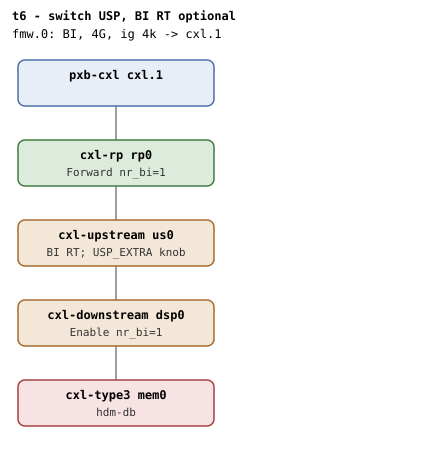

# t6 — switch USP whose BI Route Table capability is absent

| | |
|---|---|
| Topology script | `topos/t6-usp-nort.sh` |
| Checks | `guest/run-tests.sh` (`t6)` case) |
| Mode | guest-driven |
| Outputs | `t6.tap`, `t6.dmesg` (plus `t6.kmemleak` only when the host-side kmemleak scan reports unreferenced objects) |

## What it tests

CXL 4.0 8.2.4.26 makes the BI RT capability optional on switch USPs. The
kernel's `cxl_is_bi_capable()` reflects this: it requires a mapped BI
Decoder on RP/DSP/endpoint but allows `@bi==NULL` on USPs. QEMU's
`cxl-upstream` currently always advertises BI RT alongside `hdm-db`, so
with upstream QEMU this suite is effectively identical to t2; it exists
to make the "USP without RT is allowed" invariant load-bearing so a
regression on the `@bi==NULL`-allowed-for-USP branch shows up here. When
a future QEMU flag lets a USP be built with no BI RT, the guest test
will verify that BI still enables and that no "BI RT registers not
found" abort occurs.

## Topology

t2's shape: `rp0` -> `us0` -> `dsp0` -> `mem0` (1G volatile,
`hdm-db=on`), all `x-256b-flit=on`; one CFMWS 4G,
`interleave-granularity=4k`, `back-invalidate=on`. The `cxl-upstream`
line appends `$USP_EXTRA` (environment, default empty) as a
comma-prefixed extension: `x-bi-rt` is a placeholder for a knob upstream
QEMU may add. Counts per [topologies.md](../topologies.md#t6--switch-usp-without-a-bi-rt):
`dsp0`/`rp0` nr_bi=1.

## Semantics

Single phase, a reduced t2: root-decoder ABI presence, the BI root
decoder, a 1-way 256M HDM-DB region on the first memdev created and
committed, the endpoint decoder at `bi=1`, no `BI setup failed` in
dmesg, region destroyed. No check reads the USP's BI RT presence or
absence; the suite passes whether or not the RT exists, which is the
invariant under test.

## Checks

| # | Check (TAP text) | Expected | Why |
|---|---|---|---|
| 1 | cap_back_invalidate present on all root decoders (N found) | ok; `not ok` as `DECODER/cap_back_invalidate missing` or `... has bogus value 'V'`. Followed by `not ok - no BI root decoder` + exit if no BI root | - |
| 2 | create HDM-DB region (USP RT variant) | ok; `not ok - create HDM-DB region` then exit | - |
| 3 | commit HDM-DB region | ok | - |
| 4 | endpoint bi=1 (USP RT variant) | 1 | BI still enables with the USP RT optional |
| 5 | no 'BI setup failed' in dmesg | ok | No "BI RT registers not found" abort |

Host-side (run-all.sh), folded into `t6.tap` only on failure:
`not ok - qemu BI oracle silent`.

## Skips and limitations

No SKIP lines. README Known limitations: t6 is indistinguishable from t2
until QEMU grows an `x-bi-rt=off` knob on `cxl-upstream`; set `USP_EXTRA`
to pass such a knob when it exists. README diagnostics: `BI setup
failed` in dmesg on t6 means the topology walk failed where it should
have succeeded (register probing, USP probe, or `nr_bi` accounting
regression).

## Related

- [t2](t2.md) — the same topology with the full check set and the
  `found BI RT capability` dmesg assertion.
- [t9](t9.md), [t25](t25.md) — the other suites first-principles.md
  lists for "capability is advertised by structure presence" (rule 4.1).
