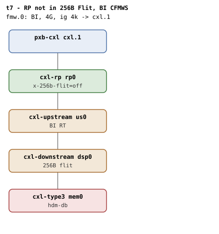

# t7 — RP not in 256B Flit mode, BI CFMWS

| | |
|---|---|
| Topology script | `topos/t7-noflit-uplink.sh` |
| Checks | `guest/run-tests.sh` (`t7)` case) |
| Mode | guest-driven |
| Outputs | `t7.tap`, `t7.dmesg` |

## What it tests

`cxl_bi_setup` walks the topology and calls `cxl_is_bi_capable()` on every
hop; on the root port it checks `cxl_pci_flit_256(pdev)`. When the RP is out
of 256B Flit mode the walk must bail at the RP hop and return 0 silently, so
`cxlds->bi` ends up false and a later HDM-DB region attach rejects with
"BI not enabled on device". QEMU rejects `hdm-db=on` when the endpoint itself
is not in flit mode ("hdm-db requires operating in 256b flit"), so t7 puts the
non-flit hop on the RP instead; [t8](t8.md) covers the same code path at the
DSP for symmetry.

## Topology

t2's shape (RP - USP - DSP - endpoint) with `x-256b-flit=off` on `cxl-rp rp0`;
`us0`, `dsp0` and `mem0` stay `x-256b-flit=on`, `mem0` is `hdm-db=on` with a
1G volatile memdev. One BI window (`fmw.0`, 4G, ig 4k, `back-invalidate=on`).
See [topologies.md, t7 / t8](../topologies.md#t7--t8--non-256b-flit-hop): the
walk must refuse the path at the RP hop (§9.14.1, §9.14.3), leaving nr_bi=0
everywhere.

## Semantics

Expected (fail-closed branch): the capability walk stops at the RP, no dport
gets BI enabled, the endpoint decoder's `back_invalidate` stays 0, a 1-way
HDM-DB region on the BI root decoder is rejected at attach or at commit, and
dmesg carries "BI not supported by topology" or "BI not enabled on device".
The README diagnostics add: `BI setup failed` **absent** in dmesg on t7/t8
means `cxl_bi_setup` did not bail on the missing 256B Flit hop, and a 5s+ pause
on t7/t8 rollback means err_rollback drove disable on the failed dport instead
of skipping it.

What actually happens today: the suite first asks `bi_setup_succeeded` (a
"BI requests enabled" line in dmesg, meaning `cxlds->bi` is 1). If BI came up
anyway, the QEMU gap described under Skips is in play and the three
fail-closed checks are emitted as TAP `# SKIP` instead of failures.

## Checks

| # | Check (TAP text) | Expected | Why |
|---|---|---|---|
| 1 | `cap_back_invalidate present on all root decoders (N found)` | ok (fail variants: `.../cap_back_invalidate missing`, `... has bogus value 'V'`) | every root decoder must expose `cap_back_invalidate` with a 0/1 value |
| 2-4 | `# SKIP QEMU x-256b-flit=off on RP does not reach LnkCtl2` (x3) | ok, only when "BI requests enabled" is in dmesg | QEMU limitation: the knob does not propagate to LnkCtl2.FlitModeEnable, so `cxl_pci_flit_256()` still returns true and BI setup succeeds |

Fail-closed branch (taken instead of the SKIPs when BI setup did not succeed):

| # | Check (TAP text) | Expected | Why |
|---|---|---|---|
| - | `no BI root decoder` | not ok + exit, only if no root decoder has `cap_back_invalidate=1` | prerequisite |
| 2 | `non-flit uplink rejected (attach or commit)` | ok (fail text: `non-flit endpoint commit unexpectedly succeeded`) | a DEVMEM region attach later rejects with "BI not enabled on device" |
| 3 | `endpoint bi stays 0 on non-flit` | `back_invalidate` = 0 | `cxlds->bi=0` |
| 4 | `dmesg reflects non-flit rejection` | ok if dmesg has "BI not supported by topology" or "BI not enabled on device" | - |

## Skips and limitations

- README, Known limitations: t7/t8 emit `# SKIP` because a downstream-facing
  port (`cxl-rp`, `cxl-downstream`) re-syncs its `LnkSta2` flit bit from its
  child at every link status read, so `x-256b-flit=off` on one is overwritten
  and `cxl_pci_flit_256()` still sees 256B. A `cxl-upstream` is not re-synced,
  which is what [t35](t35.md) uses to reach the same mixed configuration one
  hop up. If QEMU ever stops re-syncing, t7/t8 flip to strict fail-closed
  checks with no code changes.
- topologies.md: the flit knob is cosmetic in QEMU, so the path actually
  enables (counts as t2) and the negative cannot be staged.
- `run-all.sh` folds a host-side `not ok - qemu BI oracle silent` into
  `t7.tap` if the QEMU BI oracle (`-d guest_errors`) flags any BI Decoder
  programming that contradicts the topology.

## Related

[t8](t8.md) (same path at the DSP), [t35](t35.md) (the reachable 68B hop, at
the USP), [t2](t2.md) (the shape this suite degrades to today).
