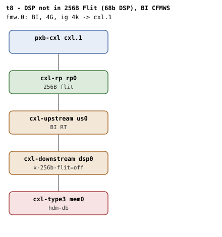

# t8 — "68b DSP" mixed config: BI-capable endpoint under a DSP not in 256B Flit mode

| | |
|---|---|
| Topology script | `topos/t8-noflit-dsp.sh` |
| Checks | `guest/run-tests.sh` (`t8)` case) |
| Mode | guest-driven |
| Outputs | `t8.tap`, `t8.dmesg` |

## What it tests

The CXL 4.0 §9.14.3 mixed configuration: a BI-capable device sitting on a
Downstream Port whose link is not in 256B Flit mode. Per §9.14.3.3 System
Software shall keep the BI bit unset on all decoders in the device / switch /
host that span the device's HDM. `cxl_bi_setup`'s check loop must find
`cxl_is_bi_capable()` false on the DSP (no 256B Flit) and return 0 silently:
no dports get BI enabled and `cxlds->bi` stays 0, the root decoder still
reads `cap_back_invalidate=1` (the CFMWS carries the flag), and a region
attach to a DEVMEM region rejects with -ENXIO.

## Topology

t2's shape with `x-256b-flit=off` on `cxl-downstream dsp0`; `rp0`, `us0` and
`mem0` stay `x-256b-flit=on`, `mem0` is `hdm-db=on` with a 1G volatile memdev.
One BI window (`fmw.0`, 4G, ig 4k, `back-invalidate=on`). See
[topologies.md, t7 / t8](../topologies.md#t7--t8--non-256b-flit-hop): the walk
must refuse the path at that hop (§9.14.1, §9.14.3), leaving nr_bi=0
everywhere.

## Semantics

Expected (fail-closed branch): the BI walk's DSP check fails, `cxlds->bi=0`, a
1-way HDM-DB region on the BI root decoder is rejected at attach or commit,
and dmesg carries "BI not supported by topology", "BI not enabled on device"
or "BI setup failed". The README diagnostics add: `BI setup failed`
**absent** in dmesg on t7/t8 means `cxl_bi_setup` did not bail on the missing
256B Flit hop, and a 5s+ pause on t7/t8 rollback means err_rollback drove
disable on the failed dport instead of skipping it.

Today the suite first asks `bi_setup_succeeded` ("BI requests enabled" in
dmesg). If BI came up anyway (the same QEMU limitation as t7: `x-256b-flit=off`
on `cxl-downstream` does not affect the flit-mode-enable register the kernel
reads), the two fail-closed checks are emitted as TAP `# SKIP`.

## Checks

| # | Check (TAP text) | Expected | Why |
|---|---|---|---|
| 1 | `cap_back_invalidate present on all root decoders (N found)` | ok (fail variants: `.../cap_back_invalidate missing`, `... has bogus value 'V'`) | root decoder `cap_back_invalidate=1` (CFMWS carries the flag) |
| 2-3 | `# SKIP QEMU x-256b-flit=off on DSP does not reach LnkCtl2` (x2) | ok, only when "BI requests enabled" is in dmesg | same QEMU limitation as t7 |

Fail-closed branch (taken instead of the SKIPs when BI setup did not succeed):

| # | Check (TAP text) | Expected | Why |
|---|---|---|---|
| - | `no BI root decoder` | not ok + exit, only if no root decoder has `cap_back_invalidate=1` | prerequisite |
| 2 | `mixed-config (68b DSP) rejected` | ok (fail text: `mixed-config (68b DSP) commit unexpectedly succeeded`) | region attach to a DEVMEM region rejects with -ENXIO |
| 3 | `dmesg reflects mixed-config rejection` | ok if dmesg has "BI not supported by topology", "BI not enabled on device" or "BI setup failed" | - |

## Skips and limitations

- README, Known limitations: t7/t8 emit `# SKIP` because a downstream-facing
  port (`cxl-rp`, `cxl-downstream`) re-syncs its `LnkSta2` flit bit from its
  child at every link status read, so `x-256b-flit=off` on one is overwritten
  and `cxl_pci_flit_256()` still sees 256B. A `cxl-upstream` is not re-synced,
  which is what [t35](t35.md) uses to reach the same mixed configuration one
  hop up. If QEMU ever stops re-syncing, t7/t8 flip to strict fail-closed
  checks with no code changes.
- topologies.md: the flit knob is cosmetic in QEMU, so the path actually
  enables (counts as t2) and the negative cannot be staged.
- `run-all.sh` folds a host-side `not ok - qemu BI oracle silent` into
  `t8.tap` if the QEMU BI oracle flags BI Decoder programming that
  contradicts the topology.

## Related

[t7](t7.md) (same path at the RP), [t35](t35.md) (the reachable §9.14.3
mixed configuration, at the USP), [t2](t2.md).
