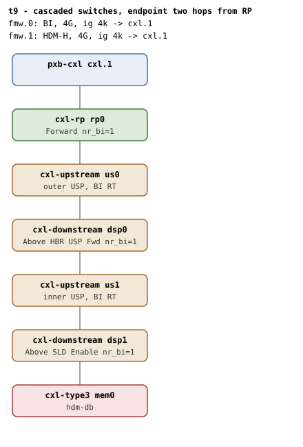

# t9 — cascaded switches: endpoint two switch hops from RP

| | |
|---|---|
| Topology script | `topos/t9-cascade.sh` |
| Checks | `guest/run-tests.sh` (`t9)` case) + `guest/switch-cascade-phase.sh` (phase 2) |
| Mode | guest-driven |
| Outputs | `t9.tap`, `t9.dmesg`, `t9-cascade.tap`, `t9-cascade.dmesg` (phase 2, per run-all.sh/README) |

## What it tests

BI works at any switch depth (Table 7-97): the DSP above the device assigns
the BI-ID, and every dport above it - the transit DSP and the RP - forwards it
untouched. t9 verifies BI across both levels (an HDM-DB region on `fmw.0`
creates and commits, the endpoint reads `back_invalidate=1`, and the
capability walk finds all four BI decoders, both route tables, and commits at
both switch levels), HDM-H alongside (a region on `fmw.1` creates and commits
through both switches with BI off), and port lifecycle (phase 2: outer-port
unbind tears the subtree down and disables BI on the way out, the emptied
outer port is reaped, and rebind rebuilds the cascade and re-enables BI).

## Topology

`rp0 - us0 (outer switch) - dsp0 - us1 (inner switch) - dsp1 - mem0`, every
hop `x-256b-flit=on`, `mem0` `hdm-db=on` with a 1G volatile memdev. Two CFMWS
windows over the same host bridge: `fmw.0` carries the BI restriction,
`fmw.1` is plain HDM-H (both 4G, ig 4k). Roles and counts per
[topologies.md, t9](../topologies.md#t9--two-level-cascade-single-endpoint):
RP Forward, `dsp0` Above HBR USP Forward, `dsp1` Above SLD Enable, nr_bi=1 at
each. The README notes CXL.mem routing through switches at any depth is one
of the QEMU changes that cannot be worked around from the command line:
without it a region behind cascaded switches enumerates but never carries
data (t9, t25, t31, t32, t33).

## Semantics

Phase 1 (`t9)` case) expects two non-root `cxl_port` entries (outer + inner
switch), then commits a 1-way HDM-DB region on the BI root decoder two switch
hops down and expects the endpoint decoder at `back_invalidate=1`. While the
region is committed it reads register truth over `/dev/mem` (`creg`): BI
roles by position (Table 8-157) - adjacent DSP Enable (BI Decoder Control
low bits = 2), transit DSP Forward (= 1), RP Forward (= 1) - and the BI bit
in the committed HDM decoder at each switch USP, the decoder an Enabled DSP
must verify before accepting a BISnp (Table 9-13). After destroy the
endpoint must read `back_invalidate=0`. The boot dmesg must show the walk
reaching every level: >= 4 "found BI Decoder capability" (endpoint, RP, both
DSPs), >= 2 "found BI RT capability" (both USPs), >= 4 "BI-ID commit wait
took" (a commit at each DSP and each RT - the RP and the device take none,
Table 8-156), and "BI requests enabled". Finally a 1-way HDM-H region on
`fmw.1`'s root decoder must create and commit with `back_invalidate=0`, and
dmesg must have no "BI setup failed".

Phase 2 (`switch-cascade-phase.sh`, run by run-all.sh only when phase 1
exits 0, after `dmesg -C`): the regions here are HDM-H on purpose - this
phase is about port lifetime, so the endpoint's `back_invalidate` stays 0
throughout even though BI itself is enabled on the topology. It classifies
the two switch ports (the outer one's USP has the host bridge root bus as its
PCI grandparent, the inner one another BDF), commits an HDM-H baseline
region, then unbinds the outer port's `cxl_port` driver. The subtree
teardown (inner port, endpoint, region, BI dealloc) must run: endpoint port
and inner port gone, region decommitted (the region device survives target
loss), "BI requests disabled" in dmesg (`cxl_bi_dealloc()` runs from the
endpoint port's devres release and can trail the sysfs directory, so it is
polled), the memdev detached (a workqueue item; the same pass runs
`cxl_detach_ep`, which finds the outer port empty + driverless and reaps it,
`delete_switch_port`), and no "BI setup failed". A `cxl_mem` rebind then
re-enumerates the cascade (`probe_dport()` re-adds the outer port's dports,
one-time setup re-maps decoders and BI RT, inner/endpoint ports come back
under fresh names): the endpoint decoder returns, "BI requests enabled"
reappears, and a fresh HDM-H region commits with `bi=0`. A second cycle fires
the unbind under region create/commit/destroy churn plus a decoder-attribute
reader (racing the cascade against an in-flight `cxl_bi_setup` walk, region
rwsem serialization, and against attribute readers, endpoint device lock),
then rebuilds and commits again. Hygiene greps close the phase.

## Checks

### Phase 1 (`t9.tap`)

| # | Check (TAP text) | Expected | Why |
|---|---|---|---|
| 1 | `cap_back_invalidate present on all root decoders (N found)` | ok (fail variants: `.../cap_back_invalidate missing`, `... has bogus value 'V'`) | - |
| 2 | `back_invalidate present on all endpoint decoders (N found)` | ok (fail variants: `.../back_invalidate missing`, `... has bogus value 'V'`, `no endpoint decoders enumerated`) | no decoders at all means enumeration failed, not a pass |
| 3 | `two switch cxl_port entries present (N)` | ok when >= 2 `port*` entries (fail text: `cascaded switches (N cxl_port(s), want >=2)`) | outer + inner switch |
| - | `no BI root decoder` / `no HDM-H root decoder` | not ok + exit, only when a root decoder of that kind is missing | prerequisites |
| 4 | `create HDM-DB region (cascaded path)` | ok (not ok + exit on failure) | the BI window must accept the endpoint two switch hops down |
| 5 | `commit HDM-DB region across cascade` | ok | - |
| 6 | `endpoint bi=1 (cascade)` | `back_invalidate` = 1 | - |
| 7-11 | `cascade register truth # SKIP no /dev/mem MMIO` (x5) | ok, only when `creg` returns empty (no `/dev/mem` MMIO) | register truth needs `/dev/mem` |
| 7 | `adjacent DSP Enable (committed region)` | BI Decoder Control & 0x3 = 2 | roles by position (Table 8-157) |
| 8 | `transit DSP Forward (committed region)` | & 0x3 = 1 | - |
| 9 | `RP Forward (committed region)` | & 0x3 = 1 | - |
| 10 | `inner USP committed HDM decoder BI` | 1 | the decoder an Enabled DSP must verify before accepting a BISnp (Table 9-13) |
| 11 | `outer USP committed HDM decoder BI` | 1 | - |
| 12 | `endpoint bi=0 after destroy` | `back_invalidate` = 0 | - |
| 13 | `BI Decoder caps discovered (ep+rp+2 dsp)` | >= 4 "found BI Decoder capability" in dmesg (fail text: `BI Decoder caps discovered (got N, want >= 4)`) | the walk must reach every level |
| 14 | `BI RT caps discovered (both USPs)` | >= 2 "found BI RT capability" (fail text: `... (got N, want >= 2)`) | a route table on each switch USP |
| 15 | `BI-ID commits at both switch levels` | >= 4 "BI-ID commit wait took" (fail text: `BI-ID commits at both levels (got N, want >= 4)`) | a commit at each DSP and each RT; the RP and the device take none (Table 8-156) |
| 16 | `dmesg: endpoint BI requests enabled` | ok if dmesg has "BI requests enabled" | - |
| 17 | `create HDM-H region (cascaded)` | ok (fail text `create HDM-H region` + exit) | HDM-H still assembles across both switches |
| 18 | `commit HDM-H region across cascade` | ok | - |
| 19 | `endpoint bi=0 post-commit` | `back_invalidate` = 0 | - |
| 20 | `no 'BI setup failed' in dmesg` | ok | README: `BI setup failed` on t9 means the topology walk failed where it should have succeeded |

### Phase 2 (`t9-cascade.tap`, `switch-cascade-phase.sh`)

| # | Check (TAP text) | Expected | Why |
|---|---|---|---|
| 1 | `two switch ports classified (outer=OUTER inner=INNER)` | ok (fail text: `two switch ports classified (n=N o=OUTER i=INNER)` then `Bail out! unexpected topology`) | - |
| - | `Bail out! prereq missing` | exit 1 (no TAP line) if root decoder, memdev or endpoint decoder is missing | - |
| 2 | `pre-unbind: committed HDM-H region, bi=0` | ok (not ok + `Bail out! baseline broken` on failure) | the main suite may leave its region behind; start clean |
| 3 | `cascade: endpoint port gone` | endpoint port directory gone after outer `cxl_port` unbind | subtree teardown runs synchronously in the unbind write |
| 4 | `cascade: inner switch port gone` | inner port directory gone | - |
| 5 | `cascade: region decommitted` | region `commit` reads 0 | the region device survives target loss; it must be decommitted |
| 6 | `cascade: BI disabled on teardown` | "BI requests disabled" in dmesg (polled) | BI came up on the cascade, so the teardown must take it back down |
| 7 | `cascade: memdev detached` | memdev `driver` link gone (polled) | the memdev detach is a workqueue item |
| 8 | `cascade: empty outer port reaped` | outer port directory gone (polled) | `cxl_detach_ep` finds the outer port empty + driverless and reaps it (`delete_switch_port`) |
| 9 | `cascade: no 'BI setup failed'` | ok if absent from dmesg | - |
| 10 | `rebuild: endpoint decoder back after rebind (DEC)` | ok after `cxl_mem` bind (fail text: `rebuild: endpoint decoder back after rebind`; #11-12 not emitted) | `cxl_mem` rebind re-enumerates |
| 11 | `rebuild: BI re-enabled on re-probe` | "BI requests enabled" in dmesg | the capability probe re-ran on rebind |
| 12 | `rebuild: fresh HDM-H commit, bi=0` | region commits and `back_invalidate` = 0 | - |
| 13 | `race: cascade under churn completed` | memdev detached after unbind under churn (fail text: `race: topology reclassify after rebuild` replaces #13-14 if the two switch ports cannot be re-classified) | races the cascade against an in-flight `cxl_bi_setup` walk and attribute readers |
| 14 | `race: rebuild + commit after storm (bi=0)` | rebind, create, commit, `back_invalidate` = 0 (fail text: `race: rebuild + commit after storm`) | - |
| 15-21 | `dmesg clean of 'PAT'` for `BUG:`, `Oops`, `kernel NULL pointer`, `WARNING:`, `possible circular`, `inconsistent lock`, `use-after-free` | ok per pattern | hygiene |

## Skips and limitations

- Phase 1 register truth (#7-11) SKIPs with `no /dev/mem MMIO` when `creg`
  returns empty (no `/dev/mem` access to the component registers).
- Phase 2 runs only if phase 1 exited 0; it clears dmesg first.
- Needs the QEMU change that routes CXL.mem through switches at any depth
  (README): on stock QEMU a region behind cascaded switches enumerates but
  never carries data.
- `run-all.sh` folds a host-side `not ok - qemu BI oracle silent` into
  `t9.tap` if the QEMU BI oracle flags BI Decoder programming that
  contradicts the topology (phases included).

## Related

[t2](t2.md) (single-switch walk and its unbind/rebind phase),
[t25](t25.md) (multi-level switch invariants, the shared Above-HBR-USP
variant), [t31](t31.md), [t32](t32.md), [t33](t33.md) (other cascaded
suites named by the README).
